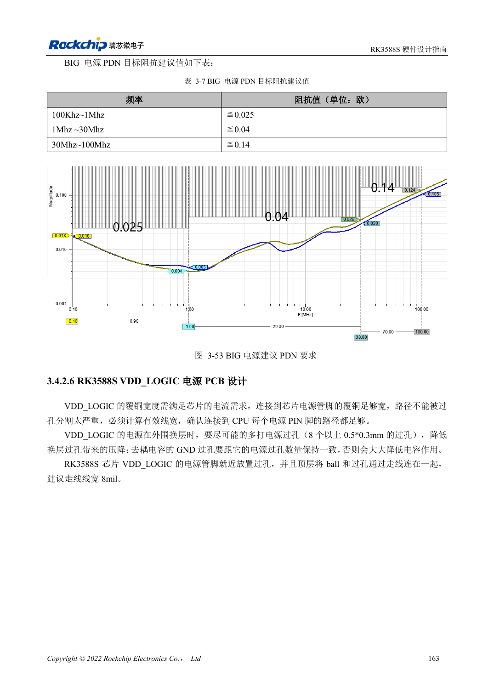

<!-- rk3588s-hardware-v12-20261109 -->

# RK3588S 电源 PCB 与 PDN：铜皮、回流和去耦

本文依据 RK3588S Hardware Design Guide V1.2（2023-12-14）中文原稿，面向电路与 PCB 设计审查。CM7S 载板需遵循模块接口定义，Sige7S 可用于软件与外设评估。芯片能力不等于板卡接口清单；SDK/BSP、内核、板卡版本、固件及复用须逐项核对。数值为原稿参考，未经 ArmSoM 硬件实测。

**RK3588S Hardware Design Guide V1.2 (2023-12-14), CN** · §3.4.2

## 电容数量不是唯一指标

大电流 Buck 输入输出电容的负极过孔应与正极数量匹配，不能只给正极加孔。电源铜皮检查有效宽度与被过孔切割后的瓶颈，关键电源连接不宜采用热焊盘式细颈。RK806 要兼顾短电源路径与热分布，不是越近越好。

## 按频段检查目标阻抗

表 3-7 的 BIG PDN 目标随频率变化，不能用一个电容值替代整段阻抗要求。模型需要包含稳压器、平面、过孔、封装和电容 ESR/ESL。目标值是参考设计建议，不是 ArmSoM 实测。验证负载跳变的压降与振铃，并和温度、频率错误一起记录。

## 设计参数与检查表

| 项目 | 原稿参考值 |
| --- | --- |
| BIG PDN 100kHz–1MHz | ≤0.025Ω |
| BIG PDN 1–30MHz | ≤0.04Ω |
| BIG PDN 30–100MHz | ≤0.14Ω |
| 过孔电流参考（<1V） | 0.5A; 原稿 0.5×0.3mm 过孔示例 |

## 参考原图

本批没有对应英文设计指南，四语统一采用中文原稿截图，图注已本地化。点击图片查看清晰原图；图片用于核对电路和布局，正文与参数表可复制。页码为 PDF 物理页码。

中文原稿 · PDF 178 · 3-53

## ArmSoM 开发路径

CM7S 适合定制载板：先确认模块已经完成的电源、DDR 与启动电路，再设计连接器外侧。Sige7S 可作为软件和外设评估起点。两种产品均须以对应版本资料核对接口是否引出、连接器针脚、电平、系统镜像与散热条件，不能把芯片原理图直接当成产品接线图。

- [ArmSoM CM7S](https://www.armsom.org/cm7s) · [CM7S Docs](https://docs.armsom.org/armsom-cm7s)
- [ArmSoM Sige7S](https://www.armsom.org/sige7s) · [Sige7S Docs](https://docs.armsom.org/armsom-sige7s)

## 继续阅读

- [RK3588S 硬件设计系列：30 个主题](/zh/articles/rk3588s-hardware-design-series/)
- [RK3588S 高速 PCB：8GT/s 以上的焊盘与过孔优化](/zh/articles/rk3588s-high-speed-pcb-review/)
- [RK3588S 热设计：参考热阻与整机验证](/zh/articles/rk3588s-thermal-hardware-design/)
