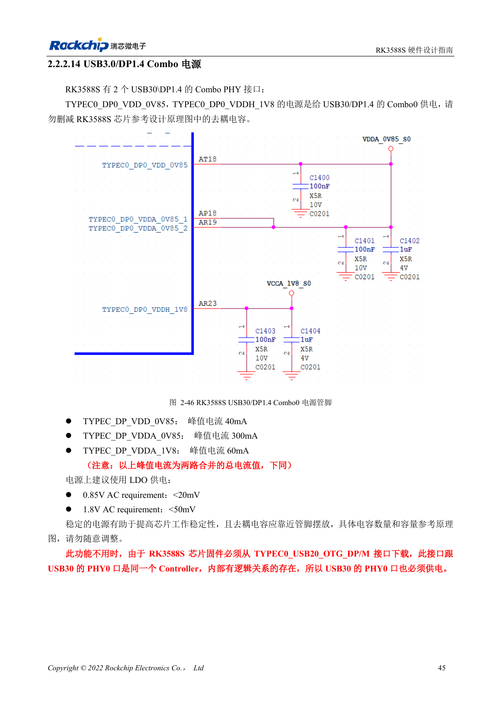
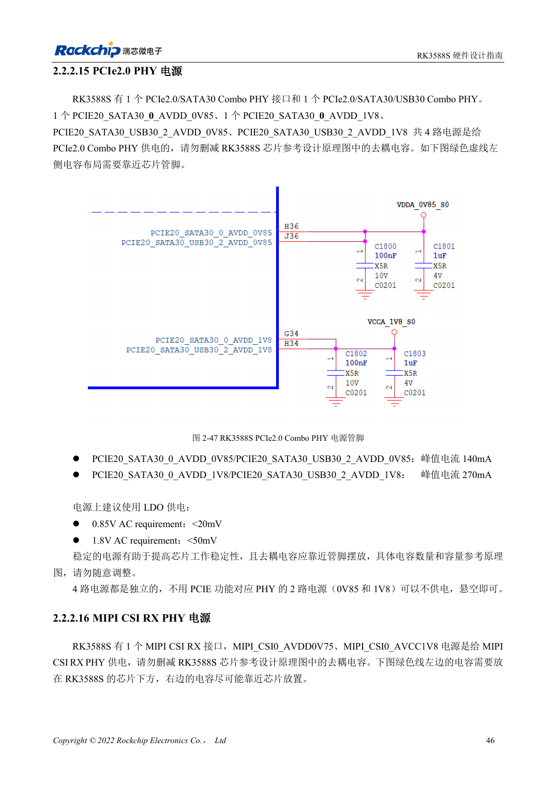

<!-- rk3588s-hardware-v12-20261109 -->

# RK3588S 电源域：首次供电与未用 PHY

本文依据 RK3588S Hardware Design Guide V1.2（2023-12-14）中文原稿，面向电路与 PCB 设计审查。CM7S 载板需遵循模块接口定义，Sige7S 可用于软件与外设评估。芯片能力不等于板卡接口清单；SDK/BSP、内核、板卡版本、固件及复用须逐项核对。数值为原稿参考，未经 ArmSoM 硬件实测。

**RK3588S Hardware Design Guide V1.2 (2023-12-14), CN** · §2.2.1–2.2.2

## 不用功能不等于可删电源

表 2-9 将 CPU、GPU、NPU、VDENC、DDR、PMU、SARADC、OTP、EMMCIO、VCCIO2、USB2 PHY 和 TYPEC0 相关供电列为首次上电必须项。逐路记录启动、运行、睡眠、负载、纹波与去耦。软件关功能不代表可以删除初次供电。

## 逐个核对 Combo PHY

RK3588S 有 PCIe2.0/SATA3.0 PHY0 和 PCIe2.0/SATA3.0/USB3.0 PHY2，两者各有 0.85V 与 1.8V 供电。原稿允许未用 PHY 不供电，但必须先确认其 SATA/USB 复用功能也不用。TYPEC0 是另一项首次上电必供要求，不能套用上述省电规则。MIPI 电源名称和峰值电流文字存在不一致，应回查原理图。

## 设计参数与检查表

| 项目 | 原稿参考值 |
| --- | --- |
| PCIe2.0 模拟纹波 | 0.85V: <20mV; 1.8V: <50mV |
| PHY 供电 | PHY0 / PHY2: 0.85V + 1.8V |
| 首次上电必需 | TYPEC0_DP0; USB2 PHY; 表 2-9 |

## 参考原图

本批没有对应英文设计指南，四语统一采用中文原稿截图，图注已本地化。点击图片查看清晰原图；图片用于核对电路和布局，正文与参数表可复制。页码为 PDF 物理页码。

中文原稿 · PDF 60 · 2-46

中文原稿 · PDF 61 · 2-47

## ArmSoM 开发路径

CM7S 适合定制载板：先确认模块已经完成的电源、DDR 与启动电路，再设计连接器外侧。Sige7S 可作为软件和外设评估起点。两种产品均须以对应版本资料核对接口是否引出、连接器针脚、电平、系统镜像与散热条件，不能把芯片原理图直接当成产品接线图。

- [ArmSoM CM7S](https://www.armsom.org/cm7s) · [CM7S Docs](https://docs.armsom.org/armsom-cm7s)
- [ArmSoM Sige7S](https://www.armsom.org/sige7s) · [Sige7S Docs](https://docs.armsom.org/armsom-sige7s)

## 继续阅读

- [RK3588S 硬件设计系列：30 个主题](/zh/articles/rk3588s-hardware-design-series/)
- [RK3588S 启动与恢复：Maskrom、JTAG 和 UART](/zh/articles/rk3588s-boot-debug-hardware/)
- [RK3588S 上下电时序：RESETn 与 S0/S3](/zh/articles/rk3588s-power-sequencing-design/)
