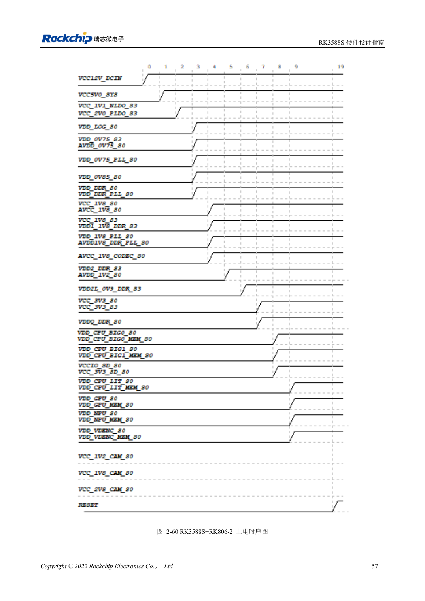

<!-- rk3588s-hardware-v12-20261109 -->

# RK3588S 上下电时序：RESETn 与 S0/S3

本文依据 RK3588S Hardware Design Guide V1.2（2023-12-14）中文原稿，面向电路与 PCB 设计审查。CM7S 载板需遵循模块接口定义，Sige7S 可用于软件与外设评估。芯片能力不等于板卡接口清单；SDK/BSP、内核、板卡版本、固件及复用须逐项核对。数值为原稿参考，未经 ArmSoM 硬件实测。

**RK3588S Hardware Design Guide V1.2 (2023-12-14), CN** · §2.1.10.3; §2.2.1.2–2.2.1.3

## 具体时序优先

低压先上的原则不能代替各模块的明确顺序：例如 MIPI_D/C_PHY_VDD→1.8V→1.2V。应使用具体电源树，不按数字大小排序。最后电源稳定后至少 1ms 释放 RESETn，还需满足共享复位外设的要求。下电先拉低 RESETn，再关闭电源。

## 把睡眠与倒灌纳入测试

可变电平域的固定 1.8V 脚和可选电压脚必须一起属于 S0 或 S3，不能一开一关。测量冷启动、热复位、睡眠和掉电，检查 USB、HDMI、外部控制器是否向未上电 IO 倒灌。模块载板遵循模块输入与使能要求，不重新实现 SoC 内部供电。

## 设计参数与检查表

| 项目 | 原稿参考值 |
| --- | --- |
| 复位释放 | ≥1ms 最后电源稳定后 |
| 下电 | RESETn 拉低 → 关闭供电 |
| MIPI D/C 参考 | VDD → 1.8V → 1.2V |

## 参考原图

本批没有对应英文设计指南，四语统一采用中文原稿截图，图注已本地化。点击图片查看清晰原图；图片用于核对电路和布局，正文与参数表可复制。页码为 PDF 物理页码。

中文原稿 · PDF 72 · 2-60

## ArmSoM 开发路径

CM7S 适合定制载板：先确认模块已经完成的电源、DDR 与启动电路，再设计连接器外侧。Sige7S 可作为软件和外设评估起点。两种产品均须以对应版本资料核对接口是否引出、连接器针脚、电平、系统镜像与散热条件，不能把芯片原理图直接当成产品接线图。

- [ArmSoM CM7S](https://www.armsom.org/cm7s) · [CM7S Docs](https://docs.armsom.org/armsom-cm7s)
- [ArmSoM Sige7S](https://www.armsom.org/sige7s) · [Sige7S Docs](https://docs.armsom.org/armsom-sige7s)

## 继续阅读

- [RK3588S 硬件设计系列：30 个主题](/zh/articles/rk3588s-hardware-design-series/)
- [RK3588S 电源域：首次供电与未用 PHY](/zh/articles/rk3588s-power-rail-planning/)
- [RK3588S 与 RK806：单、双 PMIC 电源树](/zh/articles/rk3588s-rk806-pmic-design/)
