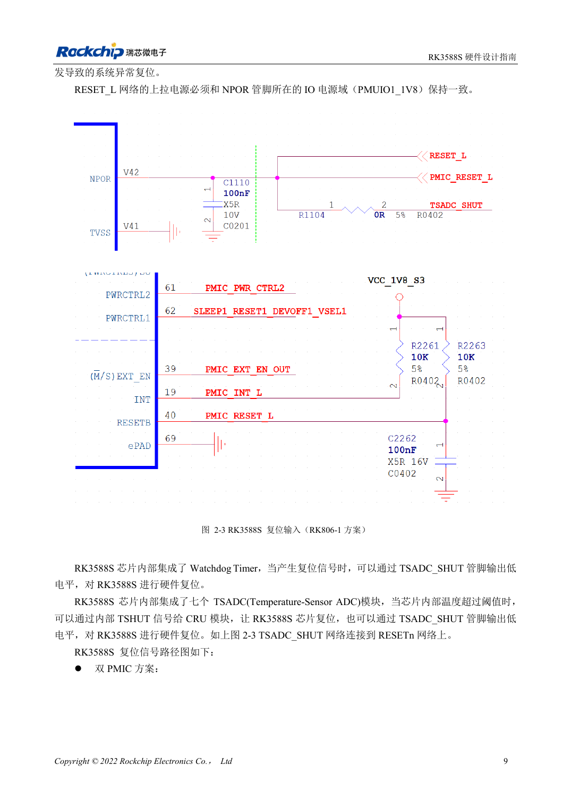
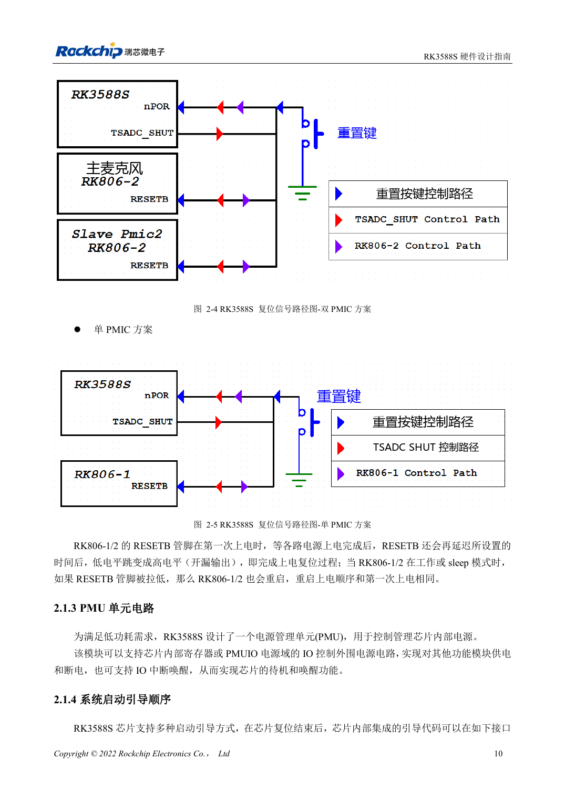

<!-- rk3588s-hardware-v12-20261109 -->

# RK3588S 复位、看门狗与过温保护

本文依据 RK3588S Hardware Design Guide V1.2（2023-12-14）中文原稿，面向电路与 PCB 设计审查。CM7S 载板需遵循模块接口定义，Sige7S 可用于软件与外设评估。芯片能力不等于板卡接口清单；SDK/BSP、内核、板卡版本、固件及复用须逐项核对。数值为原稿参考，未经 ArmSoM 硬件实测。

**RK3588S Hardware Design Guide V1.2 (2023-12-14), CN** · §2.1.2; §3.4.1

## 复位脉宽与上电等待不同

NPOR_u（V42）为低有效外部输入。指南写至少 100 个 24MHz 周期，也写至少 4μs；100/24MHz≈4.167μs，因此不能把精确 4.000μs 当作合格。100nF 靠近引脚，上拉到 PMUIO1_1V8。最后一路电源稳定后至少 1ms 才释放复位，是另一项条件。

## 验证复位网络的全部参与者

RK806-1/2 的 RESETB 在上电延时后释放，工作或睡眠期间拉低会重新执行电源时序。看门狗及七个 TSADC 温度模块也可参与复位保护。同步观察 RESETn、电源和串口。按键路径应为按键→TVS→100Ω→滤波电容→CPU/PMIC，复位线远离 DCDC、金属接口和板边。

## 设计参数与检查表

| 项目 | 原稿参考值 |
| --- | --- |
| NPOR_u | V42; 低有效 |
| 最短复位时间 | 100 周期 @24MHz ≈4.167μs |
| 滤波电容 | 100nF |
| 上拉 | PMUIO1_1V8 |

## 参考原图

本批没有对应英文设计指南，四语统一采用中文原稿截图，图注已本地化。点击图片查看清晰原图；图片用于核对电路和布局，正文与参数表可复制。页码为 PDF 物理页码。

中文原稿 · PDF 24 · 2-3

中文原稿 · PDF 25 · 2-5

## ArmSoM 开发路径

CM7S 适合定制载板：先确认模块已经完成的电源、DDR 与启动电路，再设计连接器外侧。Sige7S 可作为软件和外设评估起点。两种产品均须以对应版本资料核对接口是否引出、连接器针脚、电平、系统镜像与散热条件，不能把芯片原理图直接当成产品接线图。

- [ArmSoM CM7S](https://www.armsom.org/cm7s) · [CM7S Docs](https://docs.armsom.org/armsom-cm7s)
- [ArmSoM Sige7S](https://www.armsom.org/sige7s) · [Sige7S Docs](https://docs.armsom.org/armsom-sige7s)

## 继续阅读

- [RK3588S 硬件设计系列：30 个主题](/zh/articles/rk3588s-hardware-design-series/)
- [RK3588S 时钟电路：24MHz、32kHz 与布局](/zh/articles/rk3588s-clock-hardware-design/)
- [RK3588S 启动与恢复：Maskrom、JTAG 和 UART](/zh/articles/rk3588s-boot-debug-hardware/)
