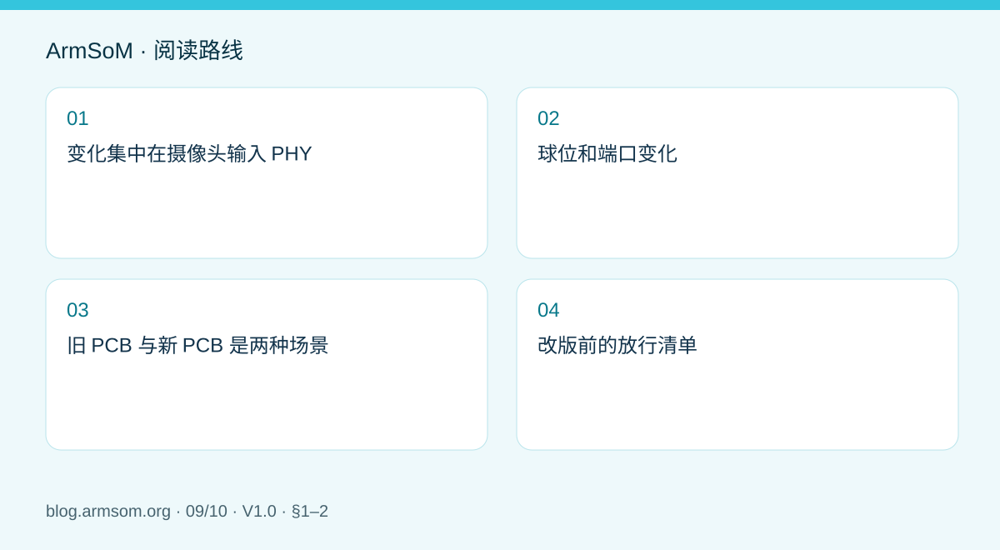
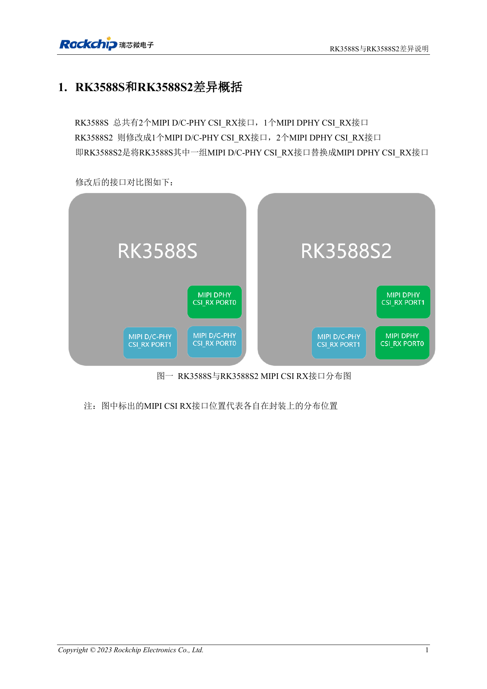
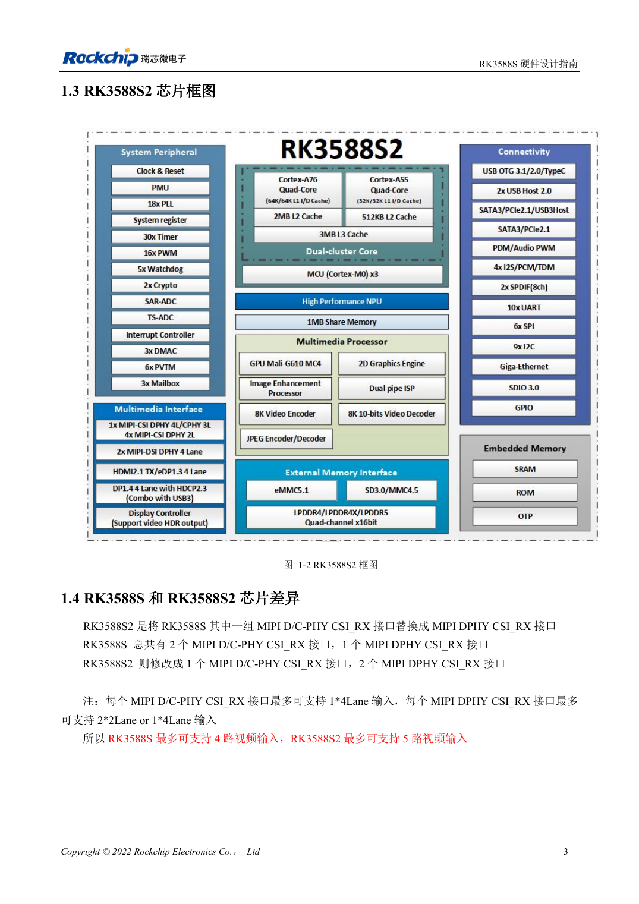
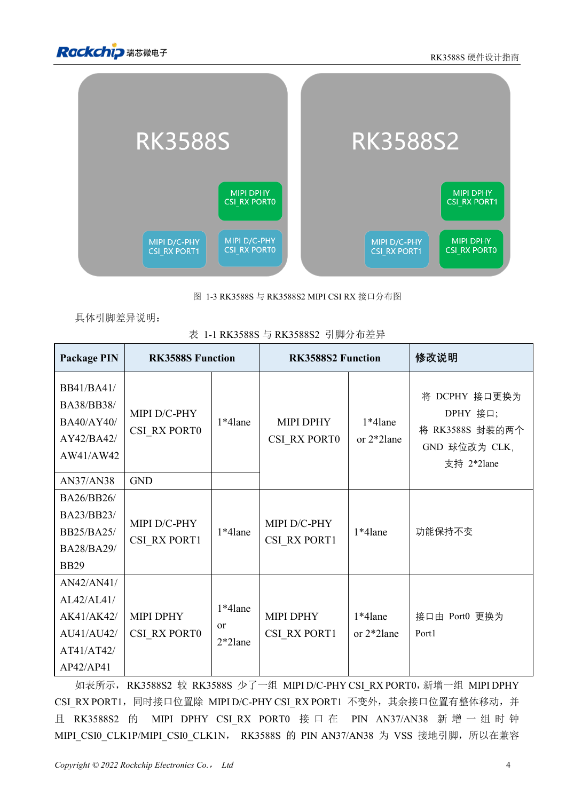

# RK3588S 与 RK3588S2 有什么区别？改版前需要核对什么

## 适用范围与资料

本篇为围绕工程问题编写的专题导读，不是整本 PDF 的逐页翻译。原文示例不代表 ArmSoM 实测；具体电压、引脚、SDK/BSP 和内核应按实际板卡版本核对。

**Rockchip:** `RK3588S与RK3588S2差异说明_V1.0_20231214_CN.pdf` · V1.0 · §1–2

## 变化集中在摄像头输入 PHY

原稿第 1 章说明：RK3588S 有两组 MIPI D/C-PHY CSI_RX 和一组 MIPI DPHY CSI_RX；RK3588S2 改为一组 D/C-PHY 和两组 DPHY。这不是简单增加一个相同接口，而是 PHY 类型和接口分布发生变化。

对既有设计，先确认传感器使用 D-PHY 还是 C-PHY、lane 配置和连接器映射。软件中的端口编号也不能只按原名字沿用。CM7s 官方资料对应 RK3588S，不能因为阅读了 S2 文档就把它宣传为 S2 产品。

## 球位和端口变化

| 对照项 | RK3588S | RK3588S2 |
| --- | --- | --- |
| 原 D/C-PHY CSI_RX PORT0 位置 | D/C-PHY，1×4 lane | DPHY CSI_RX PORT0，1×4 或 2×2 lane |
| AN37/AN38 | GND | 新增 MIPI_CSI0_CLK1P/MIPI_CSI0_CLK1N |
| D/C-PHY CSI_RX PORT1 | 原接口 | 功能保持不变 |
| 原 DPHY CSI_RX PORT0 位置 | PORT0 | 更名为 DPHY CSI_RX PORT1 |

AN37/AN38 从接地球位变为时钟功能，是不能遗漏的硬件差异。设计审查应逐个核对原表中的完整球位清单，不能只凭端口名称判断连线。

## 旧 PCB 与新 PCB 是两种场景

原文第 2 章要求：在原 RK3588S PCB 上贴 RK3588S2 时，需要 RK 的兼容补丁并调整接口映射。对于新设计的 S2 PCB，应使用新的 S2 参考设计；原稿写最多支持 5 路摄像头。

“最多 5 路”属于该芯片参考方案的能力描述，不是 CM7s 的接口承诺，也没有说明任意分辨率、帧率和 ISP 配置都能同时运行。原稿没有提供补丁文件名、BSP 提交或完整并发限制，项目必须取得与实际软件版本匹配的资料。

## 改版前的放行清单

1. 锁定实际芯片丝印、PCB 和模块版本。
2. 对照球位、PHY 类型和传感器模式，检查原理图与实装连接。
3. 核对兼容补丁、设备树端口、时钟与复位。
4. 单路验证后，再按目标组合验证采集、丢帧和恢复。
5. 在生产记录中保存硬件版本和镜像校验值。

本文为差异解读，未执行芯片替换或摄像头并发测试。

## 原文配图

中文稿原图。 参考设计，不是 ArmSoM 板卡原理图。

`RK3588S与RK3588S2差异说明_V1.0_20231214_CN.pdf` · PDF p. 6.

## 相关产品与开发资料

- **CM7s** — [产品页面](https://www.armsom.org/cm7s) · [开发文档](https://docs.armsom.org/armsom-cm7s)

## 继续阅读本系列

- [RK3576 硬件设计入门：最小系统与首次上电检查](/zh/articles/rk3576-hardware-bringup/)
- [ArmSoM CM5 载板设计检查表：供电、启动与接口规划](/zh/articles/019-cm5-carrier-production/)
- [RK3576 高速接口设计：原理图与 PCB 如何配合检查](/zh/articles/rk3576-high-speed-interface-design/)
- [RK3588S 硬件设计指南：从芯片参考设计到 CM7s 载板](/zh/articles/rk3588s-cm7s-carrier-design/)
- [RK3588 边缘 AI 设备设计：供电、散热与扩展接口规划](/zh/articles/rk3588-edge-ai-hardware-design/)
- [RK3588 高速 PCB 设计：叠层、阻抗与布线检查](/zh/articles/rk3588-high-speed-pcb-review/)
- [RK3506 工业 HMI 硬件设计：结合 CM1 与 Forge1 选择开发路径](/zh/articles/rk3506-industrial-hmi-hardware/)
- [RK3308 系列芯片差异与兼容检查：P2 Pro 音频项目参考](/zh/articles/rk3308-hardware-variant-compatibility/)
- [Rockchip 设备从样机到量产：工艺要求与测试清单](/zh/articles/rockchip-hardware-production-checklist/)

<!-- rk3588s-hardware-v12-20261109 -->

## RK3588S 与 RK3588S2：摄像头 PHY 和兼容边界

本文依据 RK3588S Hardware Design Guide V1.2（2023-12-14）中文原稿，面向电路与 PCB 设计审查。CM7S 载板需遵循模块接口定义，Sige7S 可用于软件与外设评估。芯片能力不等于板卡接口清单；SDK/BSP、内核、板卡版本、固件及复用须逐项核对。数值为原稿参考，未经 ArmSoM 硬件实测。

**RK3588S Hardware Design Guide V1.2 (2023-12-14), CN** · §1.3–1.4

## 主要差异集中在摄像头输入

RK3588S 为两个 D/C Combo RX 加一个专用 DPHY RX；RK3588S2 为一个 D/C Combo RX 加两个专用 DPHY RX。指南给出最多四路与五路摄像头的参考组合，不能据此推断具体 ArmSoM 产品的连接器数或 BSP 已支持全部组合。

## 引脚与软件都要复查

表 1-1 中 AN37、AN38 从 RK3588S 的 GND 改为 RK3588S2 的摄像头时钟信号。指南提到既有 S 设计使用 S2 时需要兼容补丁，不能宣称无条件直接替换。确认芯片丝印、板卡版本、实际网络连接、传感器和 SDK，再做输入与睡眠测试。

## 设计参数与检查表

| 项目 | 原稿参考值 |
| --- | --- |
| RK3588S 接收 PHY | 2 × D/C Combo + 1 × DPHY |
| RK3588S2 接收 PHY | 1 × D/C Combo + 2 × DPHY |
| 差异球位 | AN37 / AN38 |
| 原稿摄像头组合 | RK3588S: ≤4; RK3588S2: ≤5 |

## 参考原图

本批没有对应英文设计指南，四语统一采用中文原稿截图，图注已本地化。点击图片查看清晰原图；图片用于核对电路和布局，正文与参数表可复制。页码为 PDF 物理页码。

中文原稿 · PDF 18 · 1-2

中文原稿 · PDF 19 · 1-3

## ArmSoM 开发路径

CM7S 适合定制载板：先确认模块已经完成的电源、DDR 与启动电路，再设计连接器外侧。Sige7S 可作为软件和外设评估起点。两种产品均须以对应版本资料核对接口是否引出、连接器针脚、电平、系统镜像与散热条件，不能把芯片原理图直接当成产品接线图。

- [ArmSoM CM7S](https://www.armsom.org/cm7s) · [CM7S Docs](https://docs.armsom.org/armsom-cm7s)
- [ArmSoM Sige7S](https://www.armsom.org/sige7s) · [Sige7S Docs](https://docs.armsom.org/armsom-sige7s)

## 继续阅读

- [RK3588S 硬件设计系列：30 个主题](/zh/articles/rk3588s-hardware-design-series/)
- [RK3588S 摄像头：CSI、D/C PHY 与 CIF 接口规划](/zh/articles/rk3588s-camera-hardware-design/)
- [RK3588S HDMI TX：FRL、TMDS 与兼容电路](/zh/articles/rk3588s-hdmi-tx-hardware-design/)
