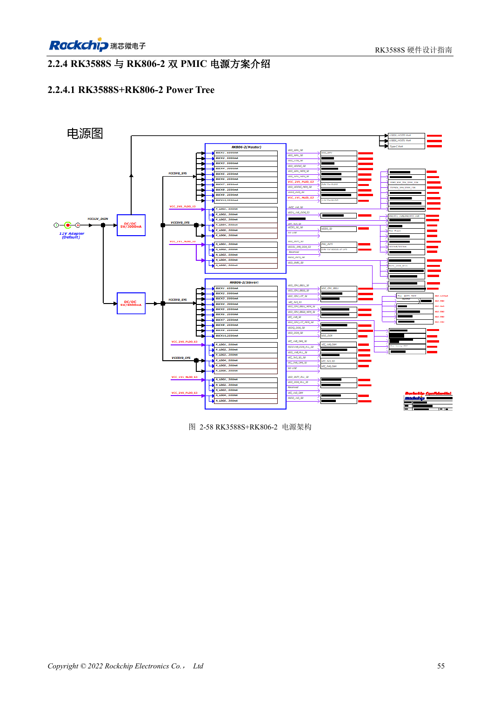
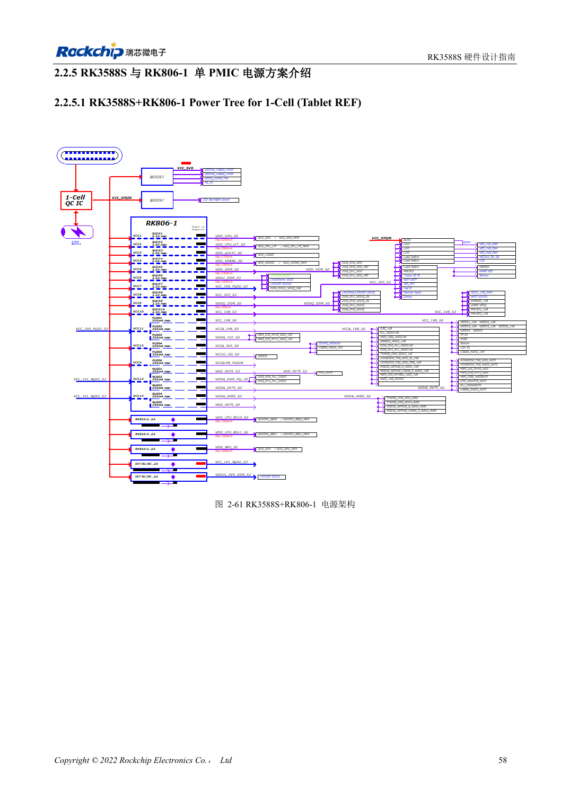

<!-- rk3588s-hardware-v12-20261109 -->

# RK3588S 与 RK806：单、双 PMIC 电源树

本文依据 RK3588S Hardware Design Guide V1.2（2023-12-14）中文原稿，面向电路与 PCB 设计审查。CM7S 载板需遵循模块接口定义，Sige7S 可用于软件与外设评估。芯片能力不等于板卡接口清单；SDK/BSP、内核、板卡版本、固件及复用须逐项核对。数值为原稿参考，未经 ArmSoM 硬件实测。

**RK3588S Hardware Design Guide V1.2 (2023-12-14), CN** · §2.2.3–2.2.5

## 选择完整参考方案

RK806-2 双 PMIC 与 RK806-1 单 PMIC 加外部电源是不同架构，不能直接删掉一颗。输出分配、默认电压、时序、控制总线、睡眠和复位必须一起迁移。PMIC 的 2.7–5.5V 输入不是 ArmSoM 整板输入范围。

## 主从同步与布局

双 PMIC 用 EXT_EN 设置主从、SYNC/SYNC_CLK 同步，按参考连接 VDC、PWRON、RESET。单 PMIC 设主模式，SYNC/SYNC_CLK 留空。优先大电流路径和电容地回路，同时评估热量集中。最大电流不是所有温度下的持续输出承诺。

## 设计参数与检查表

| 项目 | 原稿参考值 |
| --- | --- |
| RK806 输入 | 2.7–5.5V |
| 封装 | 7×7mm QFN68 |
| 双 PMIC 参考 | RK806-2 |
| 单 PMIC 参考 | RK806-1 + 外部电源 |

## 参考原图

本批没有对应英文设计指南，四语统一采用中文原稿截图，图注已本地化。点击图片查看清晰原图；图片用于核对电路和布局，正文与参数表可复制。页码为 PDF 物理页码。

中文原稿 · PDF 70 · 2-58

中文原稿 · PDF 73 · 2-61

## ArmSoM 开发路径

CM7S 适合定制载板：先确认模块已经完成的电源、DDR 与启动电路，再设计连接器外侧。Sige7S 可作为软件和外设评估起点。两种产品均须以对应版本资料核对接口是否引出、连接器针脚、电平、系统镜像与散热条件，不能把芯片原理图直接当成产品接线图。

- [ArmSoM CM7S](https://www.armsom.org/cm7s) · [CM7S Docs](https://docs.armsom.org/armsom-cm7s)
- [ArmSoM Sige7S](https://www.armsom.org/sige7s) · [Sige7S Docs](https://docs.armsom.org/armsom-sige7s)

## 继续阅读

- [RK3588S 硬件设计系列：30 个主题](/zh/articles/rk3588s-hardware-design-series/)
- [RK3588S 上下电时序：RESETn 与 S0/S3](/zh/articles/rk3588s-power-sequencing-design/)
- [RK3588S DDR 原理图：LPDDR4/4X/5 与容量配置](/zh/articles/rk3588s-ddr-circuit-design/)
