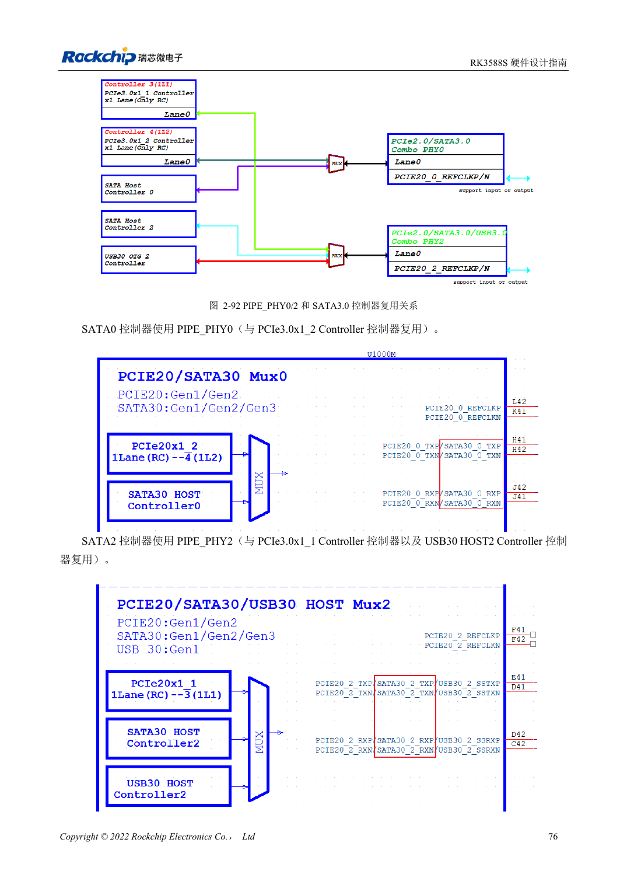
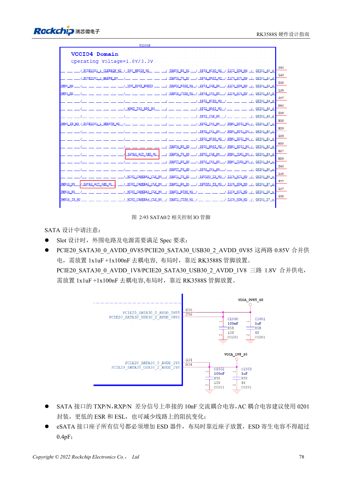

<!-- rk3588s-hardware-v12-20261109 -->

# RK3588S SATA：三路控制器与 Combo PHY 复用

本文依据 RK3588S Hardware Design Guide V1.2（2023-12-14）中文原稿，面向电路与 PCB 设计审查。CM7S 载板需遵循模块接口定义，Sige7S 可用于软件与外设评估。芯片能力不等于板卡接口清单；SDK/BSP、内核、板卡版本、固件及复用须逐项核对。数值为原稿参考，未经 ArmSoM 硬件实测。

**RK3588S Hardware Design Guide V1.2 (2023-12-14), CN** · §2.3.5; §3.4.7

## 先画复用矩阵

RK3588S 的两路 SATA 使用 PIPE_PHY0 和 PIPE_PHY2，与 PCIe2.0 复用，PHY2 还与 USB3 HOST2 共享。指南列出 1.5/3/6Gbps 与 Port Multiplier，不代表 CM7S 或 Sige7S 都引出两路接口。先按产品资料确定可用通道，再选连接器和 BSP 配置。

## 信号与硬盘电源分别验证

参考在 TX 和 RX 都串 10nF，推荐 0201；不能套用 PCIe 的耦合电容。SATA_CP_DET、MP_SWITCH、CP_POD 是共用控制资源，热插拔要单独设计。硬盘启动电流由外部电源提供并验证，测试持续写入、错误计数、热插拔与掉电恢复。

## 设计参数与检查表

| 项目 | 原稿参考值 |
| --- | --- |
| SATA 耦合 | 10nF ±20%; TX 与 RX |
| 差分目标 | 100Ω ±10%; 原稿备选 90Ω ±10% |
| 长度/对内差 | <6in / <6mil |
| 过孔数量建议 | 建议 ≤2 |

## 参考原图

本批没有对应英文设计指南，四语统一采用中文原稿截图，图注已本地化。点击图片查看清晰原图；图片用于核对电路和布局，正文与参数表可复制。页码为 PDF 物理页码。

中文原稿 · PDF 91 · 2-92

中文原稿 · PDF 93 · 2-93

## ArmSoM 开发路径

CM7S 适合定制载板：先确认模块已经完成的电源、DDR 与启动电路，再设计连接器外侧。Sige7S 可作为软件和外设评估起点。两种产品均须以对应版本资料核对接口是否引出、连接器针脚、电平、系统镜像与散热条件，不能把芯片原理图直接当成产品接线图。

- [ArmSoM CM7S](https://www.armsom.org/cm7s) · [CM7S Docs](https://docs.armsom.org/armsom-cm7s)
- [ArmSoM Sige7S](https://www.armsom.org/sige7s) · [Sige7S Docs](https://docs.armsom.org/armsom-sige7s)

## 继续阅读

- [RK3588S 硬件设计系列：30 个主题](/zh/articles/rk3588s-hardware-design-series/)
- [RK3588S USB 与 Type-C：控制器、PHY 和恢复口](/zh/articles/rk3588s-usb-typec-hardware-design/)
- [RK3588S PCIe：通道分配、参考时钟与电源](/zh/articles/rk3588s-pcie-hardware-design/)
