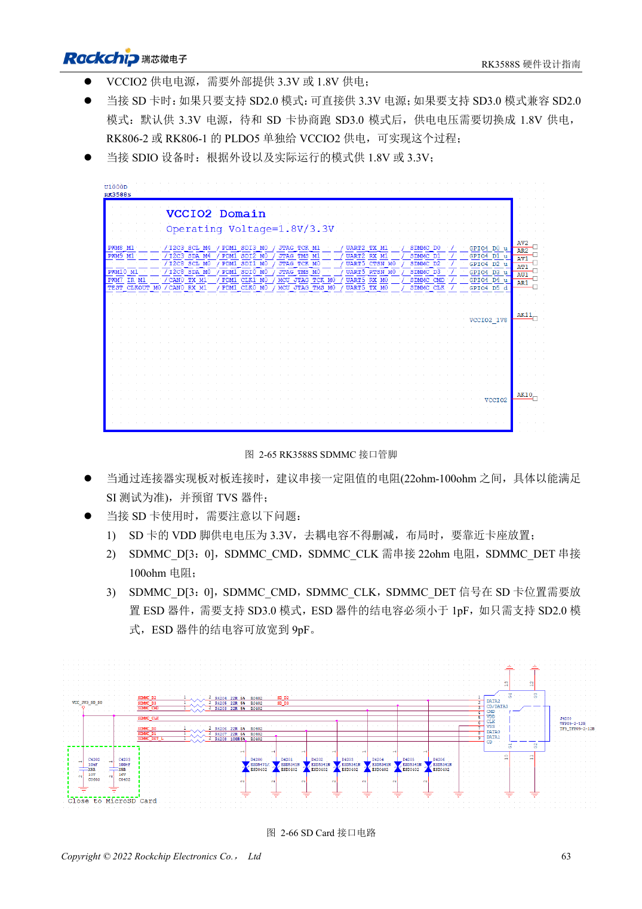

<!-- rk3588s-hardware-v12-20261109 -->

# RK3588S SDMMC 与 SDIO Wi-Fi：电压切换和防护

本文依据 RK3588S Hardware Design Guide V1.2（2023-12-14）中文原稿，面向电路与 PCB 设计审查。CM7S 载板需遵循模块接口定义，Sige7S 可用于软件与外设评估。芯片能力不等于板卡接口清单；SDK/BSP、内核、板卡版本、固件及复用须逐项核对。数值为原稿参考，未经 ArmSoM 硬件实测。

**RK3588S Hardware Design Guide V1.2 (2023-12-14), CN** · §2.3.1; §3.4.13–3.4.14; §3.4.19

## 卡电源与 IO 电压分开理解

SD 卡 VDD 为 3.3V，不能因为 SD3.0 协商后 VCCIO2 切换到 1.8V，就把卡电源也改成 1.8V。SDMMC 与 JTAG 的启动选择还取决于 SDMMC_DET。指南要求数据、CMD、CLK 串 22Ω，DET 串 100Ω，卡座旁保留去耦和 ESD。

## Wi-Fi 还需要时钟与射频检查

模块 IO、UART/PCM 方向和 32.768kHz 幅度必须核对，天线预留 π 匹配。晶体负载按模组需求选，指南 Wi-Fi 常温频率容限为 10ppm。SD3.0 防护器件结电容要求 <1pF，不能为了 ESD 任意增加总线负载。测试连接、吞吐、休眠唤醒和反复开关电源。

## 设计参数与检查表

| 项目 | 原稿参考值 |
| --- | --- |
| SD 卡 VDD | 3.3V |
| SD3.0 ESD 电容 | <1pF |
| 仅 SD2.0 ESD 参考 | ≤9pF |
| Data/CMD/CLK; DET | 22Ω; 100Ω |
| PCB 阻抗/长度 | 50Ω ±10% / <4in |
| 时钟与数据长度差 | <120mil |

## 参考原图

本批没有对应英文设计指南，四语统一采用中文原稿截图，图注已本地化。点击图片查看清晰原图；图片用于核对电路和布局，正文与参数表可复制。页码为 PDF 物理页码。

中文原稿 · PDF 78 · 2-66

## ArmSoM 开发路径

CM7S 适合定制载板：先确认模块已经完成的电源、DDR 与启动电路，再设计连接器外侧。Sige7S 可作为软件和外设评估起点。两种产品均须以对应版本资料核对接口是否引出、连接器针脚、电平、系统镜像与散热条件，不能把芯片原理图直接当成产品接线图。

- [ArmSoM CM7S](https://www.armsom.org/cm7s) · [CM7S Docs](https://docs.armsom.org/armsom-cm7s)
- [ArmSoM Sige7S](https://www.armsom.org/sige7s) · [Sige7S Docs](https://docs.armsom.org/armsom-sige7s)

## 继续阅读

- [RK3588S 硬件设计系列：30 个主题](/zh/articles/rk3588s-hardware-design-series/)
- [RK3588S FSPI Flash：启动、供电与匹配](/zh/articles/rk3588s-fspi-boot-hardware/)
- [RK3588S USB 与 Type-C：控制器、PHY 和恢复口](/zh/articles/rk3588s-usb-typec-hardware-design/)
