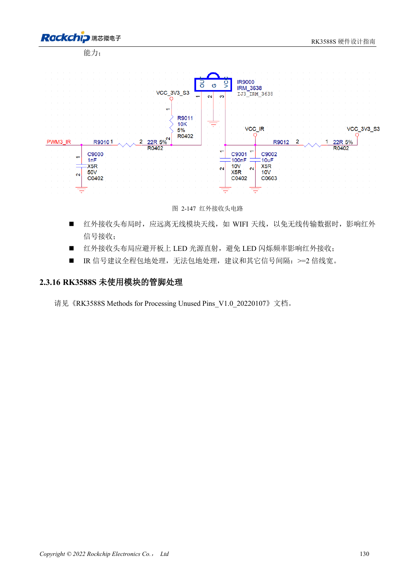

<!-- rk3588s-hardware-v12-20261109 -->

# RK3588S UART、SPI、CAN、I2C 与 PWM 分配

本文依据 RK3588S Hardware Design Guide V1.2（2023-12-14）中文原稿，面向电路与 PCB 设计审查。CM7S 载板需遵循模块接口定义，Sige7S 可用于软件与外设评估。芯片能力不等于板卡接口清单；SDK/BSP、内核、板卡版本、固件及复用须逐项核对。数值为原稿参考，未经 ArmSoM 硬件实测。

**RK3588S Hardware Design Guide V1.2 (2023-12-14), CN** · §2.3.11–2.3.15

## 同一外设的 Mx 不要混拼

UART、SPI、CAN、I2C 的不同 M0/M1/M2 位置是复用选项，不是可同时使用的独立控制器。同一组信号应按指南选择完整复用组并核对电源域。SPI2 默认用于 PMIC，不建议为增加外设随意占用。CAN 还需要外部收发器，不能将 SoC TX/RX 当总线差分线。

## 按外设协议验收

I2C 上拉参考 2.2kΩ，实际值取决于总线负载和电平；HDMI DDC 是专用总线。V1.2 的 CAN 章节为 CAN2.0B、1Mbps，不推广为 CAN FD。验证 UART 波特率和流控、SPI 模式与片选、I2C 上拉波形及 CAN 收发器电平，再测试睡眠和复位，保留测量记录。

## 设计参数与检查表

| 项目 | 原稿参考值 |
| --- | --- |
| UART / 通用 SPI | 10 / 5 控制器 |
| CAN 原稿范围 | 3 控制器; CAN2.0B; 1Mbps |
| I2C 参考 | 最高 400Kbit/s; 2.2kΩ 上拉 |
| 原稿 PWM 数量 | 4 控制器 ×4 通道 |

## 参考原图

本批没有对应英文设计指南，四语统一采用中文原稿截图，图注已本地化。点击图片查看清晰原图；图片用于核对电路和布局，正文与参数表可复制。页码为 PDF 物理页码。

中文原稿 · PDF 145 · 2-147

## ArmSoM 开发路径

CM7S 适合定制载板：先确认模块已经完成的电源、DDR 与启动电路，再设计连接器外侧。Sige7S 可作为软件和外设评估起点。两种产品均须以对应版本资料核对接口是否引出、连接器针脚、电平、系统镜像与散热条件，不能把芯片原理图直接当成产品接线图。

- [ArmSoM CM7S](https://www.armsom.org/cm7s) · [CM7S Docs](https://docs.armsom.org/armsom-cm7s)
- [ArmSoM Sige7S](https://www.armsom.org/sige7s) · [Sige7S Docs](https://docs.armsom.org/armsom-sige7s)

## 继续阅读

- [RK3588S 硬件设计系列：30 个主题](/zh/articles/rk3588s-hardware-design-series/)
- [RK3588S GPIO 与 SARADC：电源域和按键边界](/zh/articles/rk3588s-gpio-saradc-hardware/)
- [RK3588S PCB 叠层与扇出：HDI 和通孔板选择](/zh/articles/rk3588s-pcb-stackup-fanout/)
