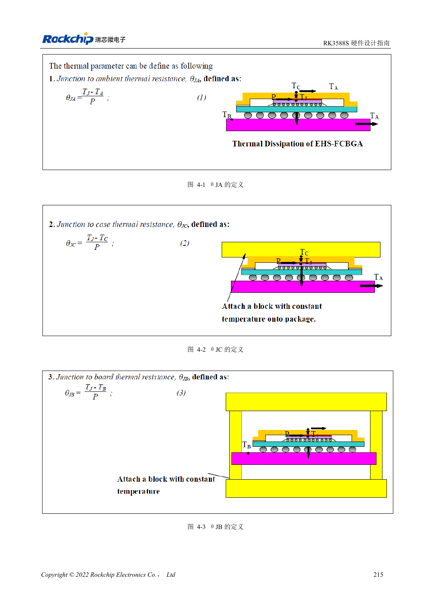

<!-- rk3588s-hardware-v12-20261109 -->

# RK3588S 热设计：参考热阻与整机验证

本文依据 RK3588S Hardware Design Guide V1.2（2023-12-14）中文原稿，面向电路与 PCB 设计审查。CM7S 载板需遵循模块接口定义，Sige7S 可用于软件与外设评估。芯片能力不等于板卡接口清单；SDK/BSP、内核、板卡版本、固件及复用须逐项核对。数值为原稿参考，未经 ArmSoM 硬件实测。

**RK3588S Hardware Design Guide V1.2 (2023-12-14), CN** · §4

## 仿真热阻不等于模块温升

表 4-1 的热阻来自指定封装和 JEDEC PCB 有限元模型：200×140mm、1.6mm、10 层、无散热片。不能直接套用到 CM7S 模块、CM7S 载板或 Sige7S 的机箱。θJA、θJB、θJC 的参考点不同，不能互换后计算散热器。

## 热路径和软件保护一起验收

确认芯片到导热界面、散热器、外壳和环境的路径，检查安装压力与电气绝缘。原稿建议 RK3588S 与 RK806 间隔 20–50mm，仅为板级参考，模块内部不能据此改造。用实际 BSP 温控策略测试持续负载、频率、温度和应用延迟，不能通过关闭保护证明性能。

## 设计参数与检查表

| 项目 | 原稿参考值 |
| --- | --- |
| 原稿 θJA / θJB / θJC | 8.2 / 3.7 / 0.01 °C/W; 仿真 |
| 原稿 PCB | 200×140mm; 1.6mm; 10 层 |
| PMIC 与 SoC 间距参考 | RK3588S–RK806: 20–50mm |

## 参考原图

本批没有对应英文设计指南，四语统一采用中文原稿截图，图注已本地化。点击图片查看清晰原图；图片用于核对电路和布局，正文与参数表可复制。页码为 PDF 物理页码。

中文原稿 · PDF 230 · 4-1

## ArmSoM 开发路径

CM7S 适合定制载板：先确认模块已经完成的电源、DDR 与启动电路，再设计连接器外侧。Sige7S 可作为软件和外设评估起点。两种产品均须以对应版本资料核对接口是否引出、连接器针脚、电平、系统镜像与散热条件，不能把芯片原理图直接当成产品接线图。

- [ArmSoM CM7S](https://www.armsom.org/cm7s) · [CM7S Docs](https://docs.armsom.org/armsom-cm7s)
- [ArmSoM Sige7S](https://www.armsom.org/sige7s) · [Sige7S Docs](https://docs.armsom.org/armsom-sige7s)

## 继续阅读

- [RK3588S 硬件设计系列：30 个主题](/zh/articles/rk3588s-hardware-design-series/)
- [RK3588S 电源 PCB 与 PDN：铜皮、回流和去耦](/zh/articles/rk3588s-power-pcb-pdn-design/)
- [RK3588S ESD 与 EMI：接口保护和整机回流](/zh/articles/rk3588s-esd-emi-hardware-design/)
