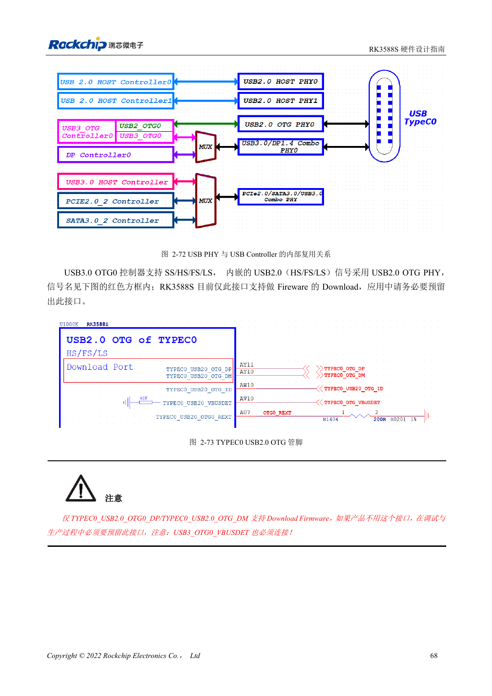
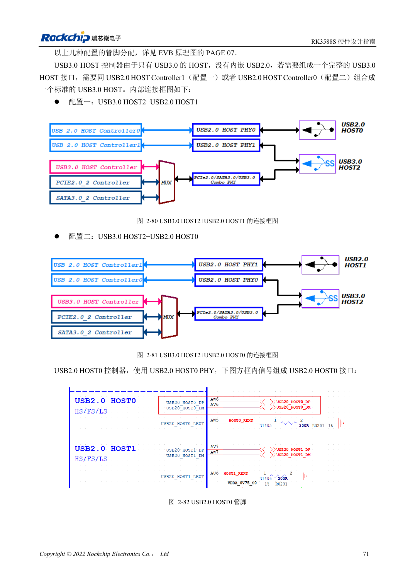

<!-- rk3588s-hardware-v12-20261109 -->

# RK3588S USB 与 Type-C：控制器、PHY 和恢复口

本文依据 RK3588S Hardware Design Guide V1.2（2023-12-14）中文原稿，面向电路与 PCB 设计审查。CM7S 载板需遵循模块接口定义，Sige7S 可用于软件与外设评估。芯片能力不等于板卡接口清单；SDK/BSP、内核、板卡版本、固件及复用须逐项核对。数值为原稿参考，未经 ArmSoM 硬件实测。

**RK3588S Hardware Design Guide V1.2 (2023-12-14), CN** · §2.3.4; §3.4.8–3.4.9

## 区分控制器与端口

RK3588S 为一个 USB3 OTG、一个 USB3 HOST 和两个 USB2 HOST。独立 USB3 HOST 不含 USB2，完整接口需配合一个 USB2 HOST。USB2 OTG0 下载路径与 VBUSDET 必须保留。Type-C 还需一起审查 USB3/DP 分配、正反插和外部 CC 控制器。

## 验证供电角色和完整链路

USB3 HOST2 与 SATA/PCIe 共用资源，不能把三个功能都算成同时可用接口。检查 VBUS 源/受电角色、防倒灌、连接器与线缆。先验证 USB2 恢复，再做 USB3 枚举与持续传输、热插拔及 Type-C 两种方向。载板长度预算应包含模块和连接器。

## ESD 电容的两个口径

电路章节第 90 页给 USB3 防护电容 ≤0.3pF，PCB 第 221 页要求 ≤0.2pF。保留两处差异，选型审查优先按更严格的 ≤0.2pF 预算，并将焊盘、连接器和器件寄生纳入实测；这不等于任意器件都已通过验证。

## 设计参数与检查表

| 项目 | 原稿参考值 |
| --- | --- |
| USB2 差分阻抗 | 90Ω ±10%; 对内差 <20mil |
| USB3 差分阻抗 | 90Ω ±10%; 对内差 <6mil |
| USB3 长度/过孔 | <6in; 建议 ≤2 |
| USB3 ESD 电容 | ≤0.2pF |

## 参考原图

本批没有对应英文设计指南，四语统一采用中文原稿截图，图注已本地化。点击图片查看清晰原图；图片用于核对电路和布局，正文与参数表可复制。页码为 PDF 物理页码。

中文原稿 · PDF 83 · 2-72

中文原稿 · PDF 86 · 2-80

## ArmSoM 开发路径

CM7S 适合定制载板：先确认模块已经完成的电源、DDR 与启动电路，再设计连接器外侧。Sige7S 可作为软件和外设评估起点。两种产品均须以对应版本资料核对接口是否引出、连接器针脚、电平、系统镜像与散热条件，不能把芯片原理图直接当成产品接线图。

- [ArmSoM CM7S](https://www.armsom.org/cm7s) · [CM7S Docs](https://docs.armsom.org/armsom-cm7s)
- [ArmSoM Sige7S](https://www.armsom.org/sige7s) · [Sige7S Docs](https://docs.armsom.org/armsom-sige7s)

## 继续阅读

- [RK3588S 硬件设计系列：30 个主题](/zh/articles/rk3588s-hardware-design-series/)
- [RK3588S SDMMC 与 SDIO Wi-Fi：电压切换和防护](/zh/articles/rk3588s-sdmmc-sdio-wifi-design/)
- [RK3588S SATA：三路控制器与 Combo PHY 复用](/zh/articles/rk3588s-sata-hardware-design/)
