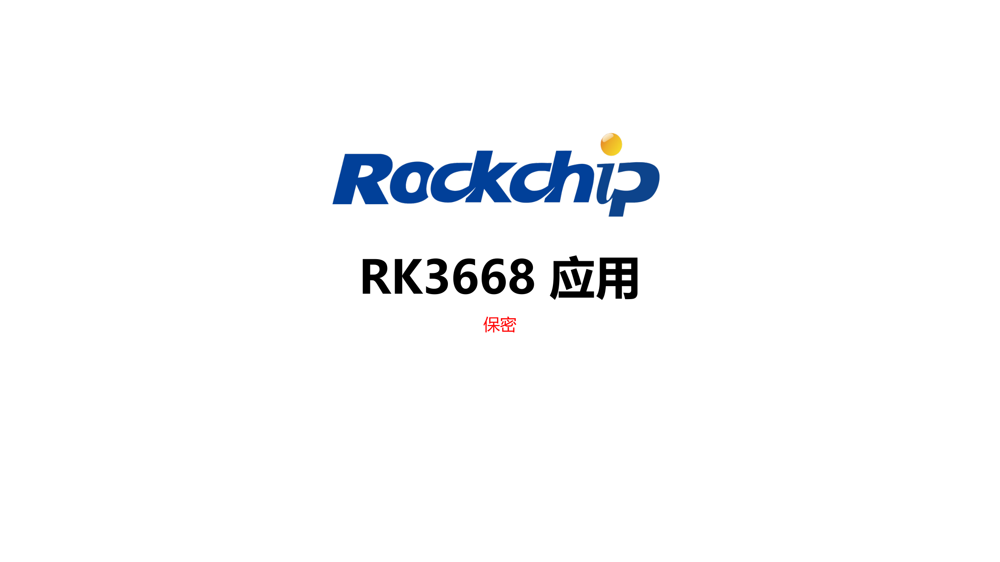
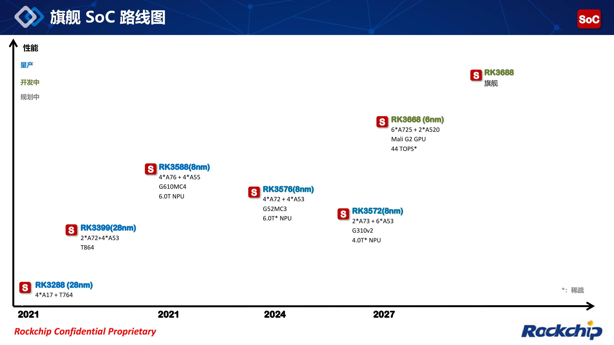
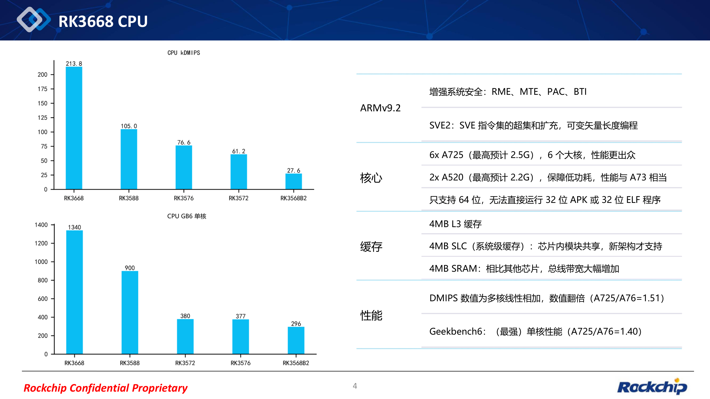
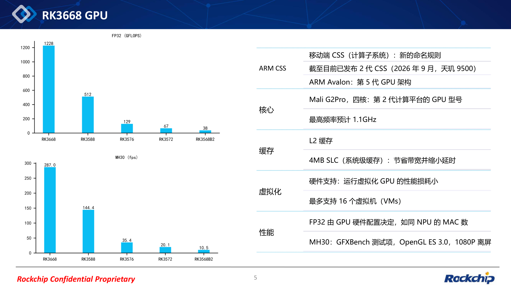
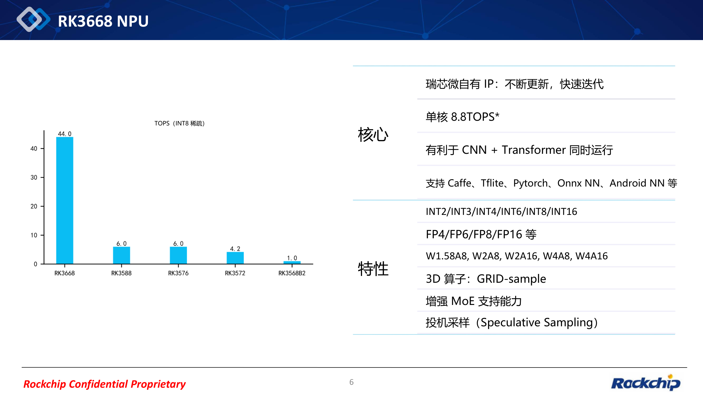
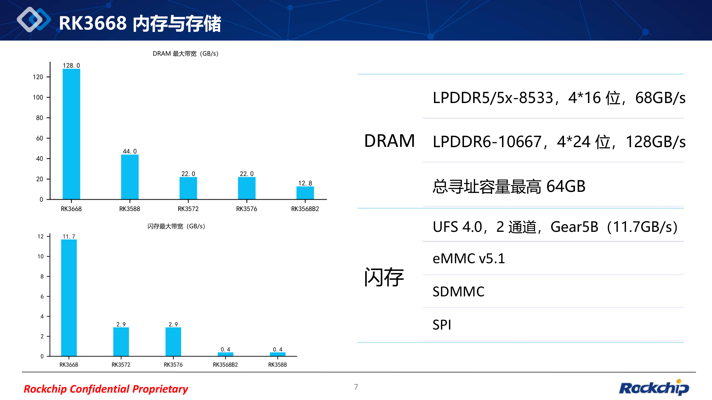
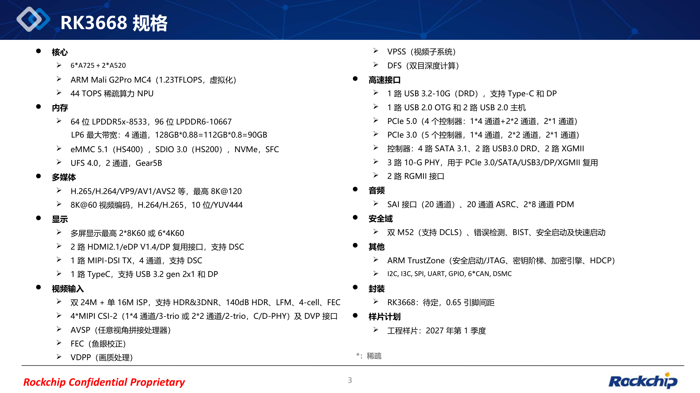
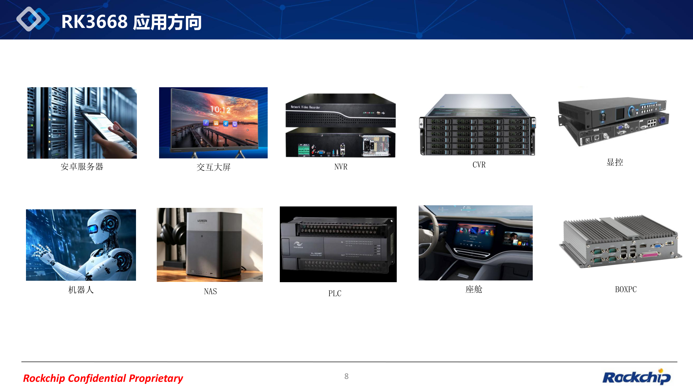

RK3668 的价值，不只是更高的计算峰值，而是把通用处理、端侧 AI、多路视频、显示与高速扩展放到同一个平台中。这份 RK3668 Application 资料展示了瑞芯微对新一代旗舰 SoC 的规划，也为下一阶段的 ArmSoM 产品设计提供了参考。

本文依据用户提供的 **REL02、文件名日期 2026-10-09、共 9 页 PDF** 逐页整理。封面及技术页保留为清晰配图，点击图片可查看大图；原文件可在文末下载。配图沿用原资料版式，图片文字已译为中文；图表数据、型号及来源标记保留。译制图不是瑞芯微官方中文版，原始 PDF 保持不变，可供核对。**图表数据为原资料数据，不是 ArmSoM 实测；预计频率、工程样片时间和接口规划不等于最终量产规格。**

*中文译制图 · 原 PDF 第 1 页: 封面：RK3668 Application.*

## 1. 路线图：RK3668 是独立的平台，不与 RK3688 混写

第 2 页将 RK3668 标注为 6nm 平台，配置 6× Cortex-A725 + 2× Cortex-A520、Mali G2 GPU 和 44 TOPS 稀疏 NPU；RK3688 在同一图中另列为后续旗舰规划。**不能把 RK3668 的规格转写为 RK3688 的规格。**

第 3 页给出的工程样片（ES）时间为 **2027 年第一季度**。这是资料中的计划节点，不是量产或 ArmSoM 成品上市日期。封装为 TBD，pitch 标注 0.65；本资料未给出最终封装尺寸。路线图还包含历史平台简写，选型应以各型号正式资料为准。

*中文译制图 · 原 PDF 第 2 页: 旗舰 SoC 路线图.*

## 2. CPU 与 GPU：算力升级之外，先看软件迁移

CPU 采用 Armv9.2，六个 Cortex-A725 大核最高频率**预计 2.5GHz**，两个 Cortex-A520 小核**预计 2.2GHz**。资料列出 SVE2，以及 RME、MTE、PAC、BTI 等安全相关能力；缓存/片上存储为 4MB L3、4MB SLC 和 4MB SRAM。

**仅支持 64 位程序**是迁移重点：原文明确无法直接运行 32 位 APK 或 ELF。已有 Android 应用、闭源动态库、外设服务和算法组件，都应提前盘点 64 位版本。硬件列出安全功能也不等于某个 SDK 默认启用了全部功能。

GPU 为 Mali G2 Pro MC4，最高频率**预计 1.1GHz**；资料列出硬件辅助虚拟化和最多 16 个 VM。虚拟机数量不是每个实例的性能承诺，仍要验证驱动、调度和多租户负载。图中 FP32 与 GFXBench MH30 的数值属于不同指标，不能互相替代。

|指标（原资料）|RK3668|RK3588|
|---|---|---|
|CPU kDMIPS|213.8|105.0|
|Geekbench 6 single-core|1340|900|
|GPU FP32 (GFLOPS)|1228|512|
|GFXBench MH30 (fps)|287.0|144.4|

CPU 图的单位是 **kDMIPS**，不是不带千倍单位的 DMIPS。资料说明其多核数值为线性相加，GB6 为单核；MH30 是 OpenGL ES 3.0、1080P 离屏测试。图表没有完整测试平台与运行条件，不能将这些数值直接作为产品性能保证。

*中文译制图 · 原 PDF 第 4 页: CPU 架构与性能对比.*

*中文译制图 · 原 PDF 第 5 页: GPU 配置、性能与虚拟化.*

## 3. NPU：44 TOPS 的前提是 INT8 Sparse

第 6 页图表标题明确为 **TOPS（INT8 Sparse）**，RK3668 为 44.0；正文另写单核 8.8 TOPS，并提出 CNN 与 Transformer 同时运行的方向。本文不据除法推断内部核心组织，也不把稀疏算力与其他口径直接比较。

整数精度包括 INT2/INT3/INT4/INT6/INT8/INT16，浮点精度包括 FP4/FP6/FP8/FP16；组合包括 W1.58A8、W2A8、W2A16、W4A8、W4A16。功能列有三维 GRID-sample、增强 MoE 支持和 Speculative Sampling（投机采样），软件名称包括 Caffe、TFLite、PyTorch、ONNX NN、Android NN。

这些能力适合提前评估视觉与语言模型协作、机器人感知及边缘推理。但是否支持某个模型、量化后的精度、上下文长度、tokens/s 和持续功耗，资料没有答案。应等相应 SDK 和样片，用真实模型验证转换、算子覆盖、内存占用与端到端延迟。

*中文译制图 · 原 PDF 第 6 页: NPU 精度、特性及稀疏算力.*

## 4. 内存与存储：128 GB/s 是资料标称值

第 7 页列出 LPDDR5/5X-8533、4×16-bit、68 GB/s；LPDDR6-10667、4×24-bit、128 GB/s；最高寻址能力 64GB。**寻址上限不意味着每款板卡会安装 64GB 内存。**

第 3 页另写 64-bit LPDDR5x-8533、96-bit LPDDR6-10667，并给出 `128GB*0.88=112GB*0.8=90GB` 的原始算式。它与第 7 页的标称带宽展示口径不同，原文也未完整解释系数，本文不把 90、112 或 128 当作已经测得的应用带宽。

存储列出 UFS 4.0、双通道、Gear5B（11.7 GB/s），以及 eMMC 5.1、SDMMC、SPI；总览还出现 NVMe、SFC、eMMC HS400 和“SDIO 3.0 w/ HS200”。最后这一写法按原图保留，模式对应关系需要正式接口文档确认，不自行纠正。UFS 标称值也不能等同于文件系统持续读写速度。

*中文译制图 · 原 PDF 第 7 页: 内存与存储带宽.*

## 5. 多媒体、扩展接口与安全域

规格页内容较多，下面按设计时需要核对的模块归纳；全部原文可在第 3 页大图中查看。

|模块|资料列出的能力|
|---|---|
|解码|H.265/H.264/VP9/AV1/AVS2 等，最高 8K@120|
|编码|H.264/H.265，最高 8K@60，10-bit/YUV444|
|显示|最高 2×8K60 或 6×4K60；两个 HDMI2.1/eDP1.4/DP combo（DSC）；一个 4-lane MIPI-DSI TX（DSC）；Type-C + DP|
|视频输入|双 24MP + 单 16MP ISP；HDR、3DNR、140dB HDR、LFM、4-cell、FEC；4×MIPI CSI-2、C/D-PHY、DVP|
|图像模块|AVSP 全景拼接、FEC 鱼眼校正、VDPP 画质、VPSS 视频子系统、DFS 双目深度|
|高速扩展|PCIe 5.0/3.0；4×SATA3.1、双 USB3.0 DRD、双 XGMII、3×10G combo PHY、双 RGMII|
|USB|1×USB3.2-10G DRD（Type-C/DP）、1×USB2.0 OTG、2×USB2.0 host|
|音频|SAI（原文 20-lane）、20-ch ASRC、2×8-ch PDM|
|安全域|双 M52（DCLS）、错误检测、BIST、安全与快速启动|
|安全与其他|Arm TrustZone、Secure boot/JTAG、key ladder、cipher engine、HDCP；I2C/I3C/SPI/UART/GPIO、6×CAN、DSMC|

PCIe 5.0 原文写“4 controllers”，后面同时列 `1*4-lane+2*2-lane, 2*1-lane`，总数与分项有歧义。PCIe 3.0 写 5 controllers，并列 1×4、2×2、2×1。**不能把所有通道、控制器和 combo PHY 简单相加为一块板卡可同时使用的接口数量。** 应等待引脚复用、通道组合和并发限制表。

同样，8K 解码、8K 编码与多路显示分别是资料中的上限描述，不能推断所有格式、所有显示输出和 AI 负载能够同时满速运行。安全域特性不代表已经取得某个功能安全等级认证。

*中文译制图 · 原 PDF 第 3 页: RK3668 规格总览.*

## 6. 十类应用方向，如何转成实际项目

第 8 页列出安卓服务器、交互大屏、NVR、CVR、显控、机器人、NAS、PLC、座舱和 BOX PC。以下是基于这些能力的工程分析，不是已交付案例：

| 场景 | 可重点评估的能力 | 产品化前应验证 |
| --- | --- | --- |
| 安卓服务器、BOX PC | 多核 CPU、GPU 虚拟化、多实例业务 | 64 位依赖、每实例资源、系统镜像和持续负载 |
| 机器人 | ISP、立体深度、NPU、CAN | 多传感器时间同步、模型精度、控制链路延迟 |
| NVR、CVR | 视频输入、编解码与 AI | 真实并发路数、码率、存储带宽、热设计 |
| 交互大屏、显控 | 多显示输出、视频与图像处理 | 分辨率组合、接口复用、显示延迟与驱动 |
| NAS | PCIe、SATA、网络接口、内存 | 实际可用 PHY、存储组合、网络吞吐和供电 |
| PLC、智能座舱 | 安全域、CAN、通用外设 | 实时性、故障处理、软件支持和项目认证要求 |

选择平台时，应从业务瓶颈倒推资源组合。例如 NAS 不只看 PCIe 代际，还要看网络与 SATA 是否共享资源；机器人不只看 TOPS，还要看采集到控制的完整延迟。

*中文译制图 · 原 PDF 第 8 页: 十类应用方向.*

## 7. ArmSoM 后续产品计划

ArmSoM 计划紧跟 RK3668 平台进度，在样片、SDK 和硬件验证具备产品化条件后，第一时间推进相关产品。当前这份资料不能确认 ArmSoM 产品名称、板型、内存配置、接口引出、价格或上市日期。

现在可以提前准备的是：整理应用的 64 位依赖，列出模型与算子，确定摄像头/显示/存储组合，以及功耗和散热约束。后续选型可关注 [ArmSoM 官网](https://www.armsom.org/)和 [ArmSoM 文档](https://docs.armsom.org/)。已有的 [RK3668 规格前瞻](/zh/articles/rockchip-rk3668-outlook/)提供背景，本篇新增逐页译制图和可下载资料，便于直接核对。

## 8. 下载原始 PDF

<a href="/downloads/rk3668/RK3668-SoC-Application-REL02-20261009.pdf" download>下载 RK3668 Application REL02 原 PDF（9 页，约 1.41 MB）</a>

文件保持原样，包含原始版式、图表及原有标识。配图文字已译为中文，原 PDF 保持不变，可供核对。正文是解读与应用分析，具体设计仍需正式数据手册、硬件设计指南和 SDK 支持。
