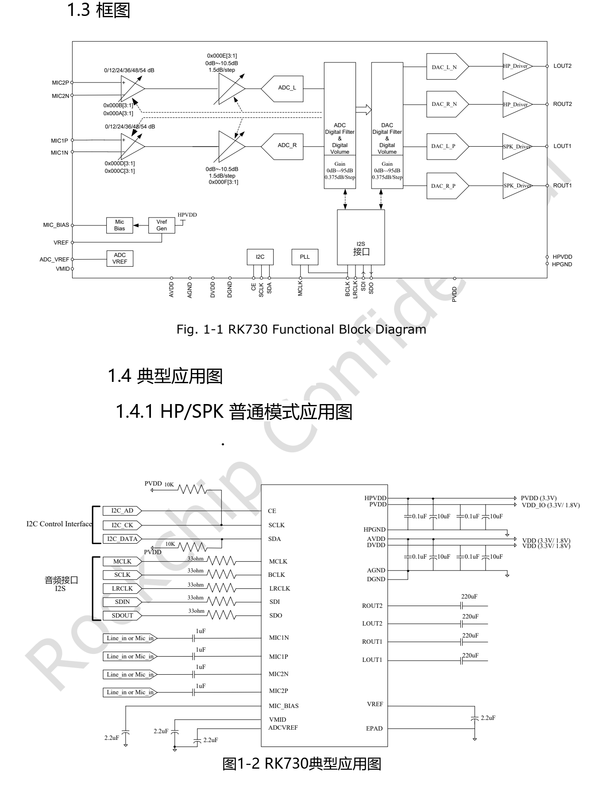
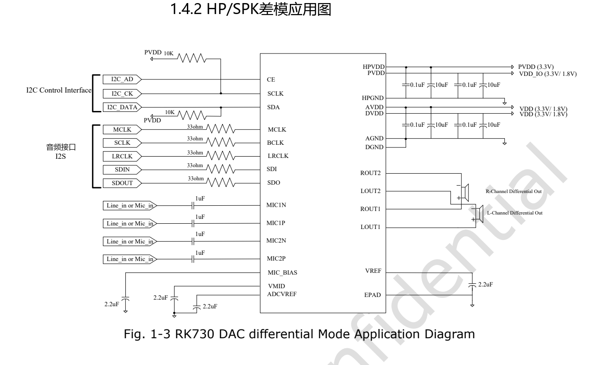

本文按选型和调试任务解读原稿，保留关键参数、边界和原图；不是逐页翻译或完整引脚／寄存器手册。原厂示例不是 ArmSoM 实测。应用前须核对具体板卡版本、原理图、SDK/BSP、内核及驱动；本文未新增硬件验证。

**主要资料：** `Rockchip RK730 Datasheet V1.0-20241118.pdf` · PDF 46 页.

## 先明确 Codec 与板卡的关系

RK730 是带双通道 ADC、双通道 DAC、麦克风放大和耳机驱动的音频 Codec。它可作为 RK3506 系列音频方案的参考器件，但本篇没有证据认定 CM1 或 Forge1 的任意版本都默认搭载 RK730。扩展前先确认板卡实际 Codec、引出的 SAI/I2S、控制总线、电平和 BSP 驱动。

*RK730 功能框图与普通输出应用 — 英文原图. `Rockchip RK730 Datasheet V1.0-20241118.pdf`, PDF p. 9.*

## 从规格表理解音频链路

| 部分 | V1.0 原稿参数 | 工程解读 |
| --- | --- | --- |
| ADC | 24-bit；8–192kHz；SNR 100dB；典型 THD+N −95dB | 麦克风、电源和布局会影响整机噪声 |
| 麦克风放大 | 最大 +54dB；差分／伪差分输入 | 先匹配输入幅度，再分配模拟与数字增益 |
| DAC | 24-bit；8–192kHz；SNR 98dB；THD+N −85dB | 不能直接当成外部功放和扬声器的系统指标 |
| 耳机输出 | 32Ω 负载 50mW；16Ω 负载 100mW | 输出功率与负载条件必须同时保留 |
| 差分输出 | 3.3V 供电下幅度最高 4.8Vpp | 差分负载接法不同于单端对地输出 |
| 控制 / 数据 | I2C 最高 400kHz；I2S/PCM 音频接口 | 控制通信成功并不代表音频时钟和数据正确 |

第 8 页功能表写 ADC 动态范围 100dB，第 14 页模拟表写 101dB，测试描述并不完全相同。本篇以功能表说明能力，不把两处数值合并成统一实测结论。早期 RK3506 应用介绍中的 RK730 指标也不能覆盖这份较晚的数据手册。

## 四路电源与地如何核对

`PVDD` 是数字 I/O 电源，`DVDD` 是数字核心电源，`AVDD` 是模拟电源，`HPVDD` 是耳机输出电源。推荐条件中前三者列 1.62–3.6V、典型 1.8/3.3V；HPVDD 为 3.0–3.6V、典型 3.3V。电源名称相近不代表可以忽略域之间的差异。

参考应用图给出 VREF、VMID、ADCVREF 和 MIC_BIAS 周边连接。载板设计需要同时检查去耦、回流路径、模拟输入走线和输出负载；用实际 BOM 与驱动初始化要求复核，不能凭一张图省去完整设计审查。

## 时钟和采样率必须成套配置

PLL 通常由 `MCLK` 参考时钟驱动，也可选 `BCLK` 来源。第 16 页分别列出 48k、44.1k 和 32k 采样率系列；主控端 SAI/I2S 的主从模式、BCLK、LRCLK、有效位宽和 slot 设置必须与 Codec 一致。没有声音时，先看时钟与路由，再看混音和音量。

原表将 `2.822MHz` 列在 BCLK 参考项，并把 `24MHz` 的来源写为 BCLK。本篇保留原文，不自行修成常见音频时钟值；使用这些组合前需向芯片／BSP资料核实。

## I2C 可达之后，还需要检查什么

原稿规定 CE 拉低／拉高对应地址 `0x16`／`0x17`。应在驱动中核对地址表示方法，不自行移位或改写。之后依次检查：电源与时钟启用、ADC/DAC 路由、静音状态、输入增益和输出模式。本文不提供未经板级验证的寄存器写入脚本。

芯片支持单声道 ADC 复制以及侧音混合。对讲设备应明确耳返、回声消除参考和扬声器回采的路径，避免把混音功能误当成完整 AEC 算法。

*RK730 差分输出参考电路 — 英文原图. `Rockchip RK730 Datasheet V1.0-20241118.pdf`, PDF p. 10.*

## 差分模式中的原文疑点

第 17 页文字把右声道负载写成连接 `ROUT2` 与 `Rout2`，图示则包含 ROUT1/ROUT2。第 13 页把 I2C 时钟脚标为输出 `O`，名称也出现 SCL/SCLK 差异。这些疑点已保留记录；不要直接按矛盾文字连线，须核对正式修订和参考原理图。

## 面向 CM1、Forge1 的验证顺序

先确认硬件是否真的采用 RK730，再取得匹配的音频驱动与设备树。依次验证播放、录音、全双工、不同采样率和待机恢复；在网络、屏幕与存储同时工作时记录底噪、失真、爆音和丢样。产品页面用于选择主控平台，不能代替 Codec 兼容性验证。

## 产品与开发资料

- **CM1** — [产品页](https://www.armsom.org/cm1) · [官方文档](https://docs.armsom.org/armsom-cm1)
- **Forge1** — [产品页](https://www.armsom.org/forge1) · [官方文档](https://docs.armsom.org/armsom-forge1)

<!-- datasheet-series-20261110 -->

## 数据手册专题与原始 PDF

- [RK730 总览](/zh/articles/rk730-audio-codec-design/)
- [RK730 封装、引脚与供电：QFN28 音频 Codec 设计入口](/zh/articles/rk730-package-power-pinout/)
- [RK730 时钟与音频路径：PLL、I2S、侧音和 I2C 地址](/zh/articles/rk730-clocks-audio-i2c/)
- [RK730 寄存器速查：65 个地址、复位值与关键控制域](/zh/articles/rk730-register-map-reference/)
- [RK730 启停流程：系统电源、ADC 录音与 DAC 播放](/zh/articles/rk730-power-adc-dac-sequences/)
- [下载完整原始 PDF](/assets/datasheet-series-20261110/Rockchip-RK730-Datasheet-V1.0-20241118.pdf)

<!-- datasheet-related-20261110 -->
## 其他芯片数据手册

以下用于跨平台查阅，各芯片的电气条件和引脚不可互换。

- [RK3506B](/zh/articles/rk3506b-datasheet-v10/)
- [RK3576](/zh/articles/rk3576-datasheet-v10/)
- [RK3588](/zh/articles/rk3588-datasheet-v14/)
- [RK3528](/zh/articles/rk3528-datasheet-v10/)
- [RK3568](/zh/articles/rk3568-datasheet-v12/)
