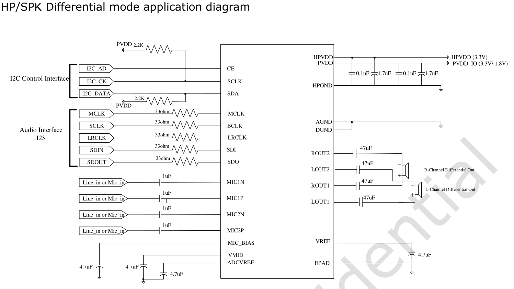

依据 RK730 数据手册 V1.2 更新。文中参数为原厂规格，未进行 ArmSoM 硬件实测；芯片修订、板级连接、SDK/BSP 和驱动应配套核对。所有配图取自本次英文原稿。

*RK730 音频 Codec 设计解读：麦克风、I2S 时钟与差分输出*

## 先明确 Codec 与板卡的关系

RK730 是带双通道 ADC、双通道 DAC、麦克风放大和耳机驱动的音频 Codec。它可作为 RK3506 系列音频方案的参考器件，但本篇没有证据认定 CM1 或 Forge1 的任意版本都默认搭载 RK730。扩展前先确认板卡实际 Codec、引出的 SAI/I2S、控制总线、电平和 BSP 驱动。

## 从规格表理解音频链路

| 部分 | V1.0 原稿参数 | 工程解读 |
| --- | --- | --- |
| ADC | 24-bit；8–192kHz；SNR 100dB；典型 THD+N −95dB | 麦克风、电源和布局会影响整机噪声 |
| 麦克风放大 | 最大 +54dB；差分／伪差分输入 | 先匹配输入幅度，再分配模拟与数字增益 |
| DAC | 24-bit；8–192kHz；SNR 98dB；THD+N −85dB | 不能直接当成外部功放和扬声器的系统指标 |
| 耳机输出 | 32Ω 负载 50mW；16Ω 负载 100mW | 输出功率与负载条件必须同时保留 |
| 差分输出 | 3.3V 供电下幅度最高 4.8Vpp | 差分负载接法不同于单端对地输出 |
| 控制 / 数据 | I2C 最高 400kHz；I2S/PCM 音频接口 | 控制通信成功并不代表音频时钟和数据正确 |

第 8 页功能表写 ADC 动态范围 100dB，第 14 页模拟表写 101dB，测试描述并不完全相同。本篇以功能表说明能力，不把两处数值合并成统一实测结论。早期 RK3506 应用介绍中的 RK730 指标也不能覆盖这份较晚的数据手册。

## V1.2 的外部供电与 NC 引脚

V1.2 中，`PVDD` 为数字 I/O 供电，并在芯片内部产生数字核心电源；`HPVDD` 为耳机输出供电，并产生模拟核心电源。推荐 PVDD 为 1.62–3.6 V，典型值 1.8/3.3 V；HPVDD 为 3.0–3.6 V，典型值 3.3 V。**Pin 2 和 Pin 17 已改为 NC，连同 Pin 9 均应悬空**，不能按 V1.0 的 DVDD/AVDD 接法继续连接。VREF、VMID、ADCVREF 按参考电路去耦，不作为通用电源输出。

## 新版 PLL 选择与保留疑点

V1.2 表 4-2 将 `1001–1011` 的 24 MHz 输入明确列为 **MCLK**，已同步修正本页；`0110/0111/1000` 对应 BCLK 3.072/2.822/2.048 MHz。寄存器 `CODEC_SYSPLL_3[7:4]` 中 0x6–0x8 的说明也已更新。`0111` 在新版仍写 2.822 MHz，本页保留该值，实际使用前应核对驱动和时钟，不能自行推断为 2.8224 MHz。`1111` 无有效选择。48 kHz 族列出 12/24/48/96/192 kHz，44.1 kHz 族列出 11.025/22.05/44.1/88.2/176.4 kHz，32 kHz 族列出 8/16/32/64/128 kHz。

## I2C 可达之后，还需要检查什么

原稿规定 CE 拉低／拉高对应地址 `0x16`／`0x17`。应在驱动中核对地址表示方法，不自行移位或改写。之后依次检查：电源与时钟启用、ADC/DAC 路由、静音状态、输入增益和输出模式。本文不提供未经板级验证的寄存器写入脚本。

芯片支持单声道 ADC 复制以及侧音混合。对讲设备应明确耳返、回声消除参考和扬声器回采的路径，避免把混音功能误当成完整 AEC 算法。

## 参考电路与版本核对

本次采用 RK730 Datasheet V1.2（2025-08-08，47 页）。新版参考应用图调整了多处器件值：上拉 10 kΩ 改为 2.2 kΩ、部分 10 µF 去耦改为 4.7 µF、输出耦合 220 µF 改为 47 µF、部分参考节点电容 2.2 µF 改为 4.7 µF；对应节点以新图为准，不对其他板卡同值器件作批量替换。旧稿差分输出章节的重复 ROUT2 文句已从新版删除。新版 Pin 28 的 SCL 方向仍写 O，须结合实际控制接口核对。

## 面向 CM1、Forge1 的验证顺序

先确认硬件是否真的采用 RK730，再取得匹配的音频驱动与设备树。依次验证播放、录音、全双工、不同采样率和待机恢复；在网络、屏幕与存储同时工作时记录底噪、失真、爆音和丢样。产品页面用于选择主控平台，不能代替 Codec 兼容性验证。

## 产品与开发资料

- **CM1** — [产品页](https://www.armsom.org/cm1) · [官方文档](https://docs.armsom.org/armsom-cm1)
- **Forge1** — [产品页](https://www.armsom.org/armsom-forge1) · [官方文档](https://docs.armsom.org/armsom-forge1)

<!-- datasheet-series-20261110 -->

## RK730 延伸阅读

- [RK730 总览](/zh/articles/rk730-audio-codec-design/)
- [RK730 封装、引脚与供电：QFN28 音频 Codec 设计入口](/zh/articles/rk730-package-power-pinout/)
- [RK730 时钟与音频路径：PLL、I2S、侧音和 I2C 地址](/zh/articles/rk730-clocks-audio-i2c/)
- [RK730 寄存器速查：65 个地址、复位值与关键控制域](/zh/articles/rk730-register-map-reference/)
- [RK730 启停流程：系统电源、ADC 录音与 DAC 播放](/zh/articles/rk730-power-adc-dac-sequences/)

<!-- datasheet-related-20261110 -->
## 其他芯片数据手册

以下用于跨平台查阅，各芯片的电气条件和引脚不可互换。

- [RK3506B](/zh/articles/rk3506b-datasheet-v10/)
- [RK3576](/zh/articles/rk3576-datasheet-v10/)
- [RK3588](/zh/articles/rk3588-datasheet-v14/)
- [RK3528](/zh/articles/rk3528-datasheet-v10/)
- [RK3568](/zh/articles/rk3568-datasheet-v12/)
