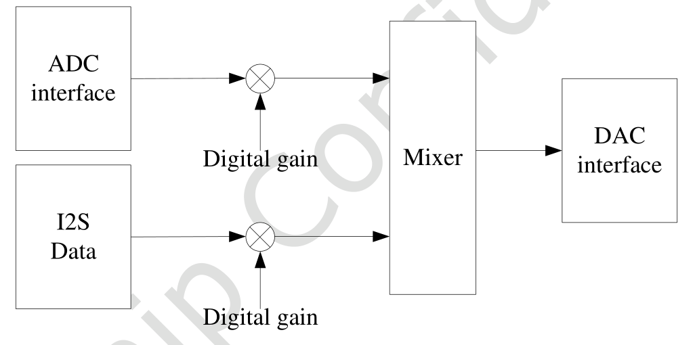
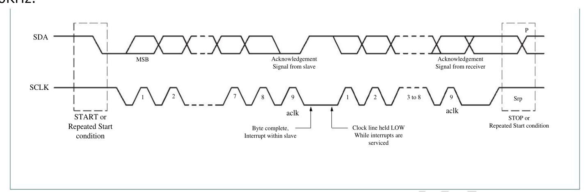
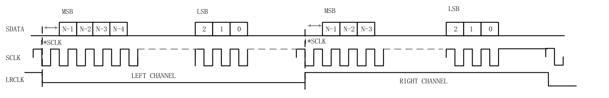
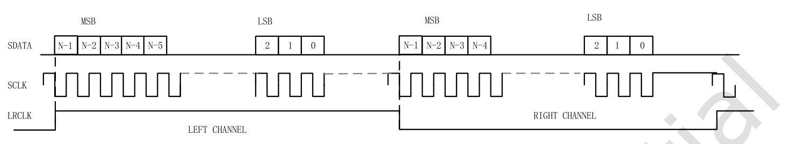
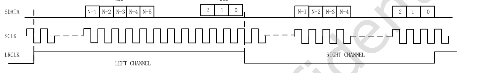
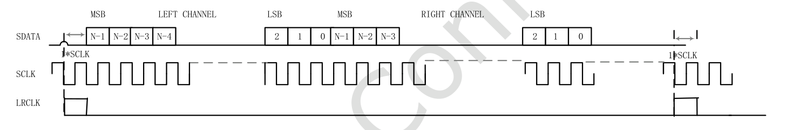
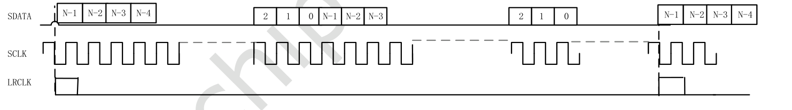

依据 RK730 数据手册 V1.2 更新。文中参数为原厂规格，未进行 ArmSoM 硬件实测；芯片修订、板级连接、SDK/BSP 和驱动应配套核对。所有配图取自本次英文原稿。

*RK730 时钟与音频路径：PLL、I2S、侧音和 I2C 地址*

## 先确定时钟主从关系

先画清 MCLK、BCLK、LRCLK、SDI、SDO 的方向，再设置 Codec。BCLK/LRCLK 是否由主机产生、采样率族、数据位宽和时隙宽度必须一致；I2C 能读到设备不意味着音频时钟正确。排查无声时，先看电源和时钟，再看数字静音、通道使能和模拟输出路径。

## PLL 选择表

| 4-bit 选择 | 参考频率 MHz | 采样率族 | 来源 |
|---|---|---|---|
| 0000 | 12.288 | 48 kHz | MCLK |
| 0001 | 12.288 | 44.1 kHz | MCLK |
| 0010 | 12.288 | 32 kHz | MCLK |
| 0011 | 12 | 48 kHz | MCLK |
| 0100 | 12 | 44.1 kHz | MCLK |
| 0101 | 12 | 32 kHz | MCLK |
| 0110 | 3.072 | 48 kHz | BCLK |
| 0111 | 2.822 | 44.1 kHz | BCLK |
| 1000 | 2.048 | 32 kHz | BCLK |
| 1001 | 24 | 48 kHz | MCLK |
| 1010 | 24 | 44.1 kHz | MCLK |
| 1011 | 24 | 32 kHz | MCLK |
| 1100 | 6.144 | 48 kHz | MCLK |
| 1101 | 11.2896 | 44.1 kHz | MCLK |
| 1110 | 8.192 | 32 kHz | MCLK |
| 1111 | — | — | — |

## 新版 PLL 选择与保留疑点

V1.2 表 4-2 将 `1001–1011` 的 24 MHz 输入明确列为 **MCLK**，已同步修正本页；`0110/0111/1000` 对应 BCLK 3.072/2.822/2.048 MHz。寄存器 `CODEC_SYSPLL_3[7:4]` 中 0x6–0x8 的说明也已更新。`0111` 在新版仍写 2.822 MHz，本页保留该值，实际使用前应核对驱动和时钟，不能自行推断为 2.8224 MHz。`1111` 无有效选择。48 kHz 族列出 12/24/48/96/192 kHz，44.1 kHz 族列出 11.025/22.05/44.1/88.2/176.4 kHz，32 kHz 族列出 8/16/32/64/128 kHz。

## ADC 复制与侧音混合

| 项目 | 规格／原稿说明 |
|---|---|
| ADC 00 | L → L; R → R |
| ADC 01 | L → L/R |
| ADC 10 | R → L/R |
| ADC 11 | L ↔ R |
| Sidetone 0000 | ADC 100% / I2S 0% |
| Sidetone 0001 | ADC 87.5% / I2S 12.5% |
| Sidetone 0010 | ADC 75% / I2S 25% |
| Sidetone 0011 | ADC 62.5% / I2S 37.5% |
| Sidetone 0100 | ADC 50% / I2S 50% |
| Sidetone 0101 | ADC 37.5% / I2S 62.5% |
| Sidetone 0110 | ADC 25% / I2S 75% |
| Sidetone 0111 | ADC 12.5% / I2S 87.5% |
| Sidetone 1XXX (≠1111) | ADC 0% / I2S 100% |
| Sidetone 1111 | (I2S_L + I2S_R) / 2 |

## 侧音信号路径

*ADC 与 I2S 的数字混音*

## I2C 地址选择

地址按 7-bit 表示，读写位另加。CE 选择的是总线从地址，寄存器偏移是另一层地址，不要把 0x16/0x17 当寄存器编号。I2C 上限为 400 kbit/s。调试前先确认主机 I/O 电压及上拉域，并与内核驱动协调，避免同时手动访问。

| 项目 | 规格／原稿说明 |
|---|---|
| CE = 0 | 0x16 |
| CE = 1 | 0x17 |

*I2C 数据传输时序*

## SPI 与五种数字音频时序图

V1.2 新增 SPI 从控制器说明：SPI_CSn 拉低选中，SPI_CLK 由主机产生，SPI_DIN 在上升沿采样。一次写过程包含 3 个 8-bit 字：7-bit 芯片地址加 R/W 位、寄存器地址、寄存器数据。该说明没有给出与 28-pin 表完整对应的 SPI 复用表，不能凭接口名称推断接线；使用前需确认实际芯片及参考电路。音频接口支持 I2S、左对齐、右对齐及 DSP/PCM，PCM 再分 A/B 时序。按下图检查帧边沿、首位相对 LRCLK 的延迟与有效位宽。

*SPI*

*I2S*

*左对齐*

*右对齐*

*DSP/PCM A*

*DSP/PCM B*

## ArmSoM 产品与应用边界

CM1 和 Forge1 可作为音频外设方案的平台参考。本文不宣称它们板载 RK730，也未验证 RK730 驱动可直接使用；须先核对连接器是否引出所需 I2S、I2C、时钟与电压。

- [CM1](https://www.armsom.org/cm1) · [Docs](https://docs.armsom.org/armsom-cm1)
- [Forge1](https://www.armsom.org/armsom-forge1) · [Docs](https://docs.armsom.org/armsom-forge1)

## RK730 延伸阅读

- [RK730 总览](/zh/articles/rk730-audio-codec-design/)
- [RK730 封装、引脚与供电：QFN28 音频 Codec 设计入口](/zh/articles/rk730-package-power-pinout/)
- [RK730 时钟与音频路径：PLL、I2S、侧音和 I2C 地址](/zh/articles/rk730-clocks-audio-i2c/)
- [RK730 寄存器速查：65 个地址、复位值与关键控制域](/zh/articles/rk730-register-map-reference/)
- [RK730 启停流程：系统电源、ADC 录音与 DAC 播放](/zh/articles/rk730-power-adc-dac-sequences/)
