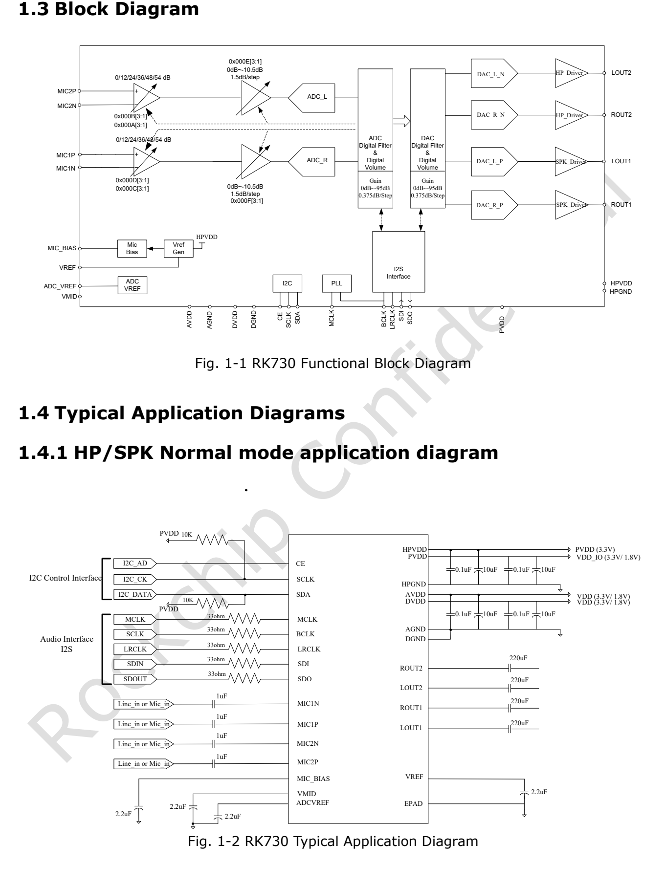
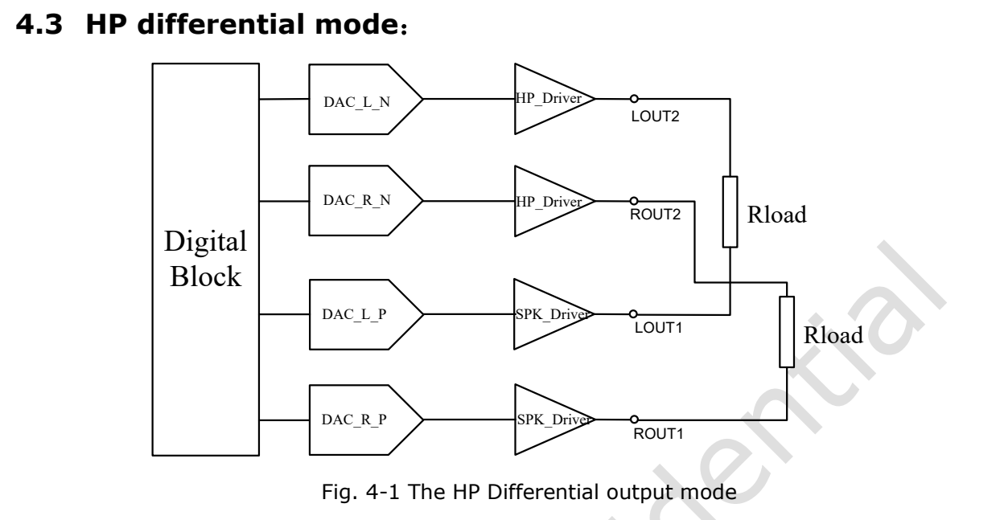
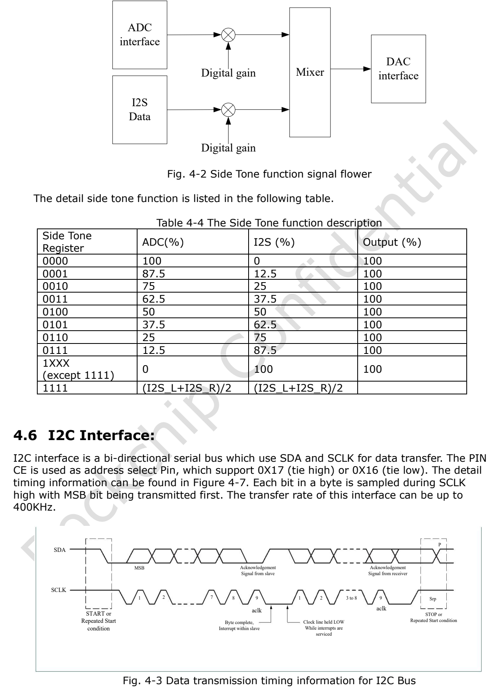

本文基于指定版本数据手册整理。表中数值是原厂规格，不是 ArmSoM 实测；未新增硬件验证。使用前核对实际芯片版本、板卡原理图、SDK/BSP、内核和驱动。专题解释与可编辑表格用于辅助阅读，完整规范及未展开的位定义请查阅原始 PDF。

**RK730 · Rockchip RK730 Datasheet V1.0-20241118.pdf · PDF 16–19.**

*英文原图，来源 PDF 第 9.*

## 先确定时钟主从关系

先画清 MCLK、BCLK、LRCLK、SDI、SDO 的方向，再设置 Codec。BCLK/LRCLK 是否由主机产生、采样率族、数据位宽和时隙宽度必须一致；I2C 能读到设备不意味着音频时钟正确。排查无声时，先看电源和时钟，再看数字静音、通道使能和模拟输出路径。

## PLL 选择表

| 4-bit 选择 | 参考频率 MHz | 采样率族 | 来源 |
|---|---|---|---|
| 0000 | 12.288 | 48 kHz | MCLK |
| 0001 | 12.288 | 44.1 kHz | MCLK |
| 0010 | 12.288 | 32 kHz | MCLK |
| 0011 | 12 | 48 kHz | MCLK |
| 0100 | 12 | 44.1 kHz | MCLK |
| 0101 | 12 | 32 kHz | MCLK |
| 0110 | 3.072 | 48 kHz | BCLK |
| 0111 | 2.822 | 44.1 kHz | BCLK |
| 1000 | 2.048 | 32 kHz | BCLK |
| 1001 | 24 | 48 kHz | BCLK |
| 1010 | 24 | 44.1 kHz | BCLK |
| 1011 | 24 | 32 kHz | BCLK |
| 1100 | 6.144 | 48 kHz | MCLK |
| 1101 | 11.2896 | 44.1 kHz | MCLK |
| 1110 | 8.192 | 32 kHz | MCLK |
| 1111 | — | — | — |

## PLL 表的两处不能擅改

0111 的参考频率原文是 2.822 MHz，不自行改成 2.8224 MHz。1001–1011 的来源写 BCLK、频率 24 MHz，不按习惯改成 MCLK。1111 在原表没有有效选择。表中的采样率族不等于所有模式下支持的任意 Fs，最终应与驱动和实际时钟测量对应。

## ADC 复制与侧音混合

| 项目 | 规格／原稿说明 |
|---|---|
| ADC 00 | L → L; R → R |
| ADC 01 | L → L/R |
| ADC 10 | R → L/R |
| ADC 11 | L ↔ R |
| Sidetone 0000 | ADC 100% / I2S 0% |
| Sidetone 0001 | ADC 87.5% / I2S 12.5% |
| Sidetone 0010 | ADC 75% / I2S 25% |
| Sidetone 0011 | ADC 62.5% / I2S 37.5% |
| Sidetone 0100 | ADC 50% / I2S 50% |
| Sidetone 0101 | ADC 37.5% / I2S 62.5% |
| Sidetone 0110 | ADC 25% / I2S 75% |
| Sidetone 0111 | ADC 12.5% / I2S 87.5% |
| Sidetone 1XXX (≠1111) | ADC 0% / I2S 100% |
| Sidetone 1111 | (I2S_L + I2S_R) / 2 |

## 差分输出与原图

ADC 复制仅作用于 ADC 通路。差分输出图按 ROUT1/ROUT2、LOUT1/LOUT2 成对标注；原文说明出现“ROUT2 and Rout2”重复，不能照着重复名称接线。1111 混音行应结合原表列义与驱动核对，不据此猜测额外模拟混音路径。

*英文原图，来源 PDF 第 17.*

## I2C 地址选择

地址按 7-bit 表示，读写位另加。CE 选择的是总线从地址，寄存器偏移是另一层地址，不要把 0x16/0x17 当寄存器编号。I2C 上限为 400 kbit/s。调试前先确认主机 I/O 电压及上拉域，并与内核驱动协调，避免同时手动访问。

| 项目 | 规格／原稿说明 |
|---|---|
| CE = 0 | 0x16 |
| CE = 1 | 0x17 |

## 原稿补充图示

*英文原图，来源 PDF 第 18.*

## ArmSoM 产品与应用边界

CM1 和 Forge1 可作为音频外设方案的平台参考。本文不宣称它们板载 RK730，也未验证 RK730 驱动可直接使用；须先核对连接器是否引出所需 I2S、I2C、时钟与电压。

- [CM1](https://www.armsom.org/cm1) · [Docs](https://docs.armsom.org/armsom-cm1)
- [Forge1](https://www.armsom.org/forge1) · [Docs](https://docs.armsom.org/armsom-forge1)

## 数据手册专题与原始 PDF

- [RK730 总览](/zh/articles/rk730-audio-codec-design/)
- [RK730 封装、引脚与供电：QFN28 音频 Codec 设计入口](/zh/articles/rk730-package-power-pinout/)
- [RK730 时钟与音频路径：PLL、I2S、侧音和 I2C 地址](/zh/articles/rk730-clocks-audio-i2c/)
- [RK730 寄存器速查：65 个地址、复位值与关键控制域](/zh/articles/rk730-register-map-reference/)
- [RK730 启停流程：系统电源、ADC 录音与 DAC 播放](/zh/articles/rk730-power-adc-dac-sequences/)
- [下载完整原始 PDF](/assets/datasheet-series-20261110/Rockchip-RK730-Datasheet-V1.0-20241118.pdf)
