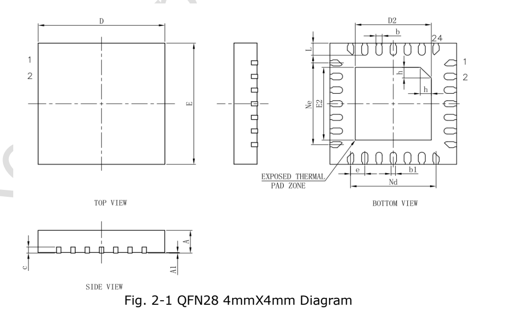
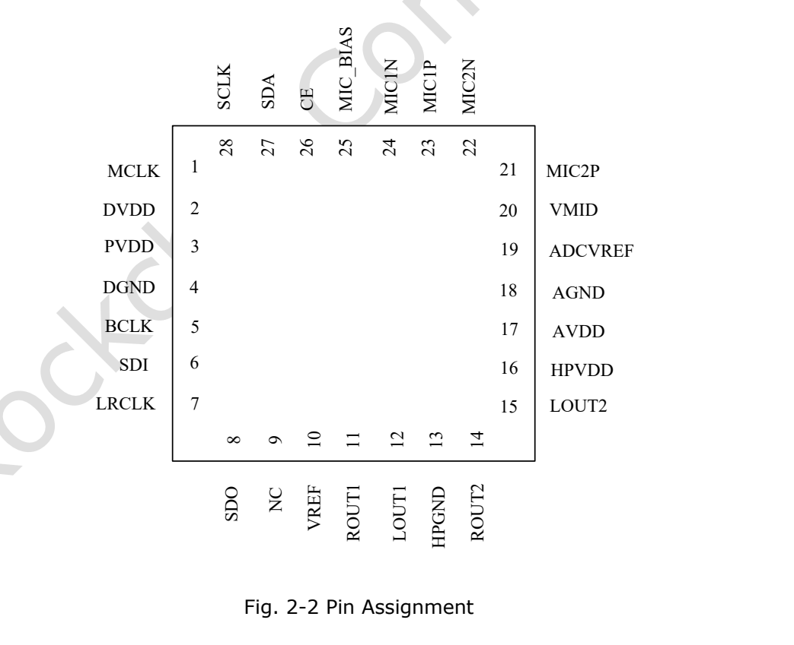

本文基于指定版本数据手册整理。表中数值是原厂规格，不是 ArmSoM 实测；未新增硬件验证。使用前核对实际芯片版本、板卡原理图、SDK/BSP、内核和驱动。专题解释与可编辑表格用于辅助阅读，完整规范及未展开的位定义请查阅原始 PDF。

**RK730 · Rockchip RK730 Datasheet V1.0-20241118.pdf · PDF 7–15.**

*英文原图，来源 PDF 第 11.*

## 音频能力与适用边界

RK730 是外部音频 Codec，包含双 ADC、双 DAC 和耳机输出。平台是否能使用它，取决于 I2S/I2C、供电、时钟和驱动，而不是仅看 SoC 型号。最大输出功率、动态范围和失真对应不同测试条件，不能同时当成单一场景性能。

| 项目 | 规格／原稿说明 |
|---|---|
| ADC / DAC | 2 / 2 · 24 bit · 8–192 kHz |
| 输出功率 | 50 mW / 32 Ω; 100 mW / 16 Ω |
| 差分输出 | 4.8 Vpp at 3.3 V supply |
| 麦克风增益 | ≤54 dB |

## 封装尺寸（mm）

| 符号 | Min / Typ / Max 或原稿值 |
|---|---|
| Package | QFN28 · 4 × 4 mm · 0.45 mm pitch |
| A | 0.70 / 0.75 / 0.80 |
| A1 | 0 / 0.02 / 0.05 |
| b | 0.15 / 0.20 / 0.25 |
| b1 | 0.14 REF |
| c | 0.18 / 0.20 / 0.25 |
| D / E | 3.90 / 4.00 / 4.10 |
| D2 / E2 | 2.30 / 2.40 / 2.50 |
| e | 0.45 BSC |
| Ne / Nd | 2.70 BSC |
| L | 0.35 / 0.40 / 0.45 |
| h | 0.30 / 0.35 / 0.40 |

## 完整引脚表

| 编号 | 名称 | 原表方向 | 功能 |
|---|---|---|---|
| 1 | MCLK | I | 主时钟输入 |
| 2 | DVDD | Supply | 数字电源 |
| 3 | PVDD | Supply | 数字 I/O 电源 |
| 4 | DGND | Supply | 数字地 |
| 5 | BCLK | I/O | 位时钟 |
| 6 | SDI | I | 音频数据输入 |
| 7 | LRCLK | I/O | 左右声道时钟 |
| 8 | SDO | O | 音频数据输出 |
| 9 | NC |  | 不连接 |
| 10 | VREF | O | 参考电压 |
| 11 | ROUT1 | O | 右声道输出 1 |
| 12 | LOUT1 | O | 左声道输出 1 |
| 13 | HPGND | Supply | 耳机地 |
| 14 | ROUT2 | O | 右声道输出 2 |
| 15 | LOUT2 | O | 左声道输出 2 |
| 16 | HPVDD | Supply | 耳机电源 |
| 17 | AVDD | Supply | 模拟电源 |
| 18 | AGND | Supply | 模拟地 |
| 19 | ADCVREF | O | ADC 参考 |
| 20 | VMID | O | 中点参考 |
| 21 | MIC2P | I | 麦克风 2 正输入 |
| 22 | MIC2N | I | 麦克风 2 负输入 |
| 23 | MIC1P | I | 麦克风 1 正输入 |
| 24 | MIC1N | I | 麦克风 1 负输入 |
| 25 | MIC_BIAS | O | 麦克风偏置 |
| 26 | CE | I | I2C 地址选择 |
| 27 | SDA | I/O | I2C 数据 |
| 28 | SCL | O | I2C 时钟；原表方向写 O，需核对 |
| EPAD | EPAD | Supply | 底部焊盘接地 |

## 供电和温度

PVDD 是数字 I/O 电源，DVDD 是数字内部电源，不能只因名称相似就合并设计假设。HPVDD 推荐 3.3 V，其余三组原稿允许 1.8/3.3 V。参考电压脚按原厂电路处理，不当作给外设供电的普通输出。

| 项目 | 规格／原稿说明 |
|---|---|
| PVDD / DVDD / AVDD | Min 1.62 V · Typ 1.8 / 3.3 V · Max 3.6 V |
| HPVDD | Min 3.0 V · Typ 3.3 V · Max 3.6 V |
| 电源／输入绝对范围 | −0.3…3.6 V |
| 原表工作温度 | −40…85 °C |
| 存储温度 | −65…150 °C |

## 音频测试条件与原文冲突

ADC 动态范围在功能列表为 100 dB，而电气表为 101 dB（A 加权）；本专题保留电气表条件，不静默合并。引脚 28 在表中写 SCL、方向 O，而接口描述是 I2C 时钟，方向应按实际设计和最新文档核对。下列质量指标属于原厂资料，不是 CM1 或 Forge1 实测。

| 项目 | 规格／原稿说明 |
|---|---|
| ADC | Full scale 1 Vrms; SNR 100 dB; dynamic range 101 dB A-weighted; THD −95 dB typ; input 20 kΩ |
| ADC filter | Passband 0.4917 Fs; stopband 0.5479 Fs; ripple 0.05 dB; attenuation 100 dB |
| DAC normal | 1 Vrms; SNR 98 dB; dynamic range 100 dB; THD −85 dB |
| DAC differential | 2 Vrms; SNR 98 dB; dynamic range 103 dB; THD −88 dB |

## 原稿补充图示

*英文原图，来源 PDF 第 12.*

## ArmSoM 产品与应用边界

CM1 和 Forge1 可作为音频外设方案的平台参考。本文不宣称它们板载 RK730，也未验证 RK730 驱动可直接使用；须先核对连接器是否引出所需 I2S、I2C、时钟与电压。

- [CM1](https://www.armsom.org/cm1) · [Docs](https://docs.armsom.org/armsom-cm1)
- [Forge1](https://www.armsom.org/forge1) · [Docs](https://docs.armsom.org/armsom-forge1)

## 数据手册专题与原始 PDF

- [RK730 总览](/zh/articles/rk730-audio-codec-design/)
- [RK730 封装、引脚与供电：QFN28 音频 Codec 设计入口](/zh/articles/rk730-package-power-pinout/)
- [RK730 时钟与音频路径：PLL、I2S、侧音和 I2C 地址](/zh/articles/rk730-clocks-audio-i2c/)
- [RK730 寄存器速查：65 个地址、复位值与关键控制域](/zh/articles/rk730-register-map-reference/)
- [RK730 启停流程：系统电源、ADC 录音与 DAC 播放](/zh/articles/rk730-power-adc-dac-sequences/)
- [下载完整原始 PDF](/assets/datasheet-series-20261110/Rockchip-RK730-Datasheet-V1.0-20241118.pdf)
