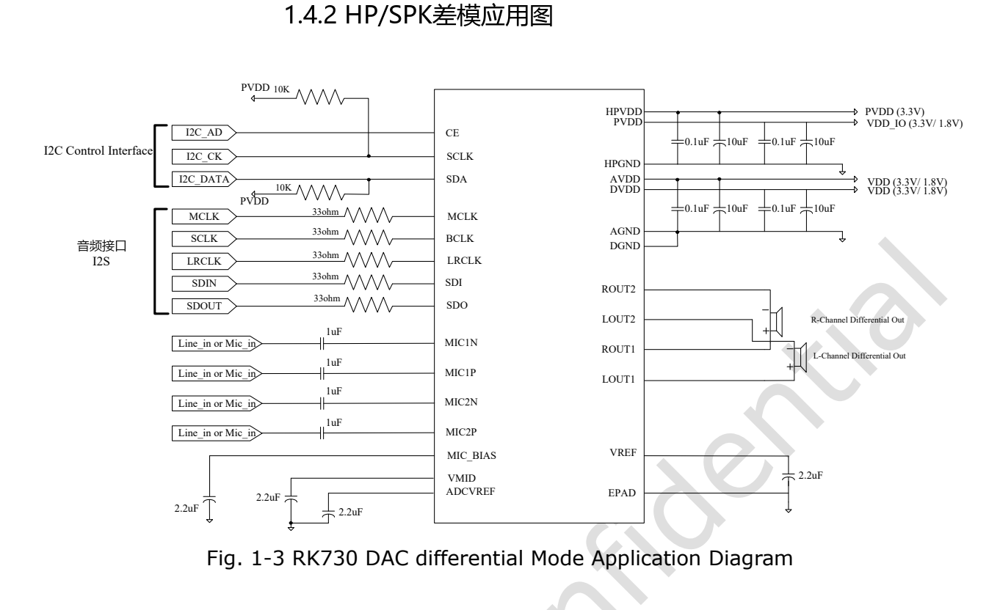

本文基于指定版本数据手册整理。表中数值是原厂规格，不是 ArmSoM 实测；未新增硬件验证。使用前核对实际芯片版本、板卡原理图、SDK/BSP、内核和驱动。专题解释与可编辑表格用于辅助阅读，完整规范及未展开的位定义请查阅原始 PDF。

**RK730 · Rockchip RK730 Datasheet V1.0-20241118.pdf · PDF 44–46.**

*英文原图，来源 PDF 第 10.*

## 这些是流程参考，不是可直接执行脚本

下表按 PDF 第 44–46 页从上到下整理。位域赋值表示修改指定比特，不等于用该数值覆盖整个寄存器；应保留其他位并遵守驱动锁和电源管理。原稿没有明确给出的等待时间，不自行编造。运行前需核对当前驱动、时钟、通道映射和板卡模拟电路。

## 六组完整步骤

### 系统上电

| 阅读顺序 | 原稿编号 | 位域赋值 | 动作／控制组 |
|---|---|---|---|
| 1 | 0 | — | 供给模拟与数字电源 |
| 2 | 1 | `0x1F[7]=1'b1` | 使能 LDO VMID |
| 3 | 2 | `0x10[7:0]=8'b00000000` | 系统 PLL 控制 |

### 系统掉电

| 阅读顺序 | 原稿编号 | 位域赋值 | 动作／控制组 |
|---|---|---|---|
| 1 | 0 | — | 保持供电，先关闭 DAC 和 ADC |
| 2 | 1 | `0x10[7:0]=8'b11111111` | 系统 PLL 掉电 |
| 3 | 2 | `0x1F[7]=1'b0` | 关闭 LDO VMID |
| 4 | 3 | — | 关闭模拟与数字电源 |

### ADC 使能

| 阅读顺序 | 原稿编号 | 位域赋值 | 动作／控制组 |
|---|---|---|---|
| 1 | 0 | — | 完成系统上电 |
| 2 | 1 | `0x01[7]=1'b0` | HK_TOP_1 |
| 3 | 2 | `0x0A[0]=1'b0` | MIC_BOOST_0 |
| 4 | 3 | `0x0B[0]=1'b0` | MIC_BOOST_1 |
| 5 | 4 | `0x0C[0]=1'b0` | MIC_BOOST_2 |
| 6 | 5 | `0x0D[0]=1'b0; 0x0D[7:6]=2'b01` | MIC_BOOST_3 |
| 7 | 6 | `0x0E[0]=1'b0` | ADC_PGA_BLOCK_0 |
| 8 | 7 | `0x0F[0]=1'b0; 0x0F[7:6]=2'b01` | ADC_PGA_BLOCK_1 |
| 9 | 8 | `0x04[1:0]=2'b00` | ADC_0 |
| 10 | 9 | `0x06[4]=1'b1; 0x06[3]=1'b1` | ADC_2 |
| 11 | 10 | `0x07[5:4]=2'b01` | ADC_3 |
| 12 | 11 | `0x41[2:0]=3'b010` | SRT |
| 13 | 12 | `0x44[7]=1'b1` | VUCTL |
| 14 | 13 | `0x69[0]=1'b0` | I2S_CKM |
| 15 | 14 | `0x6F[6]=1'b0` | I2S_TXCR1 |
| 16 | 15 | `0x71[7:0]=8'b10001000` | I2S_TXCMD |
| 17 | 16 | `0x40[7:6]=2'b11` | DIGEN |
| 18 | 17 | `0x40[5:4]=2'b11` | DIGEN |
| 19 | 18 | — | 开始录音 |

### ADC 关闭（保留原稿步骤编号）

| 阅读顺序 | 原稿编号 | 位域赋值 | 动作／控制组 |
|---|---|---|---|
| 1 | 0 | — | 停止录音，暂保留通道 |
| 2 | 1 | `0x40[5:4]=2'b00` | DIGEN |
| 3 | 2 | `0x40[7:6]=2'b00` | DIGEN |
| 4 | 3 | `0x71[7:0]=8'b00000000` | I2S_TXCMD |
| 5 | 8 | `0x04[1:0]=2'b11` | ADC_0 |
| 6 | 7 | `0x0F[0]=1'b1; 0x0E[0]=1'b1` | ADC_PGA_BLOCK_1 / ADC_PGA_BLOCK_0 |
| 7 | 6 | `0x0D[0]=1'b1` | MIC_BOOST_3 |
| 8 | 4 | `0x0C[0]=1'b1` | MIC_BOOST_2 |
| 9 | 3 | `0x0B[0]=1'b1` | MIC_BOOST_1 |
| 10 | 2 | `0x0A[0]=1'b1` | MIC_BOOST_0 |
| 11 | 1 | `0x01[7]=1'b1` | HK_TOP_1 |

### DAC 使能

| 阅读顺序 | 原稿编号 | 位域赋值 | 动作／控制组 |
|---|---|---|---|
| 1 | 0 | — | 完成系统上电 |
| 2 | 1 | `0x01[7:6]=2'b00` | HK_TOP_1 |
| 3 | 2 | `0x41[6:4]=3'b010` | SRT |
| 4 | 3 | `0x44[6]=1'b1` | VUCTL |
| 5 | 4 | `0x69[7:0]=8'b00111010` | I2S_CKM |
| 6 | 5 | `0x40[7:4]=4'b0101` | DIGEN |
| 7 | 6 | `0x40[7:4]=4'b0000` | DIGEN |
| 8 | 7 | `0x69[7:0]=8'b00000000` | I2S_CKM |
| 9 | 8 | `0x6E[7]=1'b1` | I2S_RXCMD |
| 10 | 9 | `0x40[3:0]=4'b0101` | DIGEN |
| 11 | 10 | `0x40[3:0]=4'b1111` | DIGEN |
| 12 | 11 | `0x4F[7:4]=4'b0000` | DDAC_FILTER |
| 13 | 12 | `0x08[2:0]=3'b000` | DAC_0 |
| 14 | 13 | `0x09[6:4]=3'b000` | DAC_1 |
| 15 | 14 | `0x21[7:0]=8'b10000000` | HP_0 |
| 16 | 15 | `0x24[7:0]=8'b10000000` | SPK_0 |
| 17 | 16 | — | 开始播放 |

### DAC 关闭

| 阅读顺序 | 原稿编号 | 位域赋值 | 动作／控制组 |
|---|---|---|---|
| 1 | 0 | — | 先静音 |
| 2 | 1 | `0x24[3:2]=2'b11` | SPK_0 |
| 3 | 2 | `0x21[3:2]=2'b11` | HP_0 |
| 4 | 3 | `0x09[6:4]=3'b111` | DAC_1 |
| 5 | 4 | `0x08[2:0]=3'b111` | DAC_0 |
| 6 | 5 | `0x40[3:0]=4'b0101` | DIGEN |
| 7 | 6 | `0x40[3:0]=4'b0000` | DIGEN |
| 8 | 7 | `0x6E[7]=1'b0` | I2S_RXCMD |
| 9 | 8 | `0x01[7:6]=2'b11` | HK_TOP_1 |

## 编号冲突与跨页续行

ADC 关闭的原稿编号依次为 0、1、2、3、8、7、6、4、3、2、1，存在重复与倒序。本文保留原稿编号并另列阅读顺序，绝不按数字重新排序。ADC 使能步骤 9 跨页，0x06[4] 和 0x06[3] 两项均已保留。DAC 使能对 DIGEN 先写 0101 再写 0000 的过渡步骤也未删去；不能因最终值重复就合并操作。

## 板级验证应记录什么

记录实际电源轨、MCLK/BCLK/LRCLK 波形、驱动版本、采样参数以及启停前后寄存器差异。先用已知幅度的输入检查 ADC，再在明确负载下检查 DAC；检查静音、噪声、爆音和恢复路径。系统掉电需要先关闭音频路径，不只切断外部供电。此处给的是验证建议，没有宣称这些流程已在 ArmSoM 产品上完成测试。

## ArmSoM 产品与应用边界

CM1 和 Forge1 可作为音频外设方案的平台参考。本文不宣称它们板载 RK730，也未验证 RK730 驱动可直接使用；须先核对连接器是否引出所需 I2S、I2C、时钟与电压。

- [CM1](https://www.armsom.org/cm1) · [Docs](https://docs.armsom.org/armsom-cm1)
- [Forge1](https://www.armsom.org/forge1) · [Docs](https://docs.armsom.org/armsom-forge1)

## 数据手册专题与原始 PDF

- [RK730 总览](/zh/articles/rk730-audio-codec-design/)
- [RK730 封装、引脚与供电：QFN28 音频 Codec 设计入口](/zh/articles/rk730-package-power-pinout/)
- [RK730 时钟与音频路径：PLL、I2S、侧音和 I2C 地址](/zh/articles/rk730-clocks-audio-i2c/)
- [RK730 寄存器速查：65 个地址、复位值与关键控制域](/zh/articles/rk730-register-map-reference/)
- [RK730 启停流程：系统电源、ADC 录音与 DAC 播放](/zh/articles/rk730-power-adc-dac-sequences/)
- [下载完整原始 PDF](/assets/datasheet-series-20261110/Rockchip-RK730-Datasheet-V1.0-20241118.pdf)
