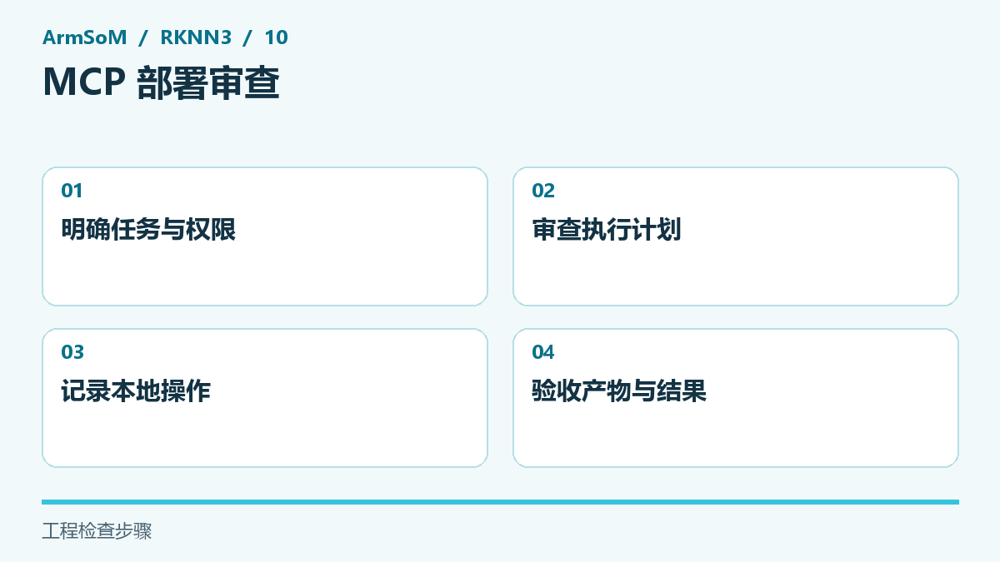

自然语言可以降低使用工具的门槛，但工程交付仍需要可追溯的计划、输入和验收标准。RKNN3 MCP 适合放在开发流程的辅助层，而不是把模型可用性判断交给一句“部署成功”。

> 本文为基于官方文档的原创技术解读与实施建议。尚未在 ArmSoM 硬件上验证本流程；具体支持范围需匹配目标芯片、SDK、Runtime、驱动和固件。

[](/assets/rknn3-v120/rknn3-v010-mcp-deployment-zh.svg)

*ArmSoM 原创流程图：实施步骤示意，不代表硬件测试结果。点击可查看矢量图。*

## 区分 MCP 服务与本地执行者

V0.1.0 指南说明，MCP Server 提供知识、规划、参数校验与任务状态管理；实际模型处理及开发板操作由客户端 Agent 在本地或工作服务器环境中执行。文档声明 MCP Server 不直接读取客户端文件或执行客户端程序。

因此，评估数据流时既要看 MCP 服务，也要看客户端 Agent 及其工具实际发送、读取和执行了什么，不能把服务端边界理解成整个工作流不可能传输数据。

## 给 Agent 一份具体任务说明

下面是编辑编写的需求模板，不是会自动执行的命令：

```text
Target chip and board revision:
SDK, Runtime and firmware versions:
Model path and checksum:
Input shapes and preprocessing:
Required output and quality threshold:
Allowed directories and device access:
Actions requiring human approval:
Evidence required for completion:
```

越早把目标和限制写清楚，越容易发现模型不适配、环境缺项或权限过宽等问题。

## 将任务拆成可以验收的关口

| 阶段 | 审查重点 |
| --- | --- |
| 分析 | 模型、平台和环境是否匹配 |
| 计划 | 会修改什么，预计生成什么 |
| 执行 | 命令、日志、返回值与产物 |
| 验证 | 精度、设备结果及未完成项 |
| 交接 | 文件位置、版本、恢复步骤 |

不要仅用“工具调用完成”判定整个项目完成。文件生成、转换成功、设备运行和业务验收是不同的检查结果。

## 连接前先理解能力范围

官方给出的服务地址是 `https://rknn-mcp.rock-chips.com/mcp`，传输方式为 Streamable HTTP。本文没有连接该服务，也没有替你配置 Agent、上传模型或授权开发板访问。

使用时应准备版本匹配的工具环境，先从范围明确的模型分析任务开始。只有实际需要连板验证时，才提供对应设备连接信息。

## 让中断后的恢复有依据

保存最后成功阶段、产物校验值、环境记录及未解决问题。恢复任务时先核对这些状态，避免重新使用过期结果。面向 ArmSoM 项目，最终仍应由可复现的板端结果和业务标准决定是否通过，而不是只看自动化流程是否走到了最后一步。

## 结合 ArmSoM 规划项目

如果项目考虑使用 ArmSoM 作为应用主机，可先查看 [Sige7](https://www.armsom.org/sige7)、[Sige5](https://www.armsom.org/sige5) 和 [CM5](https://www.armsom.org/cm5) 的产品资料，按实际板卡与载板版本核对接口、供电、系统镜像及驱动。这是主机选型参考，不是 RK182X 扩展模块的即插即用兼容声明。RK3588 / RK3576 的片内 NPU 应使用对应的 RKNN Toolkit2 软件栈，不能因主机型号而切换到 RKNN3。

相关接口与模块资料: [RK182X M.2](/zh/articles/rk182x-m2-module-guide/) · [RK182X SO-DIMM](/zh/articles/rk182x-sodimm-module-datasheet/) · [RK3572 Datasheet V1.0](/zh/articles/rk3572-datasheet-v10/)

## 官方文档与版本

依据官方仓库固定快照 `141883c8e11b0`（2026-11-14 核对）。完整接口、参数和限制请查原文。本文不替代官方手册，未转载整份 PDF。

- <a href="https://github.com/airockchip/rknn3-toolkit/blob/141883c8e11b05ef4cca4a69d8a7572c4d855191/doc/CN/09_RKNN3_MCP_%E5%BF%AB%E9%80%9F%E5%85%A5%E9%97%A8_V0.1.0.pdf">官方中文 PDF (V0.1.0)</a>
- <a href="https://github.com/airockchip/rknn3-toolkit/blob/141883c8e11b05ef4cca4a69d8a7572c4d855191/doc/EN/09_RKNN3_MCP_QuickStart_V0.1.0.pdf">官方英文 PDF (V0.1.0)</a>
- [全部官方文档](https://github.com/airockchip/rknn3-toolkit/tree/main/doc)

## 本系列阅读顺序

- [系列总览](/zh/articles/rknn3-v120-platform-guide/)
- 上一篇: [RKNN3 MoE 导出：先验证路由专家，再验证完整模型](/zh/articles/rknn3-v120-moe-export/)
