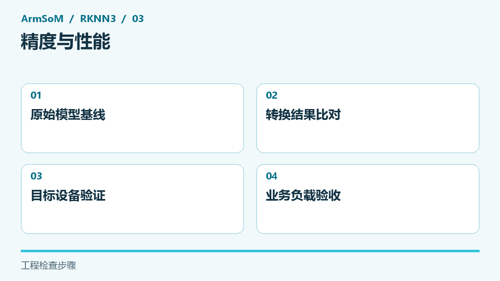

转换成功只回答“生成了产物”，没有回答“结果是否正确、设备是否够快、服务能否长时间运行”。RKNN3 项目应在优化之前建立验收规则，否则一次更快的运行可能掩盖精度下降或内存增长。

> 本文为基于官方文档的原创技术解读与实施建议。尚未在 ArmSoM 硬件上验证本流程；具体支持范围需匹配目标芯片、SDK、Runtime、驱动和固件。

[](/assets/rknn3-v120/rknn3-v120-accuracy-performance-zh.svg)

*ArmSoM 原创流程图：实施步骤示意，不代表硬件测试结果。点击可查看矢量图。*

## 先保存可信的参考结果

开发指南围绕转换、量化、评估和板端部署组织流程，并覆盖 KV Cache、LoRA、PagedAttention 等高级能力。实际工程中，先固定原始模型和预处理，再把转换产物放入同一测试集比较。

视觉任务需要同时保存输入图像和预处理后的张量；语言任务需要保存文本、模板、分词配置和生成条件。用同一个文件名代替完整处理记录，往往会漏掉颜色通道、缩放或提示词差异。

## 为三类目标分别设门槛

| 维度 | 关注的结果 | 不充分的证据 |
| --- | --- | --- |
| 精度 | 业务指标与失败样本分布 | 一张看起来正确的截图 |
| 延迟 | 首次、稳态及高分位延迟 | 只给最快的一次 |
| 内存 | 峰值与重复运行后的变化 | 只给启动后的占用 |

门槛由应用决定。交互终端更关注等待体验；检测流水线还要考虑漏检代价和队列积压。不要用同一指标替代所有业务目标。

## 建立能区分原因的对照实验

推荐依次比较原始模型、转换后未量化模型、量化模型和设备端结果。每轮只改变一个主要条件。精度异常时，先确认输入完全一致，再定位最早出现明显误差的位置。

对于生成式模型，输出措辞不同不一定等于失败。准备事实性问题、格式要求、长输入和异常输入，并明确评分方法。报告中同时列出失败案例，避免只挑选好看的回答。

## 拆开记录端到端时间

建议分别测量输入获取、预处理、排队、推理和后处理。若用户感到慢，单独提升推理速度未必能解决问题。异步流水线各阶段可能重叠，不能把不同时间窗口的测量值简单相加。

下面是编辑建议的结果字段，填写真实测量值，不预设成绩：

```text
case_id,model_sha256,input_sha256,run_mode,
load_ms,queue_ms,inference_ms,end_to_end_ms,
peak_memory_mb,quality_score,error
```

## 优化之后做回归

保留一组固定回归样本，再增加现场数据。更换量化方案、缓存策略或并发量后，重新检查精度、资源释放和异常恢复。文档中的能力或示例数据不作为 ArmSoM 产品实测；本篇提供验证方法，没有运行硬件基准。

## 结合 ArmSoM 规划项目

如果项目考虑使用 ArmSoM 作为应用主机，可先查看 [Sige7](https://www.armsom.org/sige7)、[Sige5](https://www.armsom.org/sige5) 和 [CM5](https://www.armsom.org/cm5) 的产品资料，按实际板卡与载板版本核对接口、供电、系统镜像及驱动。这是主机选型参考，不是 RK182X 扩展模块的即插即用兼容声明。RK3588 / RK3576 的片内 NPU 应使用对应的 RKNN Toolkit2 软件栈，不能因主机型号而切换到 RKNN3。

相关接口与模块资料: [RK182X M.2](/zh/articles/rk182x-m2-module-guide/) · [RK182X SO-DIMM](/zh/articles/rk182x-sodimm-module-datasheet/) · [RK3572 Datasheet V1.0](/zh/articles/rk3572-datasheet-v10/)

## 官方文档与版本

依据官方仓库固定快照 `141883c8e11b0`（2026-11-14 核对）。完整接口、参数和限制请查原文。本文不替代官方手册，未转载整份 PDF。

- <a href="https://github.com/airockchip/rknn3-toolkit/blob/141883c8e11b05ef4cca4a69d8a7572c4d855191/doc/CN/02_RKNN3_SDK_%E5%BC%80%E5%8F%91%E6%8C%87%E5%8D%97_V1.2.0.pdf">官方中文 PDF (V1.2.0)</a>
- <a href="https://github.com/airockchip/rknn3-toolkit/blob/141883c8e11b05ef4cca4a69d8a7572c4d855191/doc/EN/02_RKNN3_SDK_Development_Guide_V1.2.0.pdf">官方英文 PDF (V1.2.0)</a>
- [全部官方文档](https://github.com/airockchip/rknn3-toolkit/tree/main/doc)

## 本系列阅读顺序

- [系列总览](/zh/articles/rknn3-v120-platform-guide/)
- 上一篇: [RKNN3 首次部署：从环境核对到第一组可复现结果](/zh/articles/rknn3-v120-first-deployment/)
- 下一篇: [RKNN3 Toolkit Python：模型转换脚本怎样做到可追溯](/zh/articles/rknn3-v120-toolkit-python-workflow/)
