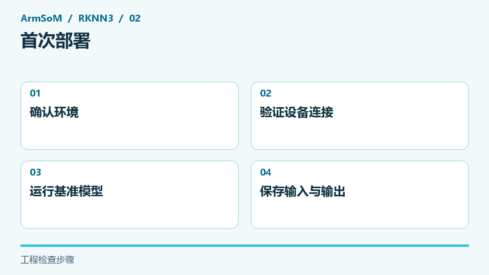

第一次部署的目标应当具体：在明确的软件版本和连接方式下，对一组已知输入获得可核对的输出。先跑通这条最小路径，再加入摄像头、容器、业务服务或多个模型，排障成本会低得多。

> 本文为基于官方文档的原创技术解读与实施建议。尚未在 ArmSoM 硬件上验证本流程；具体支持范围需匹配目标芯片、SDK、Runtime、驱动和固件。

[](/assets/rknn3-v120/rknn3-v120-first-deployment-zh.svg)

*ArmSoM 原创流程图：实施步骤示意，不代表硬件测试结果。点击可查看矢量图。*

## 把环境分成三个位置

分别记录转换电脑、运行应用的主机、执行计算的目标芯片。协处理器模式下这三者不一定是同一台设备。不要只填写“Linux”或“Windows”，还需要系统版本、CPU 架构、Python ABI 和运行库位置。

快速入门包含 RK182X 与 RK3572 两条路径，并区分开发板主机和 PC 主机。macOS 章节的 USB 主机通信不等于 Toolkit 支持连板评估；Toolkit 的 macOS 能力范围应按对应 API 文档单独核对。

## 先准备一张交接表

| 项目 | 应保存的证据 |
| --- | --- |
| 设备身份 | 板型、硬件修订、目标芯片 |
| 软件身份 | 镜像来源、包版本、模型校验值 |
| 连接路径 | 具体端口、线缆、设备枚举结果 |
| 正确性 | 固定输入与预期结果 |
| 可恢复性 | 失败日志和恢复步骤 |

这张表适合交给另一位工程师复现。只记录“昨天可以运行”无法区分换线、换镜像、换模型或换环境造成的变化。

## 使用自己的环境检查记录

下面是编辑编写的环境记录命令，不会安装软件，也不会连接开发板。在计划使用的 Python 环境中执行：

```bash
python -c "import sys, platform; print(sys.executable); print(sys.version); print(platform.platform()); print(platform.machine())"
python -m pip --version
python -m pip check
```

保存输出后，再选择与实际平台、Python 和版本匹配的安装包。包名相似不代表可互换，不要让多个工具链共用一个长期堆积依赖的环境。

## 逐层确认，避免一次接入整个业务

先检查供电与设备枚举，再检查通信服务，然后运行官方匹配版本示例，最后替换为自己的输入。任何一层失败，都应保留该层日志，不要同时更换 Runtime、模型和线缆。

加入摄像头后，先把一帧图像保存为文件，与离线输入比较；加入网络服务后，先保持单请求。这样能识别问题来自输入格式、计算链路还是服务调度。

## 第一次成功后还要留下什么

保存完整命令、工作目录、输入文件、输出及日志。记录首次加载与后续运行的区别，并关闭进程后重新验证。只有重启后仍可复现，才适合继续讨论性能优化。本文提供实施顺序，未执行刷机、板端推理或 ArmSoM 硬件兼容性测试。

## 结合 ArmSoM 规划项目

如果项目考虑使用 ArmSoM 作为应用主机，可先查看 [Sige7](https://www.armsom.org/sige7)、[Sige5](https://www.armsom.org/sige5) 和 [CM5](https://www.armsom.org/cm5) 的产品资料，按实际板卡与载板版本核对接口、供电、系统镜像及驱动。这是主机选型参考，不是 RK182X 扩展模块的即插即用兼容声明。RK3588 / RK3576 的片内 NPU 应使用对应的 RKNN Toolkit2 软件栈，不能因主机型号而切换到 RKNN3。

相关接口与模块资料: [RK182X M.2](/zh/articles/rk182x-m2-module-guide/) · [RK182X SO-DIMM](/zh/articles/rk182x-sodimm-module-datasheet/) · [RK3572 Datasheet V1.0](/zh/articles/rk3572-datasheet-v10/)

## 官方文档与版本

依据官方仓库固定快照 `141883c8e11b0`（2026-11-14 核对）。完整接口、参数和限制请查原文。本文不替代官方手册，未转载整份 PDF。

- <a href="https://github.com/airockchip/rknn3-toolkit/blob/141883c8e11b05ef4cca4a69d8a7572c4d855191/doc/CN/01_RKNN3_SDK_%E5%BF%AB%E9%80%9F%E5%85%A5%E9%97%A8_V1.2.0.pdf">官方中文 PDF (V1.2.0)</a>
- <a href="https://github.com/airockchip/rknn3-toolkit/blob/141883c8e11b05ef4cca4a69d8a7572c4d855191/doc/EN/01_RKNN3_SDK_QuickStart_V1.2.0.pdf">官方英文 PDF (V1.2.0)</a>
- [全部官方文档](https://github.com/airockchip/rknn3-toolkit/tree/main/doc)

## 本系列阅读顺序

- [系列总览](/zh/articles/rknn3-v120-platform-guide/)
- 下一篇: [RKNN3 模型验证：把精度、延迟和内存放到同一张验收表](/zh/articles/rknn3-v120-accuracy-performance/)
