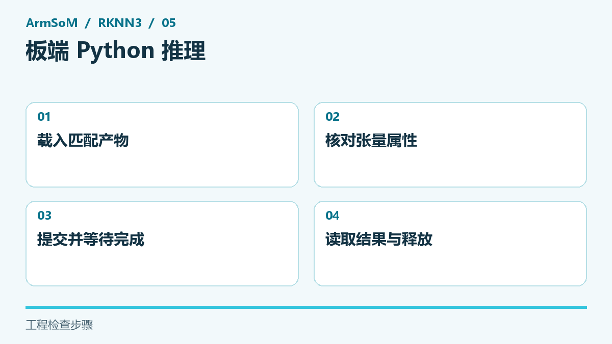

Python 适合把推理接入摄像头、消息队列和原型应用，但高级接口不会自动消除设备内存、异步任务和会话状态的复杂度。先跑通单请求，再引入并发，通常更容易形成可靠的板端程序。

> 本文为基于官方文档的原创技术解读与实施建议。尚未在 ArmSoM 硬件上验证本流程；具体支持范围需匹配目标芯片、SDK、Runtime、驱动和固件。

*ArmSoM 原创流程图：实施步骤示意，不代表硬件测试结果。点击可查看矢量图。*

## Lite 负责运行，不负责转换

V1.2.0 参考将 `RKNN3Lite` 定位为运行已转换模型的 Python 接口，依赖匹配的 Runtime。文档分别讨论同步/异步推理、张量属性、LLM Session、回调和内存生命周期；模型转换由 Toolkit 负责。

因此，不能把开发电脑上能导入转换工具当成板端环境已经就绪。先核对 Python 包与共享库的实际版本，再核对模型来自哪一次构建。

## 输入检查应该留在业务边界

应用收到图像、音频或张量时，应尽早检查尺寸、类型、布局及批次含义。避免把所有输入都无条件转换成某种类型：这可能掩盖上游变化，并使错误延迟到推理阶段才暴露。

| 边界 | 建议检查 |
| --- | --- |
| 数据进入应用 | 格式、尺寸、缺失值与来源 |
| 数据进入模型 | 张量属性、预处理和数据连续性 |
| 模型产生输出 | 输出数量、结构与异常结果 |
| 结果进入业务 | 阈值、坐标或文本解析规则 |

测试中应保留一份已知正确的离线输入，用来隔离摄像头、解码器和网络带来的变量。

## 异步提交后不要立即复用输入

接口提供 `inference_async`，但提交返回和计算完成是不同事件。必须按照对应等待接口的约定确认完成，再访问结果或回收任务使用的对象。回调也需要有明确生命周期。

设计缓冲区池时，为每个槽位记录“空闲、处理中、可读取”状态。只允许状态合法迁移；若队列满了，明确选择丢弃、阻塞还是拒绝请求，避免无限堆积。

## LLM 会话与用户请求要能对应

将业务会话映射到运行时 Session，并在取消、超时和用户退出时执行明确的清理流程。测试两个会话交替发起请求，确认应用没有串用上下文或回调对象。内存复用与会话复用需要分别验证。

## 从原型进入长时运行

在正常输入之外，加入空输入、尺寸错误、主动取消和连续重建任务。记录失败是否可恢复、占用是否回落、下一个请求能否正常工作。这里没有进行设备实测；部署到 ArmSoM 主机方案前，仍需核对实际加速器、镜像与 Runtime。

## 结合 ArmSoM 规划项目

如果项目考虑使用 ArmSoM 作为应用主机，可先查看 [Sige7](https://www.armsom.org/sige7)、[Sige5](https://www.armsom.org/sige5) 和 [CM5](https://www.armsom.org/cm5) 的产品资料，按实际板卡与载板版本核对接口、供电、系统镜像及驱动。这是主机选型参考，不是 RK182X 扩展模块的即插即用兼容声明。RK3588 / RK3576 的片内 NPU 应使用对应的 RKNN Toolkit2 软件栈，不能因主机型号而切换到 RKNN3。

相关接口与模块资料: [RK182X M.2](/zh/articles/rk182x-m2-module-guide/) · [RK182X SO-DIMM](/zh/articles/rk182x-sodimm-module-datasheet/) · [RK3572 Datasheet V1.0](/zh/articles/rk3572-datasheet-v10/)

## 官方文档与版本

依据官方仓库固定快照 `141883c8e11b0`（2026-11-14 核对）。完整接口、参数和限制请查原文。本文不替代官方手册，未转载整份 PDF。

- <a href="https://github.com/airockchip/rknn3-toolkit/blob/141883c8e11b05ef4cca4a69d8a7572c4d855191/doc/CN/04_RKNN3_Toolkit_Lite_Python_API_%E5%8F%82%E8%80%83_V1.2.0.pdf">官方中文 PDF (V1.2.0)</a>
- <a href="https://github.com/airockchip/rknn3-toolkit/blob/141883c8e11b05ef4cca4a69d8a7572c4d855191/doc/EN/04_RKNN3_Toolkit_Lite_Python_API_Reference_V1.2.0.pdf">官方英文 PDF (V1.2.0)</a>
- [全部官方文档](https://github.com/airockchip/rknn3-toolkit/tree/main/doc)

## 本系列阅读顺序

- [系列总览](/zh/articles/rknn3-v120-platform-guide/)
- 上一篇: [RKNN3 Toolkit Python：模型转换脚本怎样做到可追溯](/zh/articles/rknn3-v120-toolkit-python-workflow/)
- 下一篇: [RKNN3 C Runtime：上下文、模型、会话与内存的生命周期](/zh/articles/rknn3-v120-runtime-c-lifecycle/)
