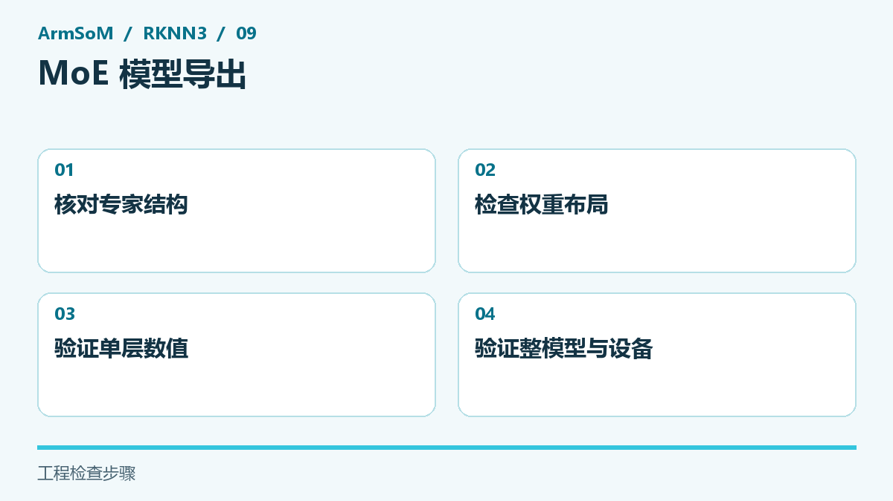

MoE 的稀疏激活方式让“每次使用多少专家”和“总共保存多少参数”成为不同问题。做端侧部署时，不能只看激活参数量，还要考虑权重、路由、缓存与完整模型的资源需求。

> 本文为基于官方文档的原创技术解读与实施建议。尚未在 ArmSoM 硬件上验证本流程；具体支持范围需匹配目标芯片、SDK、Runtime、驱动和固件。

*ArmSoM 原创流程图：实施步骤示意，不代表硬件测试结果。点击可查看矢量图。*

## 先确认导出边界

V1.2.0 适配文档用 `rknn::exUnifiedMoE` 表达路由专家，shared expert 及其合并逻辑保留在节点外。该节点当前输入 batch 限定为 1；矩阵权重约定为 `[in,out]`。

导出工具应先确认原始权重的布局，再决定是否转置。重复转置会把已正确的数据重新改错，单靠维度“看起来合理”不一定能发现问题。

## 将结构审查与数值审查分开

| 审查 | 要保存的证据 |
| --- | --- |
| 结构 | 专家数量、路由规则、输入输出与合并位置 |
| 权重 | 布局、打包方式、dtype 和校验值 |
| 数值 | 相同输入下的参考结果与误差 |
| 整体 | 完整模型输出及业务指标 |

结构检查发现不了所有数值错误，数值测试也可能漏掉没有被样本激活的分支。两种证据需要结合。

## 用单层结果解释全模型问题

把某一层的固定输入保存下来，比只保留最终聊天回答更容易排查。首先确认参考结果包含的是路由专家部分还是整个模块，再选择一致的比较对象。

除了平均误差，还应查看最大偏差及其位置。若少量 token 出现显著异常，扩大测试输入覆盖，不要让平均值掩盖局部错误。每次只改变布局、路由或量化中的一个条件。

## 明确记录尚未支持的选项

文档 §3.2 对 `enable_moe_tc` 标注“尚未实现/不支持”，随后又描述未来启用方式。本文将其视为未可用功能，初始评估保持默认关闭；不能依据后续说明就承诺当前可启用。

这项限定也说明，出现参数名称不等于功能已经可交付。项目记录应同时保存版本、能力状态及验证结果。

## 面向产品的下一步

单层通过之后，再检查整模型的内存、启动时间、持续推理和错误恢复。为不同输入规模分别建立结果，避免用一次短输入证明所有上下文都可运行。本文没有转换或测量 MoE 模型，也没有推导 ArmSoM 产品上的模型容量或生成速度。

## 结合 ArmSoM 规划项目

如果项目考虑使用 ArmSoM 作为应用主机，可先查看 [Sige7](https://www.armsom.org/sige7)、[Sige5](https://www.armsom.org/sige5) 和 [CM5](https://www.armsom.org/cm5) 的产品资料，按实际板卡与载板版本核对接口、供电、系统镜像及驱动。这是主机选型参考，不是 RK182X 扩展模块的即插即用兼容声明。RK3588 / RK3576 的片内 NPU 应使用对应的 RKNN Toolkit2 软件栈，不能因主机型号而切换到 RKNN3。

相关接口与模块资料: [RK182X M.2](/zh/articles/rk182x-m2-module-guide/) · [RK182X SO-DIMM](/zh/articles/rk182x-sodimm-module-datasheet/) · [RK3572 Datasheet V1.0](/zh/articles/rk3572-datasheet-v10/)

## 官方文档与版本

依据官方仓库固定快照 `141883c8e11b0`（2026-11-14 核对）。完整接口、参数和限制请查原文。本文不替代官方手册，未转载整份 PDF。

- <a href="https://github.com/airockchip/rknn3-toolkit/blob/141883c8e11b05ef4cca4a69d8a7572c4d855191/doc/CN/08_RKNN3_moe%E7%BB%93%E6%9E%84%E5%AF%BC%E5%87%BA%E9%80%82%E9%85%8D%E8%AF%B4%E6%98%8E_V1.2.0.pdf">官方中文 PDF (V1.2.0)</a>
- <a href="https://github.com/airockchip/rknn3-toolkit/blob/141883c8e11b05ef4cca4a69d8a7572c4d855191/doc/EN/08_RKNN3_MoE_ONNX_Export_And_Conversion_Guide_V1.2.0.pdf">官方英文 PDF (V1.2.0)</a>
- [全部官方文档](https://github.com/airockchip/rknn3-toolkit/tree/main/doc)

## 本系列阅读顺序

- [系列总览](/zh/articles/rknn3-v120-platform-guide/)
- 上一篇: [RKNN3 算子约束检查：为什么算子名称支持还不够](/zh/articles/rknn3-v120-operator-audit/)
- 下一篇: [RKNN3 MCP：让模型部署过程可审查、可恢复](/zh/articles/rknn3-v010-mcp-deployment/)
