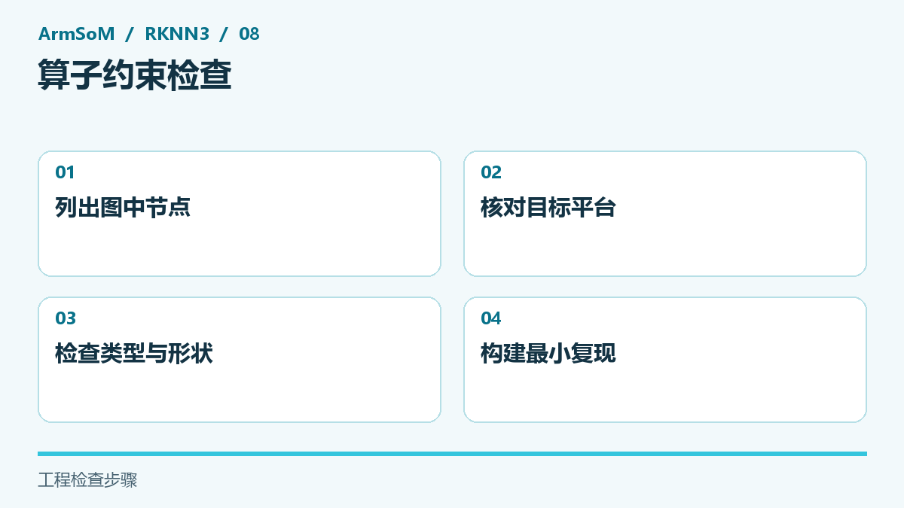

模型转换失败时，最常见的误判之一是：“手册里列出了这个算子，所以一定能运行。”实际部署还涉及目标芯片、数据类型、形状、属性组合以及编译时是否已知的常量。

> 本文为基于官方文档的原创技术解读与实施建议。尚未在 ArmSoM 硬件上验证本流程；具体支持范围需匹配目标芯片、SDK、Runtime、驱动和固件。

[](/assets/rknn3-v120/rknn3-v120-operator-audit-zh.svg)

*ArmSoM 原创流程图：实施步骤示意，不代表硬件测试结果。点击可查看矢量图。*

## 先找到正确的平台章节

V1.2.0 算子参考分别列出 RK182X 和 RK3572。条目不仅给出名称，还描述类型、规格与参数约束，并使用 Subgraph、RegEmit、NRV、NRVReg、Runtime/Simulator 等实现路径标记。某条路径有说明，不等于在所有目标上得到相同的执行方式。

排查时应记录具体条目与 SDK 版本，不要只保存一张支持列表截图。

## 先建立模型节点清单

以下是编辑编写的 ONNX 清单示例；它只读模型结构，不加载外部权重内容，也不判断是否可被 RKNN3 转换：

```python
from collections import Counter
import onnx

model = onnx.load("model.onnx", load_external_data=False)
counts = Counter((node.domain or "ai.onnx", node.op_type)
                 for node in model.graph.node)
for (domain, op_type), count in sorted(counts.items()):
    print(domain, op_type, count)
```

需要已安装 ONNX。输出可作为人工核对入口，不能当作自动兼容性证明。

## 把检查扩展到节点实例

| 检查项 | 需要回答的问题 |
| --- | --- |
| 数据类型 | 输入、权重、输出分别是什么 |
| 形状 | 维度、batch、动态范围是否明确 |
| 属性 | 特定参数组合是否有限制 |
| 常量 | 编译阶段能否获得所需值 |
| 相邻节点 | 转置、广播或融合是否改变约束 |

同名算子在不同位置可能有不同形状。只检查第一处出现的位置，会漏掉真正失败的节点。

## 用最小复现减少排查成本

围绕失败节点保留必要输入与上下游关系，缩小模型后验证能否重现。若简化后不再失败，记录删除了哪些条件，逐步恢复，而不是直接把问题归为“随机”。

对于不能公开的模型，结构性问题可先用相同维度的合成数据定位；精度问题最终仍需要真实输入或可信参考结果。

## 修改模型之后重新验收

替换或重写算子后，不仅要重新转换，还要比较模型行为。一次构建成功可能引入额外拷贝、CPU 工作或数值变化。把正确性、端到端耗时和内存放在一起复查。本文没有执行 RKNN3 编译，也不以清单脚本替代官方约束参考。

## 结合 ArmSoM 规划项目

如果项目考虑使用 ArmSoM 作为应用主机，可先查看 [Sige7](https://www.armsom.org/sige7)、[Sige5](https://www.armsom.org/sige5) 和 [CM5](https://www.armsom.org/cm5) 的产品资料，按实际板卡与载板版本核对接口、供电、系统镜像及驱动。这是主机选型参考，不是 RK182X 扩展模块的即插即用兼容声明。RK3588 / RK3576 的片内 NPU 应使用对应的 RKNN Toolkit2 软件栈，不能因主机型号而切换到 RKNN3。

相关接口与模块资料: [RK182X M.2](/zh/articles/rk182x-m2-module-guide/) · [RK182X SO-DIMM](/zh/articles/rk182x-sodimm-module-datasheet/) · [RK3572 Datasheet V1.0](/zh/articles/rk3572-datasheet-v10/)

## 官方文档与版本

依据官方仓库固定快照 `141883c8e11b0`（2026-11-14 核对）。完整接口、参数和限制请查原文。本文不替代官方手册，未转载整份 PDF。

- <a href="https://github.com/airockchip/rknn3-toolkit/blob/141883c8e11b05ef4cca4a69d8a7572c4d855191/doc/CN/07_RKNN3_%E7%AE%97%E5%AD%90%E6%94%AF%E6%8C%81%E4%B8%8E%E7%BA%A6%E6%9D%9F%E5%8F%82%E8%80%83_V1.2.0.pdf">官方中文 PDF (V1.2.0)</a>
- <a href="https://github.com/airockchip/rknn3-toolkit/blob/141883c8e11b05ef4cca4a69d8a7572c4d855191/doc/EN/07_RKNN3_Supported_Operators_and_Constraints_Reference_V1.2.0.pdf">官方英文 PDF (V1.2.0)</a>
- [全部官方文档](https://github.com/airockchip/rknn3-toolkit/tree/main/doc)

## 本系列阅读顺序

- [系列总览](/zh/articles/rknn3-v120-platform-guide/)
- 上一篇: [RKLLM3 Server：把本地模型接入业务 API 的实施顺序](/zh/articles/rknn3-v120-rkllm-server/)
- 下一篇: [RKNN3 MoE 导出：先验证路由专家，再验证完整模型](/zh/articles/rknn3-v120-moe-export/)
