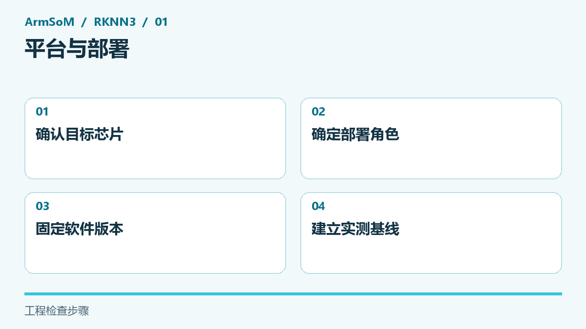

RKNN3 的价值需要放到完整系统中判断：应用运行在哪里，推理交给哪颗芯片，数据经过哪些接口，以及出了问题怎样复现。对 ArmSoM 用户，首先要避免把软件版本号当成所有 Rockchip NPU 都能直接升级的承诺。

> 本文为基于官方文档的原创技术解读与实施建议。尚未在 ArmSoM 硬件上验证本流程；具体支持范围需匹配目标芯片、SDK、Runtime、驱动和固件。

*ArmSoM 原创流程图：实施步骤示意，不代表硬件测试结果。点击可查看矢量图。*

## 先分清两种系统角色

官方发布说明列出 RK1820/RK1828 协处理器模式，以及 RK3572 的片上 NPU 模式。前者需要把主机、通信与加速器作为整体检查；后者在目标 SoC 上部署。RK3588/RK3576 的内置 NPU 使用 Toolkit2；它们作为外接 RK182X 的主机是另一种系统设计。

| 你准备做什么 | 首先确认什么 |
| --- | --- |
| 使用现有板卡的内置 NPU | 芯片对应的软件栈和板端镜像 |
| 为主机增加外接加速器 | 接口接线、供电、驱动与通信路径 |
| 评估新的 RK3572 项目 | 实际板型、硬件版本与配套 SDK |

## 如何读 V1.2.0 更新

本版涉及 MoE、PagedAttention、独立 LoRA 权重导出及 Grammar 约束等能力。功能名称说明了值得评估的方向，却不能替代实际模型、内存和响应时间验证。

建议为每项更新建立一行决策记录：它解决哪个产品问题、需要什么输入、如何验收、失败后怎样回到旧方案。没有对应业务需求的功能，可以暂时不引入，避免同时修改太多变量。

## 给 ArmSoM 项目建立版本档案

记录板卡与载板版本、镜像来源、内核、Runtime、Toolkit、模型文件校验值和测试数据版本。模型转换环境与板端环境分别存档。这样更换主机或回滚镜像时，可以区分模型变化、运行库变化和硬件变化。

不要把“官方示例能运行”和“自己的业务已可交付”合为一个结论。前者用于确认基础路径，后者需要覆盖实际输入、异常恢复、散热及长时运行。

## 性能数据怎样用于选型

把厂商数据当作寻找候选方案的线索，再用自己的业务负载建立基线。比较时固定输入、预处理、输出长度、并发量和运行时长；同时记录尾延迟、内存峰值及错误率。单个峰值数字无法回答设备会不会在持续负载下积压任务。

## 本系列的阅读顺序

先完成首次部署，再处理精度与性能；随后按应用语言选择 Toolkit Lite 或 C Runtime，最后考虑服务化、算子约束、MoE 与 MCP。每个阶段都留下可复现的输入和结果，后续优化才有比较依据。

## 结合 ArmSoM 规划项目

如果项目考虑使用 ArmSoM 作为应用主机，可先查看 [Sige7](https://www.armsom.org/sige7)、[Sige5](https://www.armsom.org/sige5) 和 [CM5](https://www.armsom.org/cm5) 的产品资料，按实际板卡与载板版本核对接口、供电、系统镜像及驱动。这是主机选型参考，不是 RK182X 扩展模块的即插即用兼容声明。RK3588 / RK3576 的片内 NPU 应使用对应的 RKNN Toolkit2 软件栈，不能因主机型号而切换到 RKNN3。

相关接口与模块资料: [RK182X M.2](/zh/articles/rk182x-m2-module-guide/) · [RK182X SO-DIMM](/zh/articles/rk182x-sodimm-module-datasheet/) · [RK3572 Datasheet V1.0](/zh/articles/rk3572-datasheet-v10/)

## 官方文档与版本

依据官方仓库固定快照 `141883c8e11b0`（2026-11-14 核对）。完整接口、参数和限制请查原文。本文不替代官方手册，未转载整份 PDF。

- <a href="https://github.com/airockchip/rknn3-toolkit/blob/141883c8e11b05ef4cca4a69d8a7572c4d855191/doc/CN/00_RKNN3_SDK_%E5%8F%91%E5%B8%83%E8%AF%B4%E6%98%8E_V1.2.0.pdf">官方中文 PDF (V1.2.0)</a>
- <a href="https://github.com/airockchip/rknn3-toolkit/blob/141883c8e11b05ef4cca4a69d8a7572c4d855191/doc/EN/00_RKNN3_SDK_Release_Notes_V1.2.0.pdf">官方英文 PDF (V1.2.0)</a>
- [全部官方文档](https://github.com/airockchip/rknn3-toolkit/tree/main/doc)

## 本系列阅读顺序

| # | 专题 |
| --- | --- |
| 01 | RKNN3 V1.2.0 平台指南：RK182X、RK3572 与 ArmSoM 的部署边界 |
| 02 | [RKNN3 首次部署：从环境核对到第一组可复现结果](/zh/articles/rknn3-v120-first-deployment/) |
| 03 | [RKNN3 模型验证：把精度、延迟和内存放到同一张验收表](/zh/articles/rknn3-v120-accuracy-performance/) |
| 04 | [RKNN3 Toolkit Python：模型转换脚本怎样做到可追溯](/zh/articles/rknn3-v120-toolkit-python-workflow/) |
| 05 | [RKNN3 Toolkit Lite：板端 Python 推理与异步资源管理](/zh/articles/rknn3-v120-lite-python-inference/) |
| 06 | [RKNN3 C Runtime：上下文、模型、会话与内存的生命周期](/zh/articles/rknn3-v120-runtime-c-lifecycle/) |
| 07 | [RKLLM3 Server：把本地模型接入业务 API 的实施顺序](/zh/articles/rknn3-v120-rkllm-server/) |
| 08 | [RKNN3 算子约束检查：为什么算子名称支持还不够](/zh/articles/rknn3-v120-operator-audit/) |
| 09 | [RKNN3 MoE 导出：先验证路由专家，再验证完整模型](/zh/articles/rknn3-v120-moe-export/) |
| 10 | [RKNN3 MCP：让模型部署过程可审查、可恢复](/zh/articles/rknn3-v010-mcp-deployment/) |
