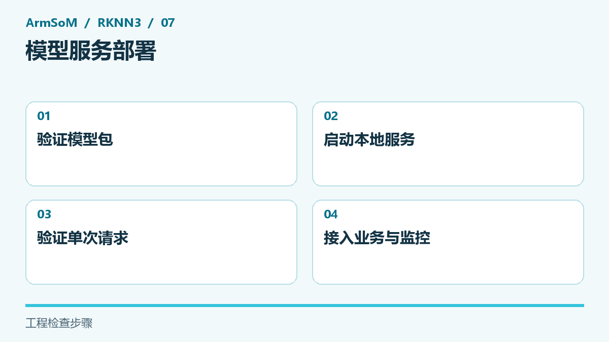

模型能在命令行运行之后，下一步常是让业务系统通过 API 调用。服务化会引入请求排队、会话管理、取消、超时和访问控制，因此不能把“端口打开”当成部署完成。

> 本文为基于官方文档的原创技术解读与实施建议。尚未在 ArmSoM 硬件上验证本流程；具体支持范围需匹配目标芯片、SDK、Runtime、驱动和固件。

[](/assets/rknn3-v120/rknn3-v120-rkllm-server-zh.svg)

*ArmSoM 原创流程图：实施步骤示意，不代表硬件测试结果。点击可查看矢量图。*

## 兼容接口不代表所有功能相同

RKLLM3 Server V1.2.0 提供 OpenAI-compatible 的聊天接口，并列出 `/health`、`/v1/models` 和 `/v1/chat/completions`。文档另有多模态、LoRA、缓存、Grammar 和多卡内容；具体模型与参数仍需分别验证。

业务客户端应只依赖经过验证的字段和行为。特别检查流式返回、错误响应、停止条件及参数优先级，避免把另一个服务的全部语义直接套进来。

## 先用最小请求验证服务状态

假设服务已经在本机 8080 端口启动，下面是编辑整理的只读检查：

```bash
curl --fail --max-time 10 http://127.0.0.1:8080/health
curl --fail --max-time 10 http://127.0.0.1:8080/v1/models
```

地址与端口需替换为实际配置。健康检查成功不等于模型回答正确；接下来仍要用固定请求验证输出结构和业务质量。本次文章编写没有启动该推理服务。

## 将验收分成四层

| 层次 | 应验证什么 |
| --- | --- |
| 模型 | 产物完整、输入输出正确 |
| 服务 | 启动、健康状态、失败日志 |
| 协议 | 请求字段、流式行为、超时与错误 |
| 业务 | 回答质量、并发量、可恢复性 |

只要有一层尚未验证，就应把状态写清楚，避免上层集成依赖不稳定的下层行为。

## 多模态与结构化输出要单独测试

加入图片或音频时，为格式、尺寸和内容类型建立测试集合。要求 JSON 格式时，既验证结构，也验证字段含义；符合结构不保证内容正确。若模型能请求工具调用，实际执行仍应由业务层控制。

先保持一个模型、一个请求和短输入。等基本行为稳定，再增加上下文、并发或模型组合，并观察排队时间及内存峰值。

## 用于 ArmSoM 项目的交付边界

将服务绑定范围、认证入口、日志保存、重启行为及模型包版本纳入部署记录。接口对外开放前，应按业务网络要求配置访问控制。当前是架构与验收建议，不是任何 ArmSoM 板卡上的服务性能承诺。

## 结合 ArmSoM 规划项目

如果项目考虑使用 ArmSoM 作为应用主机，可先查看 [Sige7](https://www.armsom.org/sige7)、[Sige5](https://www.armsom.org/sige5) 和 [CM5](https://www.armsom.org/cm5) 的产品资料，按实际板卡与载板版本核对接口、供电、系统镜像及驱动。这是主机选型参考，不是 RK182X 扩展模块的即插即用兼容声明。RK3588 / RK3576 的片内 NPU 应使用对应的 RKNN Toolkit2 软件栈，不能因主机型号而切换到 RKNN3。

相关接口与模块资料: [RK182X M.2](/zh/articles/rk182x-m2-module-guide/) · [RK182X SO-DIMM](/zh/articles/rk182x-sodimm-module-datasheet/) · [RK3572 Datasheet V1.0](/zh/articles/rk3572-datasheet-v10/)

## 官方文档与版本

依据官方仓库固定快照 `141883c8e11b0`（2026-11-14 核对）。完整接口、参数和限制请查原文。本文不替代官方手册，未转载整份 PDF。

- <a href="https://github.com/airockchip/rknn3-toolkit/blob/141883c8e11b05ef4cca4a69d8a7572c4d855191/doc/CN/06_RKLLM3_Server_%E4%BD%BF%E7%94%A8%E6%8C%87%E5%8D%97_V1.2.0.pdf">官方中文 PDF (V1.2.0)</a>
- <a href="https://github.com/airockchip/rknn3-toolkit/blob/141883c8e11b05ef4cca4a69d8a7572c4d855191/doc/EN/06_RKLLM3_Server_User_Guide_V1.2.0.pdf">官方英文 PDF (V1.2.0)</a>
- [全部官方文档](https://github.com/airockchip/rknn3-toolkit/tree/main/doc)

## 本系列阅读顺序

- [系列总览](/zh/articles/rknn3-v120-platform-guide/)
- 上一篇: [RKNN3 C Runtime：上下文、模型、会话与内存的生命周期](/zh/articles/rknn3-v120-runtime-c-lifecycle/)
- 下一篇: [RKNN3 算子约束检查：为什么算子名称支持还不够](/zh/articles/rknn3-v120-operator-audit/)
