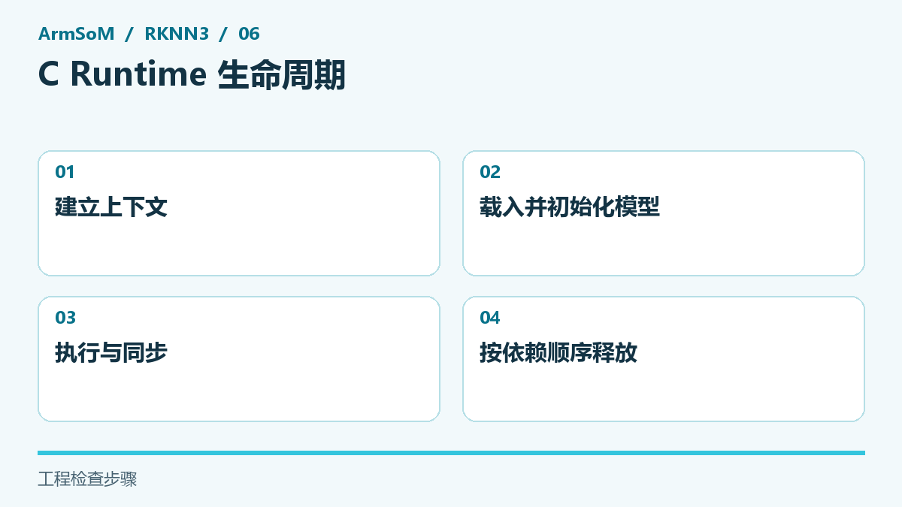

C/C++ 集成往往承担长期运行和资源控制，因此“何时可以释放”与“怎样调用推理”同样重要。把 Runtime 看成一组带依赖关系的资源，通常比只记住一条函数调用链更有帮助。

> 本文为基于官方文档的原创技术解读与实施建议。尚未在 ArmSoM 硬件上验证本流程；具体支持范围需匹配目标芯片、SDK、Runtime、驱动和固件。

*ArmSoM 原创流程图：实施步骤示意，不代表硬件测试结果。点击可查看矢量图。*

## 先理解三个不同对象

V1.2.0 文档将上下文初始化、模型加载、模型初始化与 LLM Session 分开。典型接口名包括 `rknn3_init`、`rknn3_load_model_from_path`、`rknn3_model_init` 和 `rknn3_destroy`。缓存内存还涉及 `rknn3_mem_sync` 的同步约定。

这不是可直接编译的完整示例。具体参数结构、平台限制及错误码必须与当前头文件和运行库匹配。

## 为每类资源写下拥有者

| 资源 | 应明确的问题 |
| --- | --- |
| Context | 谁创建，谁负责最终销毁 |
| Model | 文件、权重及初始化失败怎样处理 |
| Session | 请求结束、取消及重用的规则 |
| Buffer | 谁分配，谁读写，何时允许回收 |
| Callback | 它引用的状态能否活到最后一次调用 |

可以在代码评审中要求每个创建操作对应明确的释放路径。成功路径、初始化中途失败和进程关闭应分别讨论。

## 把依赖关系画进清理逻辑

先停止新任务，再处理仍在执行的工作，随后清理依赖资源。不能在仍可能发生回调时销毁回调引用的对象。多线程程序还需要明确由哪条线程负责关闭，避免两个错误处理分支重复释放。

对 C++ 封装，可以用拥有者对象统一管理资源，但不要假设析构函数的调用时机天然满足设备异步任务要求。异步完成条件仍需要单独表达。

## 共享内存不等于已经同步

CPU 与设备之间的可见性、布局和所有权是三件不同的事。遇到偶发结果错误时，除模型精度外，还应检查写入完成、设备读取、结果同步和 CPU 读取的顺序。不要靠增加固定延时来掩盖状态管理问题。

## 设计可恢复的错误报告

至少记录操作阶段、返回值、模型标识、设备信息和请求标识。应用日志不必包含完整业务数据，但应能把错误对应到可复现的测试样本。发生失败后，验证下一次初始化是否仍正常。

本篇为集成设计解读，没有编译或运行板端 C 程序，也未确认某块 ArmSoM 板卡的直接兼容性。

## 结合 ArmSoM 规划项目

如果项目考虑使用 ArmSoM 作为应用主机，可先查看 [Sige7](https://www.armsom.org/sige7)、[Sige5](https://www.armsom.org/sige5) 和 [CM5](https://www.armsom.org/cm5) 的产品资料，按实际板卡与载板版本核对接口、供电、系统镜像及驱动。这是主机选型参考，不是 RK182X 扩展模块的即插即用兼容声明。RK3588 / RK3576 的片内 NPU 应使用对应的 RKNN Toolkit2 软件栈，不能因主机型号而切换到 RKNN3。

相关接口与模块资料: [RK182X M.2](/zh/articles/rk182x-m2-module-guide/) · [RK182X SO-DIMM](/zh/articles/rk182x-sodimm-module-datasheet/) · [RK3572 Datasheet V1.0](/zh/articles/rk3572-datasheet-v10/)

## 官方文档与版本

依据官方仓库固定快照 `141883c8e11b0`（2026-11-14 核对）。完整接口、参数和限制请查原文。本文不替代官方手册，未转载整份 PDF。

- <a href="https://github.com/airockchip/rknn3-toolkit/blob/141883c8e11b05ef4cca4a69d8a7572c4d855191/doc/CN/05_RKNN3_Runtime_C_API_%E5%8F%82%E8%80%83_V1.2.0.pdf">官方中文 PDF (V1.2.0)</a>
- <a href="https://github.com/airockchip/rknn3-toolkit/blob/141883c8e11b05ef4cca4a69d8a7572c4d855191/doc/EN/05_RKNN3_Runtime_C_API_Reference_V1.2.0.pdf">官方英文 PDF (V1.2.0)</a>
- [全部官方文档](https://github.com/airockchip/rknn3-toolkit/tree/main/doc)

## 本系列阅读顺序

- [系列总览](/zh/articles/rknn3-v120-platform-guide/)
- 上一篇: [RKNN3 Toolkit Lite：板端 Python 推理与异步资源管理](/zh/articles/rknn3-v120-lite-python-inference/)
- 下一篇: [RKLLM3 Server：把本地模型接入业务 API 的实施顺序](/zh/articles/rknn3-v120-rkllm-server/)
