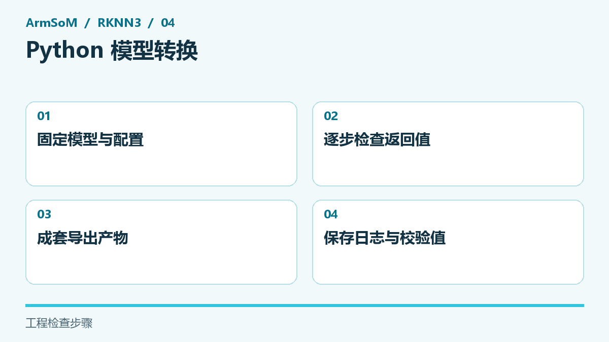

一段转换脚本既是开发工具，也是模型交付记录。长期项目需要回答的不只是“运行过哪条命令”，还包括当时使用了什么输入、配置和软件，以及失败发生在哪一步。

> 本文为基于官方文档的原创技术解读与实施建议。尚未在 ArmSoM 硬件上验证本流程；具体支持范围需匹配目标芯片、SDK、Runtime、驱动和固件。

[](/assets/rknn3-v120/rknn3-v120-toolkit-python-workflow-zh.svg)

*ArmSoM 原创流程图：实施步骤示意，不代表硬件测试结果。点击可查看矢量图。*

## 不要根据 SDK 名称猜 Python 导入名

V1.2.0 API 参考中的类仍通过 `from rknn.api import RKNN` 导入。转换主流程涉及 `config`、`load_onnx`、`build`、`export_rknn` 和 `release`。文件导出涉及 `.rknn` 与配套 `.weight`，应作为同一次构建的产物管理。

Python 命名空间相似尤其容易掩盖装错环境的问题。先确认实际导入路径，再处理模型配置。

## 检查脚本究竟加载了哪个环境

下面是编辑编写的只读诊断，不进行模型转换：

```python
import sys
from importlib.util import find_spec

print("python:", sys.executable)
spec = find_spec("rknn")
print("rknn:", None if spec is None else spec.origin)
```

将输出与环境安装记录一起保存。查到模块仅说明 Python 能找到它，不能证明它是正确版本，更不能证明目标模型可运行。

## 把转换拆成可判定的阶段

| 阶段 | 需要留下的记录 |
| --- | --- |
| 输入 | 模型校验值、外部权重、输入定义 |
| 配置 | 目标平台、预处理和量化选择 |
| 构建 | 返回状态、日志与耗时 |
| 导出 | 成套文件、文件大小和校验值 |
| 验证 | 固定输入、输出和对照结果 |

任何阶段失败都应停止交付，避免用上一次留下的文件伪装成当前构建成功。输出目录可按构建标识分开，验证完成后再进入候选发布目录。

## 清理与错误处理同样属于接口设计

为对象和临时文件指定明确的拥有者。异常退出路径也应释放已获得的资源，并保留足够日志供下一位工程师定位。不要用空异常处理把构建错误吞掉，也不要只凭输出文件存在就判定成功。

## ArmSoM 集成时怎样交付

交付模型包时附带配置记录、目标环境要求和固定验证样本。把“模型已转换”与“已在具体 ArmSoM 硬件版本上验收”分别记录。本篇未执行实际 SDK 转换；完整参数、默认值和约束请以对应版本官方 API 为准。

## 结合 ArmSoM 规划项目

如果项目考虑使用 ArmSoM 作为应用主机，可先查看 [Sige7](https://www.armsom.org/sige7)、[Sige5](https://www.armsom.org/sige5) 和 [CM5](https://www.armsom.org/cm5) 的产品资料，按实际板卡与载板版本核对接口、供电、系统镜像及驱动。这是主机选型参考，不是 RK182X 扩展模块的即插即用兼容声明。RK3588 / RK3576 的片内 NPU 应使用对应的 RKNN Toolkit2 软件栈，不能因主机型号而切换到 RKNN3。

相关接口与模块资料: [RK182X M.2](/zh/articles/rk182x-m2-module-guide/) · [RK182X SO-DIMM](/zh/articles/rk182x-sodimm-module-datasheet/) · [RK3572 Datasheet V1.0](/zh/articles/rk3572-datasheet-v10/)

## 官方文档与版本

依据官方仓库固定快照 `141883c8e11b0`（2026-11-14 核对）。完整接口、参数和限制请查原文。本文不替代官方手册，未转载整份 PDF。

- <a href="https://github.com/airockchip/rknn3-toolkit/blob/141883c8e11b05ef4cca4a69d8a7572c4d855191/doc/CN/03_RKNN3_Toolkit_Python_API_%E5%8F%82%E8%80%83_V1.2.0.pdf">官方中文 PDF (V1.2.0)</a>
- <a href="https://github.com/airockchip/rknn3-toolkit/blob/141883c8e11b05ef4cca4a69d8a7572c4d855191/doc/EN/03_RKNN3_Toolkit_Python_API_Reference_V1.2.0.pdf">官方英文 PDF (V1.2.0)</a>
- [全部官方文档](https://github.com/airockchip/rknn3-toolkit/tree/main/doc)

## 本系列阅读顺序

- [系列总览](/zh/articles/rknn3-v120-platform-guide/)
- 上一篇: [RKNN3 模型验证：把精度、延迟和内存放到同一张验收表](/zh/articles/rknn3-v120-accuracy-performance/)
- 下一篇: [RKNN3 Toolkit Lite：板端 Python 推理与异步资源管理](/zh/articles/rknn3-v120-lite-python-inference/)
