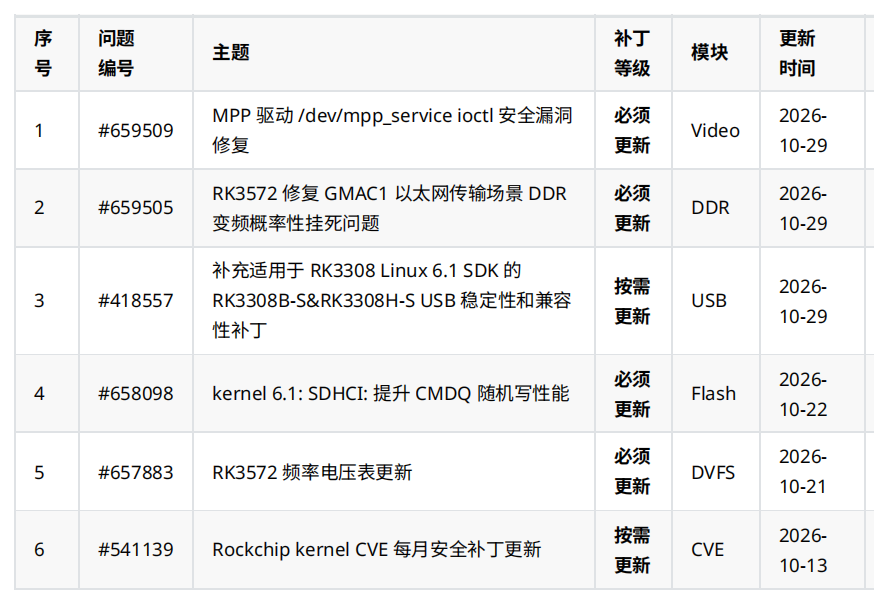

2026 年 10 月这份 Rockchip 补丁清单，覆盖视频驱动安全、RK3572 的 DDR 与频率电压配置、RK3308 USB，以及 Linux 6.1 存储和内核安全维护。对正在开发或交付 ArmSoM 设备的团队，最有价值的下一步是把清单逐项对应到自己的芯片、SDK/BSP 和软件基线，再决定合入与验证范围。

本文将原始六项清单与登录后核对的 Rockchip Redmine 正文、历史记录及附件目录结合，核对日期为 **2026-11-06**。**不代表当月全部补丁，也不代表 ArmSoM 全部镜像已合入修复。** 下表日期保留原始月报口径；条目的开始日期、附件日期和后续更新日期另行说明。厂商测试结果均明确归属来源，工程建议尚未进行 ArmSoM 硬件验证。

## 1. 六项更新一览

| 问题编号 | 原清单主题 | 原清单级别 | 模块 | 更新时间 |
| --- | --- | --- | --- | --- |
| [#659509](https://redmine.rock-chips.com/issues/659509) | MPP 驱动 `/dev/mpp_service` ioctl 安全漏洞修复 | 必须更新 | Video | 2026-10-29 |
| [#659505](https://redmine.rock-chips.com/issues/659505) | RK3572 修复 GMAC1 以太网传输场景 DDR 变频概率性挂死问题 | 必须更新 | DDR | 2026-10-29 |
| [#418557](https://redmine.rock-chips.com/issues/418557) | 补充适用于 RK3308 Linux 6.1 SDK 的 RK3308B-S & RK3308H-S USB 稳定性和兼容性补丁 | 按需更新 | USB | 2026-10-29 |
| [#658098](https://redmine.rock-chips.com/issues/658098) | kernel 6.1：SDHCI 提升 CMDQ 随机写性能 | 必须更新 | Flash | 2026-10-22 |
| [#657883](https://redmine.rock-chips.com/issues/657883) | RK3572 频率电压表更新 | 必须更新 | DVFS | 2026-10-21 |
| [#541139](https://redmine.rock-chips.com/issues/541139) | Rockchip kernel CVE 每月安全补丁更新 | 按需更新 | CVE | 2026-10-13 |

“必须更新”应理解为原清单对**适用基线**的要求，不能据此直接给所有 Rockchip 板卡刷入同一个补丁。“按需更新”也不等于可以忽略，仍需判断对应功能和安全修复是否适用。

## 2. MPP：从十月的 17 个修复更新到当前 19 个

[#659509](https://redmine.rock-chips.com/issues/659509) 针对 `drivers/video/rockchip/mpp/`，补丁分支为 `kernel: develop-6.1`。条目列出越界读写、释放后使用（UAF）/双重释放、任意内核写及跨进程信息泄露，入口为用户态访问 `/dev/mpp_service` 的 ioctl。不能据此将问题写成已确认的远程攻击漏洞，条目也没有给出对应 CVE 编号或 CVSS 分数。

原描述列出 17 个修复；**2026-11-04 历史记录新增两个，当前共 19 个**：`4e950a32a45f7` 修复 `mpp_check_req()` 越界访问，`531cdbdcfe94` 修复 fd translate 中过严的 offset 边界检查。不能只按原始 17 项清单认定完整合入，也不能在不检查依赖的情况下仅选这两个提交。

修复涉及用户输入边界检查、会话与 DMA 生命周期、类型混淆及 procfs 权限。原记录说明正常用户态用法保持不变，异常输入会以 `-EINVAL` / `-EOPNOTSUPP` 拒绝。厂商报告 Jenkins 构建通过、无已有告警之外的新告警；这属于构建证据，不是 ArmSoM 视频业务的完整回归结果。

条目覆盖的 SDK 包含 RK3576、RK3588、RK3566/3568 等多个 Linux 6.1 和 Android 产品分支；芯片列表很广，但实际适用仍要匹配驱动代码和 BSP。历史记录还删除了 RK3572/RK3572S，不能因它们出现在本月其他条目中就归入此项。维护 CM5/Sige5、RK3588 系列等项目时，应核对对应 BSP；仅更新用户态 MPP 库不能证明内核修复已经生效。

建议回归实际编码/解码、启动停止、进程退出重启和长时间运行，并核对依赖 procfs 的诊断工具是否仍可按预期工作。这里的回归项目是工程建议。

## 3. RK3572：BL31 V1.15 与频率电压表要配套核对

[#659505](https://redmine.rock-chips.com/issues/659505) 明确针对 RK3572/RK3572S：GMAC1 传输与 DDR 变频期间访问路径冲突，可能黑屏挂死。修复位于 `rkbin: master`，要求 **BL31 V1.15 或以上**，Change-Id 为 `I34c7b43db47b2fa8c763154969c2f79c9140adde`。附件列有 V1.15 更新补丁和 `rk3572_bl31_v1.15.elf`；厂商测试字段为“测试正常”，没有公开测试时长和负载矩阵。

[#657883](https://redmine.rock-chips.com/issues/657883) 对应 `kernel: develop-6.12` 与 `rkbin: master`，原因是部分芯片使用旧频率电压表时稳定性余量不足。附件涵盖 CPU/GPU/NPU OPP、DMC OPP、供电配置和 ISP devfreq/OPP，并附 BL31 V1.14。厂商测试字段为“pass”，没有功耗或性能提升数据。

**两项一起处理时，不要为了频率电压表条目的 V1.14 附件而把已满足 GMAC1 修复要求的固件降级。** 应由 BSP 维护方确认包含所需变更的 V1.15 或更新配套组合，而不是任意拼接内核、设备树与固件。本文未审阅附件代码，也不从文件名推导具体电压值或完整依赖关系。

适用 SDK 列表包含 RK3572 Linux 6.12 和多个 Android SDK。对 ArmSoM 的 [RK3572 项目规划](/zh/articles/rockchip-rk3572-armsom-zero-preview/)，建议覆盖持续 GMAC1 传输、负载变化、DDR 调频、冷启动和温度条件，保留串口日志。短时测速通过不等于概率性挂死已经消除。

## 4. RK3308 USB：十月新增的是 Linux 6.1 专用包

[#418557](https://redmine.rock-chips.com/issues/418557) 是始于 2023 年的长期维护条目，问题描述为 RK3308B-S/RK3308H-S 长时间工作后 USB 稳定性和兼容性异常。软件检测 DP/DM linestate，并在异常时调整电平以保证高速握手。原测试记录是 RK3308B-S EVB 通过，不能视为 P2 Pro 实测。

**2026-10-29 新增** `RK3308B-S&RK3308H-S_USB_Compatible_Linux6.1_SDK_Patch_V1.0.0_20261013.zip`，同时加入 RK3308 Linux 6.1 SDK 适用信息。文件名中的 10 月 13 日与上传日期 10 月 29 日是不同字段。页面旧描述和仓库字段仍写 Linux 4.4，历史记录另有 Linux 5.10；不要据此把旧包直接套到 6.1。

月报标为“按需更新”，详情页补丁等级字段为空，本文保留月报分级并记录这一差异。历史更新还涉及 OTG gadget 断开事件、热插拔初始化和 HOST 待机唤醒，选包时应按实际 SDK 阅读对应说明。

[P2 Pro 官方文档](https://docs.armsom.org/armsom-p2pro)标明采用 RK3308B-S，因此值得对照此项，但是否需要合入取决于镜像、分支与现有修复。建议在实际 USB 外设上验证枚举、反复插拔、持续传输、待机唤醒及 gadget 断开通知。

## 5. SDHCI 与 CVE：性能数据和清单月份要读准确

[#658098](https://redmine.rock-chips.com/issues/658098) 对应 `rk/kernel: develop-6.1-android14` 和 `develop-6.1`，Change-Id 为 `I5f8cfd9d62228e62fd0ad71d7b69698d80b21f80`。部分 eMMC 启用 CMDQ 后，每次查询仅返回一个可传输 SLOT，较长的查询间隔影响随机写性能；修复方式是缩短查询间隔。

厂商在 RK3576 上报告：部分支持多队列的 eMMC 从 **160 MB/s 到 200 MB/s**，不支持多队列的 eMMC 从 **19 MB/s 到 70 MB/s**。这是条目中的特定测试结果，并非 ArmSoM 实测或所有存储设备的保证；没有完整测试配置，不能据此承诺普遍加速比例。月报日期为 2026-10-22，但条目开始日期和附件日期为 2025-09-10，本文将它视为十月清单收录，不写成十月首次开发。

[#541139](https://redmine.rock-chips.com/issues/541139) 维护 `kernel: 4.19/5.10/6.1/6.12` 的月度 CVE 清单，通过 Markdown 附件列出 CVE、提交和补丁链接。**本次核对可见的最新附件是 2026-10-13 上传的 `2026-09.md`，不是 `2026-10.md`。** 最新历史说明文字又写 August，与文件名冲突；这里保留附件名并指出差异，不自行改判月份。截图模块为 CVE，详情页 Component 为 System，二者属于不同展示口径。

本文未逐项审计这份约 575 KB 的 CVE 附件，不宣称所有 CVE 都影响 ArmSoM，也不将其与 MPP 条目自动合并。实际维护应按内核代码、配置、暴露功能和回移记录逐项评估。“按需更新”并不意味着适用的安全修复可以忽略。

## 6. 给 ArmSoM 项目建立一份可追溯的更新记录

建议为每台测试设备记录：板卡与硬件版本、SoC、镜像名称与校验值、SDK/BSP 分支、内核版本、补丁来源及提交标识、测试结果和回退镜像。下面的命令仅用于读取运行信息，**输出不能证明漏洞已修复**：

```sh
uname -a
cat /etc/os-release
cat /proc/device-tree/model
```

某些系统没有 `/etc/os-release` 或设备树节点；`model` 输出也可能不带换行。内核版本字符串相同的两份镜像仍可能有不同的回移补丁，需要结合构建记录和维护方说明确认。

实际更新按“核对适用范围 → 取得匹配补丁与依赖 → 测试设备合入 → 业务回归 → 分批部署并保留回退”推进。联系 ArmSoM 时，提供上述基线信息和问题编号，能更快确认应使用哪个镜像或 BSP 更新。页面右下角的联系入口可用于咨询；这不代表任何型号的修复交付时间承诺。

## 原始清单与阅读说明



原图保留中文，四语正文均提供可复制表格。上文六个问题编号链接到已核对的官方条目，访问详情和附件可能需要相应 Redmine 权限。本次核对正文、历史及附件名称，未下载执行补丁、未逐行审计附件源码，也未在硬件上应用或测试。附件应从匹配 SDK 的官方渠道获取；本文不托管补丁包。
