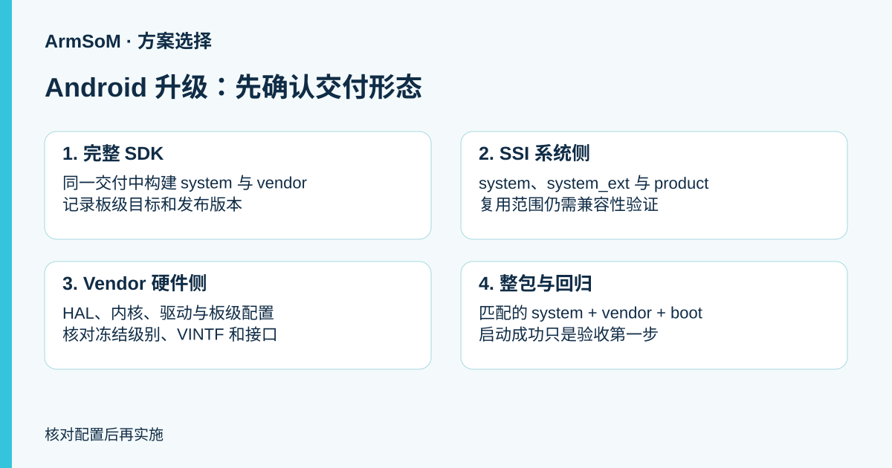

**问一款 Rockchip 芯片能运行哪个 Android 版本时，还要问：拿到的是完整 SDK，还是系统侧与硬件侧分别交付的组合？** 同一个 Android 版本号，并不能说明源码目录、编译入口、vendor 基线和升级方式相同。

本文为 ArmSoM Android 项目提供选型与交付检查方法。下方版本表来自用户提供的第三方资料快照，不等同于 ArmSoM 固件下载清单、GMS 认证清单或原厂当前承诺；具体产品以板卡文档、SDK 发布说明和测试结果为准。



## 1. 三个术语，三个不同层次

| 术语 | 工程含义 | 不应误解为 |
| --- | --- | --- |
| 完整 SDK | 一套交付包含系统与硬件侧构建所需内容 | 任意板卡无需适配即可启动 |
| SSI | Shared System Image，共享系统镜像 | 任意 vendor 与任意 system 都能组合 |
| GRF | Google Requirements Freeze，与 vendor 要求冻结相关 | 一个可替换所有驱动的固件文件 |

SSI 设计让系统侧在兼容设备间复用，但 system、system_ext、product 与 vendor/odm 之间仍有接口和兼容性约束。[AOSP SSI](https://source.android.com/docs/core/architecture/partitions/shared-system-image)

对 BSP 工程师，重点是 HAL、VINTF、内核与板级资源；对应用团队，重点是框架行为、权限、ABI 与 API 变化。两边分别构建，不等于两边可以分别不做回归。

## 2. 如何读这份版本对照

下面完整保留原资料按芯片列出的范围，作为查找相应发布包的线索。来源日期为 **2026-11-06**；本次没有取得所有对应分支逐项构建，因此不把这些 Android 16/17 组合写成已验证支持。横线表示原表未列出，不证明技术上不可能。

| 芯片系列 | 原资料：完整 SDK 的 Android 版本 | 原资料：SSI + GRF 的 Android 版本 |
| --- | --- | --- |
| RK3572 / RK3572S | 16 | 17 |
| RK3576 | 14, 15 | 16, 17 |
| RK3588 / RK3588S | 12–15 | 16, 17 |
| RK3568 / RK3566 | 11–15 | 16, 17 |
| RK3562 | 13–15 | 16, 17 |
| RK3399 | 6–15 | 16, 17 |
| RK3399PRO | 8, 9 | — |
| RK3326 / RK3326-S | 8–15 | 16, 17 |
| PX30 / PX30-S | 8–15 | 16, 17 |
| RK3368 | 5–11 | — |
| RK3288W | 5–12 | — |
| RK3126C | 8–10 | — |
| RK312X | 5–7 | — |
| PX5 | 6, 8 | — |
| PX3SE | 7 | — |

范围不代表每个小版本、所有板卡和全部外设均可用。原文的另一张按 Android 版本表还出现 RK3528，与上述芯片表范围不一致，本文不据此新增其支持承诺。采购或升级前应拿到具体 SDK manifest、release note 和产品镜像链接。

## 3. Android 16/17 的分支差异怎样核对

原资料把 RK3572 的 Android 16 描述为完整 SDK，其他若干平台使用 SSI 加 Android 14 vendor；这属于其调查到的交付方式，不能从 Android 大版本直接推导。`rk3572_a16-*`、`ssi_16_arm64`、`rkbuild`、`build.sh -M / -T` 都是需要在目标 SDK 中核对的名称或入口。

原资料为 Android 17 列出的 vendor 门槛如下，**只作追溯信息**：

| 平台 | Vendor SDK | 原资料的最低发布号 | SSI 发布号 |
| --- | --- | --- | --- |
| RK3572 | Android 16 | RKR5+ | RKR1 / RKR2 |
| RK3588 / RK3576 | Android 14 | RKR9+ | RKR1 / RKR2 |
| RK3568 / RK3566 / RK3562 / RK3399 / RK3326 / PX30 | Android 14 | RKR10+ | RKR2 |

不要把 Android API level 与 vendor API level 当成同一数字体系。AOSP 对 vendor 接口冻结与 API 标识有单独规则。[AOSP API flags](https://source.android.com/docs/core/architecture/api-flags)

## 4. 先读取设备，再固定源码

```bash
adb shell getprop ro.build.fingerprint
adb shell getprop ro.vendor.build.fingerprint
adb shell getprop ro.build.version.release
adb shell getprop ro.build.version.sdk
adb shell getprop ro.product.first_api_level
adb shell getprop ro.board.first_api_level
adb shell getprop ro.board.api_level
adb shell getprop ro.vendor.api_level
adb shell getprop ro.board.api_frozen
adb shell uname -a
```

属性为空时记录“未提供”，不要用系统 Android 版本代填。`ro.build.version.release` 显示系统版本，并不能独立识别 vendor 的构建来源。保存系统和 vendor 指纹、内核版本、镜像校验和及板卡硬件版本。

在已取得的 SDK 根目录做源码调查：

```bash
repo manifest -r -o manifest-pinned.xml
find device/rockchip -name AndroidProducts.mk -o -name BoardConfig.mk
rg -n 'ssi_16_arm64|rk3572_a16|GRF|VINTF|PRODUCT_SHIPPING_API_LEVEL' \
  device/rockchip build.sh
rg -n 'getopts|rkbuild|merge|vendor|system' build.sh
```

`repo manifest` 只生成本地版本记录；以上命令不编译、不刷机。缺少路径说明分支布局不同，应先找发布说明。尤其不要把别的 SDK 的 `build.sh` 参数或 lunch 目标直接照搬。

## 5. 两条开发路径如何分工

| 工作 | 系统侧主要检查 | 硬件侧主要检查 |
| --- | --- | --- |
| 应用升级 | 权限、后台限制、framework API、WebView | 相机、媒体和传感器 HAL 行为 |
| 新载板 | 系统功能开关与产品配置 | DTS、供电、时钟、显示、触摸、网络 |
| 系统合包 | 分区内容、签名、OTA 与回滚策略 | boot/vendor/odm、VINTF 与内核匹配 |
| 长期维护 | 安全更新与应用依赖 | BSP 补丁、固件、驱动与 vendor 更新 |

SSI 复用可以减少重复维护，但前提是兼容性边界成立。不能只替换 `system.img` 就认为已经完成平台升级；也不应为了启动而跳过 AVB、SELinux 或接口检查。

## 6. 面向 ArmSoM 项目的验收清单

先在 CM5/Sige5 或 Sige7/AIM7/LM7 的已知可用镜像上建立业务基线，再评估新的 SDK 组合。除启动外，至少覆盖显示与触摸、网络重连、相机、音视频、NPU、存储、休眠唤醒和 OTA。选择与产品要求相符的兼容性测试；测试通过与获得商业认证是两回事。

每次交付应包含：源码锁定记录、构建参数、system/vendor/boot 配套关系、签名与回滚方案、测试结果以及未支持功能。这样“支持 Android”才会变成可复现的交付，而不是版本号宣传。

来源：[用户提供的 SDK 与 GRF 对照](https://mp.weixin.qq.com/s/_M3UC7uYivdxHesFIhAVTw)，以及上文 AOSP 架构资料。可继续阅读 [Android CA 维护](/zh/articles/android-ca-trust-store-emudhra-audit/)和 [VendorStorage 集成](/zh/articles/rockchip-vendor-storage-android-aidl-guide/)。

## 适用产品与继续阅读

ArmSoM 项目可从 [Sige7](https://www.armsom.org/sige7)、[AIM7](https://www.armsom.org/aim7)、[LM7](https://www.armsom.org/lm7) 的 RK3588 平台，或 [CM5](https://www.armsom.org/cm5)、[Sige5](https://www.armsom.org/sige5) 的 RK3576 平台开始评估。接口与系统支持请分别查阅 [Sige7 文档](https://docs.armsom.org/armsom-sige7)、[CM5 文档](https://docs.armsom.org/armsom-cm5)、[Sige5 文档](https://docs.armsom.org/armsom-sige5)。产品链接用于选型，不代表这些板卡已验证本文全部 SDK 组合。
