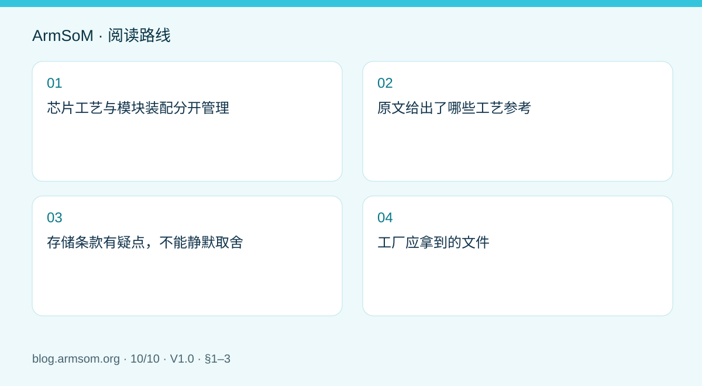
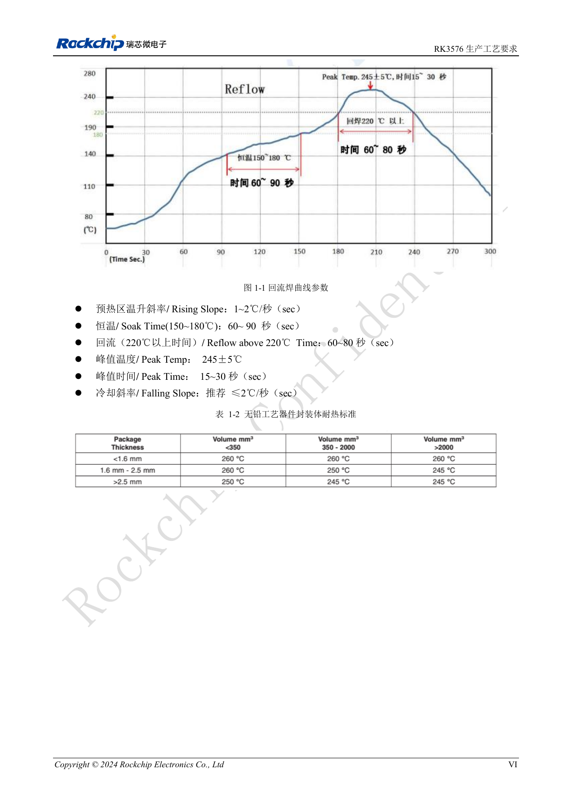

# Rockchip 设备从样机到量产：工艺要求与测试清单

## 适用范围与资料

本篇为围绕工程问题编写的专题导读，不是整本 PDF 的逐页翻译。原文示例不代表 ArmSoM 实测；具体电压、引脚、SDK/BSP 和内核应按实际板卡版本核对。

**Rockchip:** `RK3576_Production_Process_Requirements_V10_20240522_CN.pdf` · V1.0 · §1–3

## 芯片工艺与模块装配分开管理

芯片回流曲线描述的是对应封装的工艺参考，不应直接用于一整块 CM5、CM7s 或 AIM7 模块的再次回流。板对板连接器、导热材料和最终机壳也有各自装配要求。选择模块方案可以减少自己处理 SoC 焊接和核心电路的范围，但载板与整机质量仍需要独立控制。

## 原文给出了哪些工艺参考

RK3576 生产工艺要求 V1.0 的 §1.3 给出以下建议，供工艺工程师结合整板、锡膏和设备验证，不是无需测温即可照搬的生产配方。

| 项目 | 原稿参考值 |
| --- | --- |
| 锡膏 | SAC305；flux 比重 10%–11.5% |
| 升温斜率 | 1–2℃/s |
| 150–180℃ 恒温 | 60–90s |
| 220℃ 以上 | 60–80s |
| 峰值 | 245±5℃；15–30s |
| 降温斜率 | 推荐 ≤2℃/s |

§3.2.2 的开孔参考为正方形倒圆角 r=0.05mm、边长 0.30–0.32mm、钢网厚度 0.1mm，仅对应文档的 RK3576 工艺背景，不是所有封装通用值。

## 存储条款有疑点，不能静默取舍

§2.2 写 MSL 3，并列出 ≤30℃/60%RH 环境、开包建议 168 小时内用完；同段又出现过炉前停留 6 小时。表格 MSL 1 行还写“≤300℃/85%RH”。这些是原稿写法，适用条件或数值存在需澄清之处，不能把 300℃作为存储建议，也不能自行删除 6 小时。执行前应向供应商确认，并遵循对应批次标签及适用工艺规范。

## 工厂应拿到的文件

- 固定版本的原理图、BOM、PCB、装配和测试文件。
- 模块与外围器件完整料号、硬件修订号和替代料规则。
- 已确认的工艺参数、测温记录和异常处理流程。
- 系统镜像校验值、烧录步骤、序列号分配和结果回传方式。

测试至少区分电源检查、启动、接口功能与持续负载。先用试产数据发现问题，再决定量产放行标准；一次桌面演示不能替代工厂验收。任何工艺或替代料变更，都应保留评审和复测记录。

## 原文配图

中文稿原图。 参考设计，不是 ArmSoM 板卡原理图。

`RK3576_Production_Process_Requirements_V10_20240522_CN.pdf` · PDF p. 7.

## 相关产品与开发资料

- **CM5** — [产品页面](https://www.armsom.org/cm5) · [开发文档](https://docs.armsom.org/armsom-cm5)
- **CM7s** — [产品页面](https://www.armsom.org/cm7s) · [开发文档](https://docs.armsom.org/armsom-cm7s)
- **AIM7** — [产品页面](https://www.armsom.org/aim7) · [开发文档](https://docs.armsom.org/armsom-aim7)

## 继续阅读本系列

- [RK3576 硬件设计入门：最小系统与首次上电检查](/zh/articles/rk3576-hardware-bringup/)
- [ArmSoM CM5 载板设计检查表：供电、启动与接口规划](/zh/articles/019-cm5-carrier-production/)
- [RK3576 高速接口设计：原理图与 PCB 如何配合检查](/zh/articles/rk3576-high-speed-interface-design/)
- [RK3588S 硬件设计指南：从芯片参考设计到 CM7s 载板](/zh/articles/rk3588s-cm7s-carrier-design/)
- [RK3588 边缘 AI 设备设计：供电、散热与扩展接口规划](/zh/articles/rk3588-edge-ai-hardware-design/)
- [RK3588 高速 PCB 设计：叠层、阻抗与布线检查](/zh/articles/rk3588-high-speed-pcb-review/)
- [RK3506 工业 HMI 硬件设计：结合 CM1 与 Forge1 选择开发路径](/zh/articles/rk3506-industrial-hmi-hardware/)
- [RK3308 系列芯片差异与兼容检查：P2 Pro 音频项目参考](/zh/articles/rk3308-hardware-variant-compatibility/)
- [RK3588S 与 RK3588S2 有什么区别？改版前需要核对什么](/zh/articles/rk3588s-rk3588s2-hardware-differences/)
