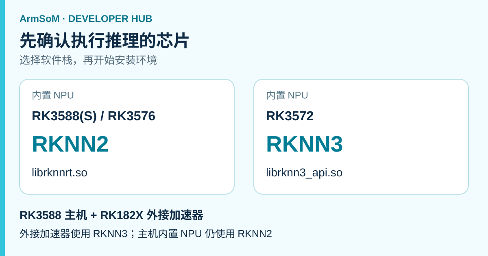
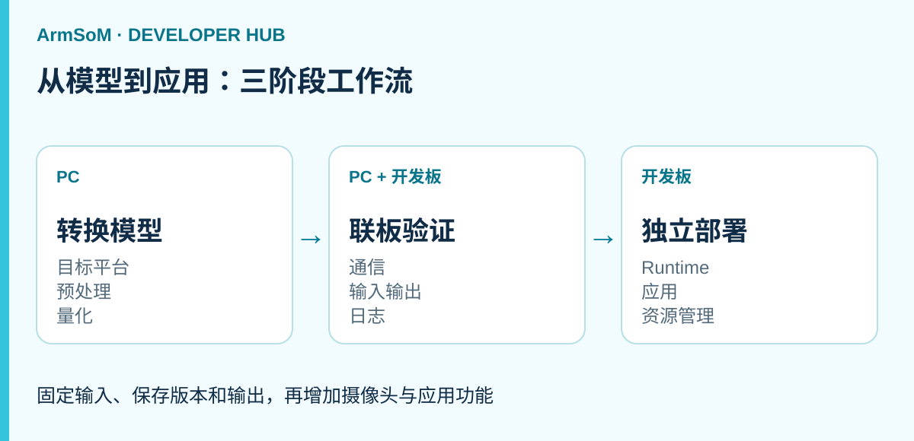

**在 ArmSoM 板卡上部署 AI 模型，先看实际执行推理的芯片：RK3588/RK3588S、RK3576 使用 RKNN-Toolkit2；RK3572 使用 RKNN3-Toolkit。** RK3588 主机连接 RK1820/RK1828 协处理器时，外接加速器才走 RKNN3，主机内置 NPU 仍走 RKNN2。

本文按“选路线 → 检查板端 → 安装独立环境 → 运行参考模型 → 接入应用”的顺序，整理两套工具链的关键差异、可复制命令和排障方法。版本基线为 RKNN-Toolkit2 2.5.0 与 RKNN3-Toolkit 1.2.0，主机命令以 Ubuntu x86_64、Python 3.10 为例。

> 适用范围：面向 Sige7、AIM7、LM7 等 RK3588 平台，以及 CM5、Sige5 等 RK3576 平台的开发者；RK3572 部分是官方 SDK 平台参考。板卡镜像、内核驱动和 Runtime 必须另行匹配。本篇完成文档与示例代码核对，未进行 ArmSoM 硬件推理测试，也不把参考文章中的第三方测试结果当作 ArmSoM 实测。



## 1. 先选软件栈，再选安装包

| 项目 | RKNN2 路线 | RKNN3 路线 |
| --- | --- | --- |
| 本文重点平台 | RK3588/RK3588S、RK3576；官方另列 RK3566/3568、RK3562、部分 RV 系列、RK2118 | RK3572；RK1820/RK1828 为协处理器模式 |
| PC 转换工具 | RKNN-Toolkit2 | RKNN3-Toolkit |
| 运行库 | `librknnrt.so` | `librknn3_api.so`；RK3572 本地路径还涉及 `librknn3_api_native.so` |
| 联板调试 | `rknn_server` | RK3572 使用 `rknn3-server`；RK182X 通信使用 `rknn3_transfer_proxy` |
| 板端 Python | RKNN-Toolkit-Lite2 | RKNN3-Toolkit Lite |
| 本文示例模型文件 | `.rknn` | `.rknn` 与配套 `.weight` |
| 大语言模型方向 | 单独的 RKNN-LLM SDK | RKNN3 的 LLM 流程及 `rkllm3-server`，仍需核对模型和平台支持 |

两套 Toolkit 的 Python 示例都可能写 `from rknn.api import RKNN`。**相同导入语句、相同文件后缀，不代表相同模型格式或相同运行库。** 换到另一工具链或目标芯片，应从原始模型重新转换，不能靠重命名 `.rknn` 文件完成迁移。支持列表和版本对应关系以官方发布为准。[RKNN2 官方仓库](https://github.com/airockchip/rknn-toolkit2/tree/2c723177a94fac65cbc036d722907ddbc91980cf) · [RKNN3 官方仓库](https://github.com/airockchip/rknn3-toolkit/tree/141883c8e11b05ef4cca4a69d8a7572c4d855191)

| ArmSoM 选型入口 | 内置 NPU 路线 | 项目落地时继续确认 |
| --- | --- | --- |
| [Sige7](https://www.armsom.org/sige7)、[AIM7](https://www.armsom.org/aim7)、[LM7](https://www.armsom.org/lm7) | RK3588 → RKNN2 | 整机或载板、供电散热、系统镜像及驱动 |
| [CM5](https://www.armsom.org/cm5)、[Sige5](https://www.armsom.org/sige5) | RK3576 → RKNN2 | 模块/载板版本、摄像头输入、SDK 和部署接口 |
| RK3572 平台 | RKNN3 | 以实际开发板与 BSP 为准，不将平台参考写成某款 ArmSoM 产品已经验证 |

产品参数见 [Sige7 文档](https://docs.armsom.org/armsom-sige7)和 [CM5 文档](https://docs.armsom.org/armsom-cm5)。看到 RK3588 固件中存在 `librknn3_api.so` 时，先查它是否服务于外接 RK182X；不能据此把 RK3588 内置 NPU 判为 RKNN3。

## 2. 分清转换、联板验证和独立部署



| 阶段 | 在哪里执行 | 需要得到什么 |
| --- | --- | --- |
| 模型转换 | PC 的对应 Toolkit 环境 | 目标平台、输入格式、预处理、量化数据和导出模型 |
| 联板验证 | PC + 开发板 | 在真实目标上验证输出；按该模式准备通信服务 |
| 独立部署 | 板端 Runtime/C++ 或 Lite Python | 应用自行加载模型、管理输入输出和资源 |

`rknn_server` 是 RKNN2 的联板调试代理，不等于最终业务应用。独立 C/C++ 程序直接使用 Runtime，不应因为没有常驻 PC 调试服务就认定部署失败。RKNN3 同样要先分清联板和本地执行模式。

先固定一张输入图片，确认模型结果，再接入摄像头、视频解码、网络请求和多线程。这样可以把模型问题与取流、颜色格式、缩放、内存复制等问题分开定位。

## 3. 安装前，先检查 Android 板端

以下为开发主机上的只读检查。Linux 板端可通过 SSH 检查对应的 `/usr/lib`、`/usr/bin` 路径；Android 的 `/vendor` 路径不能直接照搬到所有 Linux 镜像。

```bash
adb devices
adb shell getprop ro.board.platform
adb shell uname -m
adb shell 'ls -l /vendor/lib64/librknn* /vendor/bin/rknn* /dev/rknpu* /dev/dri/renderD*'
adb shell 'cat /sys/kernel/debug/rknpu/version'
```

`debugfs` 未挂载、权限不足或 BSP 路径不同都可能使最后一条命令失败。设备节点也不一定固定为 `/dev/rknpu` 或某个 `renderD` 编号。应结合驱动日志、固件说明和实际节点判断，不把“找不到某个路径”直接等同于“没有 NPU”。

记录板卡与载板版本、镜像来源、内核、NPU 驱动、Runtime 和 Toolkit 版本。优先使用同一 SDK 发布配套的组件；需要跨版本组合时查兼容说明，而不是把“版本号完全相等”当作所有版本的永久规则。

## 4. RK3588 / RK3576：RKNN2 参考流程

### 4.1 获取源码并建立独立环境

将官方 [Toolkit2](https://github.com/airockchip/rknn-toolkit2/tree/2c723177a94fac65cbc036d722907ddbc91980cf) 与 [Model Zoo](https://github.com/airockchip/rknn_model_zoo/tree/837db8e992815ff8647eadb709f07067f4bc3a71) 仓库或配套 SDK 放到 `~/Projects/rknn-toolkit2`、`~/Projects/rknn_model_zoo`，保留完整目录。已有 SDK 不必重复下载；先确认版本与本节基线一致。Python 3.10 和 venv 支持需已安装。

```bash
python3.10 -m venv ~/venvs/armsom-rknn2
source ~/venvs/armsom-rknn2/bin/activate
cd ~/Projects/rknn-toolkit2/rknn-toolkit2
python -m pip install -r packages/x86_64/requirements_cp310.txt
python -m pip install packages/x86_64/rknn_toolkit2-2.5.0-cp310-cp310-manylinux_2_17_x86_64.manylinux2014_x86_64.whl
python -m pip check
python -c "from rknn.api import RKNN; import importlib.metadata as m; print(m.version('rknn-toolkit2'))"
```

先安装该版本的依赖清单，再安装匹配 CPU 架构和 Python ABI 的 wheel。`cp310` 不是 Python 3.8 包；本文的 x86_64 wheel 也不是板端 aarch64 包。这里使用 venv，Conda 也可用于隔离环境。

### 4.2 仅在联板调试需要时启动 rknn_server

如果固件已有配套服务，先检查其运行状态，避免重复启动。若服务缺失，且开发固件允许 shell 运行 NPU 程序，可将 SDK 内的 Android arm64 服务放到临时目录，并在单独终端前台运行以保留错误输出：

```bash
cd ~/Projects/rknn-toolkit2
adb push rknpu2/runtime/Android/rknn_server/arm64/rknn_server /data/local/tmp/rknn_server
adb shell 'chmod +x /data/local/tmp/rknn_server'
adb shell /data/local/tmp/rknn_server
```

保持该终端运行，在另一个终端执行 PC 推理。临时目录不会自动解决缺失的动态库、设备权限或 SELinux 策略；遇到错误应先修正对应层。正式固件应由 BSP 构建流程集成组件和启动配置，不把修改只读 `/vendor` 分区或关闭安全策略作为通用安装步骤。

### 4.3 使用 YOLOv5 做第一次目标验证

下面沿用官方 Model Zoo 的 `yolov5s_relu.onnx`。转换前确认 `datasets/COCO/coco_subset_20.txt` 及其引用图片齐全；示例量化集用于起步，正式模型需要代表实际场景的数据。[示例与参数](https://github.com/airockchip/rknn_model_zoo/blob/837db8e992815ff8647eadb709f07067f4bc3a71/examples/yolov5/README.md)

```bash
source ~/venvs/armsom-rknn2/bin/activate
cd ~/Projects/rknn_model_zoo/examples/yolov5/model
bash download_model.sh
cd ../python
python convert.py ../model/yolov5s_relu.onnx rk3588 i8 ../model/yolov5s_relu.rknn
python yolov5.py --model_path ../model/yolov5s_relu.rknn --target rk3588 --img_save
```

`i8` 表示启用量化。`--img_save` 适合无桌面环境，避免 `--img_show` 依赖显示服务。切换 CM5/Sige5 的 RK3576 时，**转换目标和推理目标都要改**，建议另存模型以免混淆：

```bash
python convert.py ../model/yolov5s_relu.onnx rk3576 i8 ../model/yolov5s_relu_rk3576.rknn
python yolov5.py --model_path ../model/yolov5s_relu_rk3576.rknn --target rk3576 --img_save
```

成功判断应包含进程无错误退出、检测类别与输入图片一致、输出图可检查，以及日志中的目标/版本符合预期。本文没有给出 ArmSoM 实测帧率或延迟。后续可接入 [C/C++ 部署指南](/zh/articles/rknn-v250-sdk-guide-c-deployment/)与 [Lite2 板端部署](/zh/articles/rknn-v250-sdk-guide-lite-deployment/)。

## 5. RK3572：RKNN3 的独立环境和参考模型

### 5.1 使用另一个 Python 环境

将官方 [RKNN3 Toolkit](https://github.com/airockchip/rknn3-toolkit/tree/141883c8e11b05ef4cca4a69d8a7572c4d855191) 和 [RKNN3 Model Zoo](https://github.com/airockchip/rknn3-model-zoo/tree/7f8c7d848448fa14cf16ba359ca98405c8bb94b5) 放到 `~/Projects/rknn3-toolkit`、`~/Projects/rknn3-model-zoo`。如果当前没有激活 venv，可略过第一行 `deactivate`。

```bash
deactivate
python3.10 -m venv ~/venvs/armsom-rknn3
source ~/venvs/armsom-rknn3/bin/activate
cd ~/Projects/rknn3-toolkit/rknn3-toolkit
python -m pip install -r packages/requirements_cp310-1.2.0.txt
python -m pip install packages/x86_64/rknn3_toolkit-1.2.0-cp310-cp310-manylinux2014_x86_64.whl
python -m pip check
python -c "from rknn.api import RKNN; import importlib.metadata as m; print(m.version('rknn3-toolkit'))"
```

本次核对的 RKNN2 2.5.0 Python 3.10 依赖包含 `numpy<=1.26.4`，RKNN3 1.2.0 则要求 `numpy>=2.0`；两者不能放进同一个环境。导入成功后还要核对包名和版本，避免实际上加载了另一套 `rknn` 模块。

Android RK3572 的联板组件可按下面检查；路径应以自己的 BSP 为准。本节后续运行的是本地 C++ demo，不以 PC 联板服务代替应用：

```bash
adb shell 'ls -l /vendor/lib64/librknn3_api.so /vendor/lib64/librknn3_api_native.so'
adb shell '/vendor/bin/rknn3-server -v'
```

### 5.2 明确选择 RK3572 对应的 YOLOv6 模型

官方 1.2.0 快速入门在 RK3572 路线使用 **`yolov6n.onnx`**。本次核对的下载脚本默认启用的是面向 RK182X 优化的 `yolov6n_rknn3.onnx`，标准模型下载行被注释；因此不能只执行脚本就假定拿到了 RK3572 所需模型。下面直接使用脚本内给出的标准模型地址：

```bash
source ~/venvs/armsom-rknn3/bin/activate
cd ~/Projects/rknn3-model-zoo/examples/yolov6/model
wget -O yolov6n.onnx https://ftrg.zbox.filez.com/v2/delivery/data/95f00b0fc900458ba134f8b180b3f7a1/examples/yolov6/yolov6n.onnx
cd ../python
python convert.py ../model/yolov6n.onnx rk3572 i8
ls -lh ../model/yolov6n.rknn ../model/yolov6n.weight
```

确认 `.rknn` 和 `.weight` 同时产生，且来自同一次转换。`convert.py` 的旧帮助文字只列 `rk1820`，但 1.2.0 快速入门明确给出 `rk3572` 用法；脚本将该参数传入 `target_platform`。[官方 RKNN3 文档](https://github.com/airockchip/rknn3-toolkit/tree/141883c8e11b05ef4cca4a69d8a7572c4d855191/doc) · [所核对转换脚本](https://github.com/airockchip/rknn3-model-zoo/blob/7f8c7d848448fa14cf16ba359ca98405c8bb94b5/examples/yolov6/python/convert.py)

### 5.3 编译并运行 Android arm64 参考程序

先安装 CMake 和该 SDK 支持的 Android NDK，把 `ANDROID_NDK_PATH` 指向实际 NDK 目录；板端须有匹配 Runtime、驱动和执行权限。构建脚本会重新生成自己的 demo 安装目录。

```bash
cd ~/Projects/rknn3-model-zoo
: "${ANDROID_NDK_PATH:?Set ANDROID_NDK_PATH to your Android NDK directory}"
./build-android.sh -t rk3572 -a arm64-v8a -b Release -d yolov6
adb push install/rk3572_android_arm64-v8a/rknn_yolov6_demo /data/local/tmp/
```

随后进入板端运行，再回到主机取出结果图：

```bash
adb shell
cd /data/local/tmp/rknn_yolov6_demo
export LD_LIBRARY_PATH=./lib${LD_LIBRARY_PATH:+:$LD_LIBRARY_PATH}
./rknn_yolov6_demo model/yolov6n.rknn model/yolov6n.weight model/bus.jpg 1
exit
adb pull /data/local/tmp/rknn_yolov6_demo/out.png .
```

末尾的 `1` 是这个示例使用的核心掩码，应与转换时 `core_num=1` 的配置匹配；不能照抄其他平台的多核掩码。检查 `out.png`、类别、置信度和坐标，同时保留完整日志。不要把官方示例输出或别人的测试时间当作本机性能。

Linux 部署使用配套 `build-linux.sh`、aarch64 交叉工具链及 Linux Runtime，不能复用 Android ELF 和 Android 库。更完整的 API 与资源释放流程见 [RKNN3 Runtime 指南](/zh/articles/rknn3-v120-runtime-c-lifecycle/)。

## 6. 从 demo 接到 Android 应用

| 方式 | 适合什么项目 | 主要设计事项 |
| --- | --- | --- |
| APK + JNI | 摄像头界面、交互式检测应用 | ABI、图像预处理、推理线程、Runtime 依赖、权限与生命周期 |
| 系统服务 + IPC | 多个应用共享推理、需要统一管理模型 | 明确服务接口、进程身份、请求队列、异常恢复和 BSP 集成 |
| 本机 HTTP 服务 | 原型验证、网页前端或跨语言调用 | 自行定义图像/结果协议、限流与超时，默认仅监听回环地址 |

Rockchip 有 [RKNN2 Android APK 示例](https://github.com/airockchip/rknn-toolkit2/tree/2c723177a94fac65cbc036d722907ddbc91980cf/rknpu2/examples/rknn_yolov5_android_apk_demo)，可用来理解 Java/JNI 分层，但不能只替换库名就当作 RKNN3 实现。APK 能否加载 vendor 库还受 Android linker namespace 和 SELinux 等约束，单纯把 `.so` 复制到目录里并不足够。[Android 动态库隔离](https://source.android.com/docs/core/architecture/vndk/linker-namespace) · [SELinux](https://source.android.com/docs/security/features/selinux)

本机 HTTP 是应用层架构选择，不是 `rknn_server` 默认提供的 REST 接口。RKNN3 的 `rkllm3-server` 提供 OpenAI 兼容的 LLM/VLM 服务能力，也不能直接当作 YOLO 检测接口使用。先确定模型类型，再选择 API。

## 7. 按故障层定位，比反复重装更有效

| 现象 | 优先检查 |
| --- | --- |
| `No module named 'torch'` | 是否激活正确 venv、是否完整安装该版本依赖、是否误用 `--no-deps` |
| `libcublas.so` 等依赖缺失 | 主机 PyTorch 包及依赖是否完整；若不需 CUDA，选择版本相容的官方 CPU 构建 |
| 导入成功但连接不到设备 | ADB 授权、数据线/端口、服务、Runtime、设备权限和日志 |
| `.rknn` 加载失败 | Toolkit 家族、目标芯片、模型导出版本、RKNN3 配套 `.weight` |
| 有结果但检测不正确 | RGB/BGR、缩放和 padding、归一化、输入张量布局、量化数据及后处理 |
| 单图正常而视频卡顿 | 分开测取流、预处理、推理、后处理、复制与显示，别只看 NPU 用时 |
| `/vendor` 写入失败 | 系统分区与 BSP 集成方式；临时目录调试并不代表量产 APK 具有相同权限 |

例如仅在 RKNN2 的 Python 3.10 环境、确认项目不依赖 CUDA 且版本允许时，可按 PyTorch 官方历史版本说明选 CPU 包；不是要求所有用户重新安装：

```bash
python -m pip install --force-reinstall torch==2.4.0 --index-url https://download.pytorch.org/whl/cpu
python -m pip check
```

[PyTorch 官方版本安装说明](https://pytorch.org/get-started/previous-versions/)。离线环境需提前准备相同主机架构/Python 版本的全部依赖、模型、量化图片和仓库文件，仅复制一个 wheel 不足以重建环境。

## 8. 让第一个模型成为可复现的工程起点

保存板卡/载板、系统镜像、SDK 四件套版本、仓库提交号、模型和输入文件校验值、预处理参数、完整命令与结果。分别记录首次加载、预热后的推理和端到端耗时；没有这些条件，两个“FPS”通常不可直接比较。

下一步按项目选入口：[CM5 产品](https://www.armsom.org/cm5)、[Sige5 产品](https://www.armsom.org/sige5)、[Sige7 产品](https://www.armsom.org/sige7)；继续学习 [RKNN2 YOLOv5 与精度评估](/zh/articles/rknn-v250-sdk-quickstart-yolov5/)、[RKNN3 平台与软件栈](/zh/articles/rknn3-v120-platform-guide/)。

## 资料与核对范围

选题参考读者提供的《RK 平台 NPU 开发快速入门：RK3588 与 RK3572》截图（RK软件开发-吴工，2026-11-14；[原文入口](https://mp.weixin.qq.com/s/67VJOwm3z00N_u6xIudwdA)）。截图止于第 3.3 节开头，本文后续步骤由 ArmSoM 依据官方资料重新组织，不声称已提取该文全部内容。

2026-11-17 核对的官方快照：RKNN2 `2c723177a94f`、RKNN3 `141883c8e11b0`、RKNN Model Zoo `837db8e99281`、RKNN3 Model Zoo `7f8c7d848448`。命令、路径和依赖以这些版本为基线；系统镜像和实际硬件验证仍需项目方完成。两张流程图为 ArmSoM 编辑示意图，不是设备截图或性能结果。
