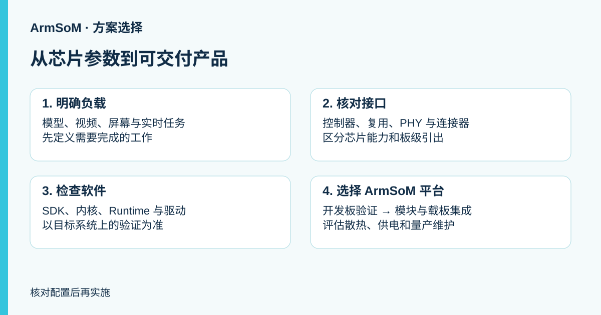

**选 Rockchip 平台，先看模型、视频与接口能否组成完整方案，再看 CPU 或 TOPS。** 对 ArmSoM 项目，RK3588 平台可重点评估多媒体与扩展需求，RK3576 平台可评估紧凑计算与嵌入式 AI；RK3572 则需要单独核对新一代 NPU 软件栈与具体板卡进度。

本文把用户提供的九芯片对比资料改编为工程选型指南。表格是芯片层面的参考，不是 ArmSoM 板卡功能承诺，也不把第三方判断写成实测。制程、功耗、频率、供货状态和生命周期不从型号或发布时间推断。

## 1. 先用 CPU 与加速器缩小范围

| SoC | CPU | GPU 系列 | 资料标称 NPU |
| --- | --- | --- | --- |
| RK3588 | 4 × Cortex-A76 + 4 × Cortex-A55 | Mali-G610 | 6 TOPS |
| RK3576 | 4 × Cortex-A72 + 4 × Cortex-A53 | Mali-G52 | 6 TOPS* |
| RK3572 | 2 × Cortex-A73 + 6 × Cortex-A53 | Mali-G310 | 4 TOPS* |
| RK3562 | 4 × Cortex-A53 | Mali-G52 | 1 TOPS |
| RK3568 | 4 × Cortex-A55 | Mali-G52 | 1 TOPS |
| RK3566 | 4 × Cortex-A55 | Mali-G52 | 1 TOPS |
| RK3399 | 2 × Cortex-A72 + 4 × Cortex-A53 | Mali-T860 | — |
| RK3326 | 4 × Cortex-A35 | Mali-G31 | — |
| PX30 | 4 × Cortex-A35 | Mali-G31 | — |

星号表示所提供对比资料对 RK3576、RK3572 使用了稀疏计算口径；这不是与其他芯片严格等条件的性能榜。GPU 只列系列，不混用不同驱动版本的 Vulkan/OpenCL 支持表。横线表示这几款型号未列出独立 NPU，**不表示 CPU/GPU 无法运行 AI**。

[瑞芯微 RK3562 产品页](https://www.rock-chips.com/a/en/products/RK35_Series/2024/0626/1983.html)与 [RK3572 官方介绍](https://www.rock-chips.com/a/cn/news/rockchip/2026/0518/2168.html)可用于核对对应平台的基本定位。模型最终能否落地，还取决于算子覆盖、量化精度、内存占用和端到端延迟。

### AI 项目不能只比较 TOPS

先固定输入分辨率、模型版本、量化方式、批大小和目标帧率，再记录预处理、推理、后处理各自耗时。多路摄像头项目还要计入解码、颜色转换和内存复制；单模型推理快，不代表整条视频链路快。

RK3588、RK3576 的片上 NPU 走 RKNN2，RK3572 走 RKNN3；主机外接 RK182X 又是另一条部署链路。转换工具、模型文件和 Runtime 必须匹配，参考 [ArmSoM RKNN2/RKNN3 入门](/zh/articles/rockchip-npu-rknn2-rknn3-getting-started/)。

## 2. 按应用约束建立候选清单

| 项目 | 优先评估的方向 | 必须验证的条件 |
| --- | --- | --- |
| 多路视觉、复杂显示、较多高速扩展 | RK3588；Sige7、AIM7、LM7 | 视频格式与并发组合、存储吞吐、散热以及载板布线 |
| 智能终端、边缘网关、紧凑型 AI | RK3576；CM5、Sige5 | 模型精度、接口引出、目标 Android/Linux 镜像 |
| 新平台成本与功能平衡 | RK3572 | RKNN3 适配、BSP 完整度、板卡与量产计划 |
| 网关、控制与成熟方案维护 | RK3568 / RK3566 | 两者不能当作引脚和接口完全相同的替代品 |
| 低复杂度显示或嵌入式终端 | RK3562 | 原生显示接口；需要 HDMI 时另算桥接器与驱动成本 |
| 已有设备升级与长期维护 | RK3399 / RK3326 / PX30 | 既有软件资产、内存压力、安全更新和实际供货 |

这是需求筛选顺序，不是性能排名。“存量项目适合维护”也不是厂商停产声明。若已有软件稳定运行，重新设计的收益应覆盖迁移、认证和回归成本。

## 3. 多媒体：把一个“最高规格”拆成五个问题

1. **编解码格式**：H.264、H.265、VP9、AV1 的分辨率、帧率与 profile 限制并不相同，不能把最高解码值写成所有格式通用。
2. **像素格式**：位深、YUV420/422/444、stride 和缓冲区布局是否贯通 ISP、RGA、MPP 与显示链路？
3. **并发组合**：两路摄像头、一条编码流和两个屏幕同时运行时，是否超过带宽或显示资源？
4. **物理连接**：HDMI/eDP/DP combo、MIPI lane、Type-C 复用及板级连接器是否满足需求？
5. **目标系统**：Linux 与 Android 的驱动、用户态组件、相机调校和应用框架需要分别验收。

可用 [ArmSoM 视频编解码文档](https://docs.armsom.org/advanced-manual/rockchip-video-codec)建立测试流程。本文没有据此声称任何具体并发组合已经通过。

## 4. 内存、网络和存储要核对到板级

芯片寻址上限不是可购买内存配置。对推理任务，应预算模型权重、激活、输入输出、视频缓冲和系统余量；对 NAS，应同时考虑持续写入、网络流量、文件系统与温度。

| 容易混淆的说法 | 工程上应确认 |
| --- | --- |
| 有两个 MAC，就有两个可用网口 | PHY、接口模式、连接器、驱动与板级速率 |
| PCIe/SATA/USB 数量可以相加 | combo PHY 复用表、lane 分配与同时启用条件 |
| 支持 UFS，板上就能装 UFS | 焊盘、供电、启动支持与具体板卡 BOM |
| 有 CAN 控制器，就能直接接总线 | 板级收发器、隔离、终端电阻和设备树 |
| SoC 有接口，模块插上就能用 | 模块针脚定义、载板布线、电压与软件适配 |

对 CM5 这类模块，选型文件应包含模块和载板两张接口清单；对 Sige 系列整板，则从板卡原理图与连接器出发。不要用另一款 SoC 的规格填补当前型号资料的空白。

## 5. 建一份可复查的选型记录

用户提供的对比图列出了以下 datasheet 版本。它们是**原资料声明的依据**，不意味着本次已取得并逐页核验全部这些版本；版本不同的官方简表只用于交叉核对，不静默替换。

| 型号 | 原资料列出的版本 |
| --- | --- |
| RK3588 | V1.8 · 20240821 |
| RK3576 | V1.3 · 20240826 |
| RK3572 | V1.0 · 20260324 |
| RK3562 | V2.0 · 20241104 |
| RK3568 / RK3568B2 | V2.1 · 20240621 |
| RK3566 | V1.4 · 20240621 |
| RK3399 | V1.8 · 20180529 |
| RK3326 | V1.4 · 20190110 |
| PX30 | V1.2 · 20190110 |

每个项目建议保存：芯片完整后缀、板卡硬件版本、内存/存储配置、原理图版本、SDK release、内核提交、NPU Runtime、测试负载、结果和未验证项。尤其 RK3568B2 与 RK3568、RK3588 与 RK3588S，不应省略后缀后混用所有参数。

## 6. 从候选平台走到 ArmSoM 样机

先用开发板验证一条真实业务链路，再决定模块和载板方案。视觉项目先跑自己的数据，显示项目先接目标屏幕，存储项目先测持续负载。把冷启动、断电恢复、长时间运行与升级回归加入验收，避免只凭一次 demo 成功定型。

比较结果应写成“满足哪些约束、仍有哪些缺口”，而不是“这颗芯片最好”。来源参考：[用户提供的九芯片对比文章](https://mp.weixin.qq.com/s/Li61_e6BUuoQ_YPQWkJuKg)、上述官方产品资料及对应 ArmSoM 文档。

## 适用产品与继续阅读

ArmSoM 项目可从 [Sige7](https://www.armsom.org/sige7)、[AIM7](https://www.armsom.org/aim7)、[LM7](https://www.armsom.org/lm7) 的 RK3588 平台，或 [CM5](https://www.armsom.org/cm5)、[Sige5](https://www.armsom.org/sige5) 的 RK3576 平台开始评估。接口与系统支持请分别查阅 [Sige7 文档](https://docs.armsom.org/armsom-sige7)、[CM5 文档](https://docs.armsom.org/armsom-cm5)、[Sige5 文档](https://docs.armsom.org/armsom-sige5)。产品链接用于选型，不代表这些板卡已验证本文全部 SDK 组合。
