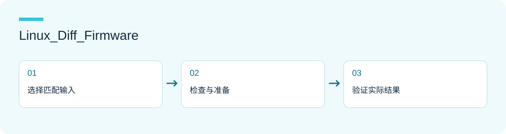





差分升级描述从指定旧固件到指定新固件的变化，有机会减少传输体积，但大小取决于实际镜像，不能承诺固定压缩比例。

## 先固定旧版本基线

保存不可混淆的 `old.img`、`new.img` 与哈希。设备必须运行预期旧版本，同时核对产品、存储布局和升级机制；差分包小不代表不同产品的固件可以兼容。

## 主机依赖与调用

脚本检查 `bsdiff`、`rkImageMaker`、`afptool`、`md5sum`，识别 Squashfs 和 ext4，并在脚本目录创建 OLD/NEW/DIFF 临时目录。使用输入副本，预留两份解包镜像与差分结果所需空间。

```text
./mk-diff-ota.sh old.img new.img diff.img
```

参数顺序是旧固件、新固件、输出。核对脚本里的芯片映射与实际 SDK；其中 A/B 支持仍标为 TODO，不能因为存在 A/B 分区名就认定该包支持现代 A/B 发布流程。

## 验收路线

先独立确认两个完整镜像能在测试板启动，再从精确旧基线测试差分升级，检查最终系统版本、文件和关键服务。按照产品的恢复设计测试错误基线、升级中断，并保留完整恢复镜像。

## 常见问题

不支持的文件系统要换受支持的打包路线，不能仅改扩展名。缺依赖要补齐对应主机工具。基线不一致需要修正版本分发流程。记录日志和退出状态，生成差分文件不等于现场升级已经验证成功。

## 适用范围与验证状态

本文依据本次工具包及原始资料整理。使用前核对具体板卡、SoC、载板、SDK/BSP 与主机架构。本次未执行烧录、生产配置、寄存器写入或硬件测试；提供下载不代表所有 ArmSoM 产品均支持。

## 工具下载、版本与 SHA-256

下载对应压缩包，校验哈希后完整解压。Linux PinDebug 分卷请先按链接中的说明还原；下方该项哈希对应合并后的完整文件。

| 主机 / 版本 | 下载包 |
|---|---|
| Linux / directory snapshot | [linux-diff-firmware-directory-snapshot.zip](https://raw.githubusercontent.com/ArmSoM/rockchip-tools/main/downloads/diff-firmware/linux-diff-firmware-directory-snapshot.zip) |

**linux-diff-firmware-directory-snapshot.zip — SHA-256**

```text
e13711865267ea4ee1f71c048d356bc5dff2de0f24e3d1b71dcd4cfb159b45b9
```

[GitHub · catalog.json](https://github.com/ArmSoM/rockchip-tools/blob/main/catalog.json) · [SHA256SUMS](https://github.com/ArmSoM/rockchip-tools/blob/main/SHA256SUMS)

## 资料依据与原图

- Linux_Diff_Firmware/mk-diff-ota.sh and bundled packaging utilities

## 继续阅读相关流程

- [afptool 与 rkImageMaker：理解并打包 Rockchip update.img](/zh/articles/rockchip-tool-firmware-pack-tools/)
- [Rockchip 量产烧录完整指南：USB、SD、烧录器与故障排查](/zh/articles/147-rockchip-firmware-production/)
- [Rockchip 工具下载与使用指南索引](/zh/articles/rockchip-tools-download-guide/)

## 查找准确的 ArmSoM 板卡资料

板卡、载板与接口要求先以产品手册为准。以下链接是平台参考，不表示该归档工具已在这些产品上验证。

[ArmSoM Docs](https://docs.armsom.org/) · [Sige7](https://www.armsom.org/sige7) / [Docs](https://docs.armsom.org/armsom-sige7) · [CM5](https://www.armsom.org/cm5) / [Docs](https://docs.armsom.org/armsom-cm5)


