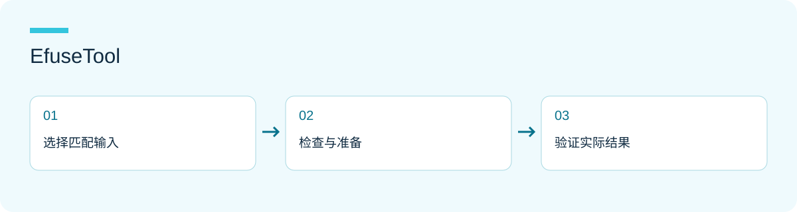



EfuseTool 涉及公钥哈希等安全信息写入，eFuse/OTP 状态可能不可逆，应纳入板卡专用的生产配置流程，而不是当成普通恢复刷机工具。

## 包内资料能确认什么

1.42 修订记录增加 356X 支持，较早记录修复 RK3288/RK3399、RK3229P 公钥哈希问题，不能据此推断全部新 SoC 支持。本包没有完整独立 PDF；语言资源显示固件加载、设备 ID、逐设备状态及 key-hash 写入、读取、比较错误。

## 准备工位

连接设备前核对已批准固件和登记公钥身份，记录固件、Loader、工具版本、USB 拓扑与板卡版本。包内帮助要求把每个物理 USB 口与工具显示的 ID 对应标记。先在指定工程样机上验证流程。

## 控制不可逆步骤

在生产流程中将签名、签名校验与熔丝配置分为独立检查点。不能从别的芯片推断安全地址或密钥长度。“firmware is unsigned”“creating publickey hash failed”应修正文件与密钥关系，而不是绕过检查。

## 按设备保存结果

保留设备身份、预期公钥指纹、操作状态及后续启动/恢复结果。重试前要考虑设备已经改变的状态，超时后不可盲目重复。界面文字只能证明这些处理阶段存在，不等于已验证的全平台点击教程；本文没有烧写熔丝。

## 适用范围与验证状态

本文依据本次工具包及原始资料整理。使用前核对具体板卡、SoC、载板、SDK/BSP 与主机架构。本次未执行烧录、生产配置、寄存器写入或硬件测试；提供下载不代表所有 ArmSoM 产品均支持。

## GitHub 工具目录、版本与 SHA-256

打开 GitHub 对应目录后选择所需平台和版本，再校验文件哈希并完整解压。下方链接均为仓库目录入口。

[前往 GitHub 对应工具目录](https://github.com/ArmSoM/rockchip-tools/tree/main/downloads/efuse-tool)

| 平台 / 版本 | 文件 | SHA-256 |
|---|---|---|
| Windows / 1.42 | `EfuseTool_v1.42.zip` | `abb81d072ad6a7cec31d7a7c5a3f72d9bfe57544ee4d8715e4c031b4bd780fc9` |

[GitHub · catalog.json](https://github.com/ArmSoM/rockchip-tools/blob/main/catalog.json) · [SHA256SUMS](https://github.com/ArmSoM/rockchip-tools/blob/main/SHA256SUMS)

## 资料依据与原图

- EfuseTool_v1.42.zip: revision.txt and Language/English.ini

## 继续阅读相关流程

- [rk_sign_tool 与 sign_tool：Rockchip 固件签名和校验流程](/zh/articles/rockchip-tool-rk-sign-tool/)
- [SecureBootTool 1.85：理解历史 Rockchip 安全启动工具链](/zh/articles/rockchip-tool-secureboot-tool/)
- [Rockchip Secure Boot 完整应用指南：签名、eFuse、OTP 与验证](/zh/articles/105-rockchip-secure-boot/)
- [Rockchip 工具下载与使用指南索引](/zh/articles/rockchip-tools-download-guide/)

## 查找准确的 ArmSoM 板卡资料

板卡、载板与接口要求先以产品手册为准。以下链接是平台参考，不表示该归档工具已在这些产品上验证。

[ArmSoM Docs](https://docs.armsom.org/) · [Sige7](https://www.armsom.org/sige7) / [Docs](https://docs.armsom.org/armsom-sige7) · [CM5](https://www.armsom.org/cm5) / [Docs](https://docs.armsom.org/armsom-cm5)


