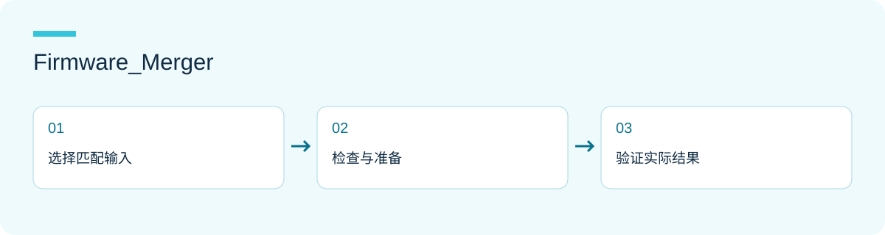





Firmware_Merger 从 `setting.ini` 生成固件文件，适用于需要明确整片存储布局的生产流程。选择烧写工具之前，必须先区分原手册的三种输出格式。

## 选择输出格式

| `Gpt_Enable` | 原文含义 | 写入路线 |
|---|---|---|
| 留空 | Flat RK，RK miniloader | 匹配的原始镜像写入流程 |
| `0` | Flat GPT，U-Boot SPL | 匹配的原始镜像写入流程 |
| `1` | Compact GPT | 需要生产工具支持 |

留空、0、1 的对应关系按原文保留。Compact 不能当作 Flat 镜像直接用 `wl` 原始写入。`Backup_Partition_Enable=1` 表示备份固件头，留空是默认值，原文也用于未知 Flash 容量时。

## 定义分区布局

IDBlock 必须是第一分区，原例为：

```text
Name=IDBlock
Type=0x2
PartOffset=0x40
PartSize=0x400
Flag=
File=Image/FlashData.bin,Image/FlashBoot.bin
```

原文要求该分区小于 2M；没有核对格式单位前，不要把十六进制偏移直接理解为字节。其他分区中，`Flag` 留空表示写文件并填满分区，`0x2` 表示无文件填充，`0x1` 跳过，`0x4` 让最后分区使用剩余空间。`Type_Guid` 引用 `[PARTITION_TYPE_GUID]` 中的键。

## 打包与验证

复制对应配置，核对每个镜像路径、存储容量和分区布局，再执行 README 的命令：

```text
./firmware_merger -P setting.ini ./
```

此步骤生成文件，烧写是后续独立动作。对比预期和实际大小，记录哈希，用 SDK 对应工具检查分区映射。上板前确认写入工具支持生成的格式。

## 常见问题

缺镜像、分区重叠、混淆 Compact 与 Flat，都不是换 USB 线能够解决的问题。配置与所有输入镜像要作为同一个版本归档。包内示例是格式参考，不是已经验证的 ArmSoM 存储布局。

## 适用范围与验证状态

本文依据本次工具包及原始资料整理。使用前核对具体板卡、SoC、载板、SDK/BSP 与主机架构。本次未执行烧录、生产配置、寄存器写入或硬件测试；提供下载不代表所有 ArmSoM 产品均支持。

## 工具下载、版本与 SHA-256

下载对应压缩包，校验哈希后完整解压。Linux PinDebug 分卷请先按链接中的说明还原；下方该项哈希对应合并后的完整文件。

| 主机 / 版本 | 下载包 |
|---|---|
| Linux / directory snapshot | [firmware-merger-linux-directory-snapshot.zip](https://raw.githubusercontent.com/ArmSoM/rockchip-tools/main/downloads/firmware-merger/firmware-merger-linux-directory-snapshot.zip) |

**firmware-merger-linux-directory-snapshot.zip — SHA-256**

```text
798ce66df5ee1f22cd96f811bf9140e5e9f4f0f3977a4ef37acd54554d6992ea
```

[GitHub · catalog.json](https://github.com/ArmSoM/rockchip-tools/blob/main/catalog.json) · [SHA256SUMS](https://github.com/ArmSoM/rockchip-tools/blob/main/SHA256SUMS)

## 资料依据与原图

- Firmware_Merger/Readme.txt; user_manual.txt; setting examples

## 继续阅读相关流程

- [afptool 与 rkImageMaker：理解并打包 Rockchip update.img](/zh/articles/rockchip-tool-firmware-pack-tools/)
- [programmer_image_tool：将 update.img 转为 eMMC、SPI NOR 与 NAND 烧录器文件](/zh/articles/rockchip-tool-programmer-image-tool/)
- [Rockchip 工具下载与使用指南索引](/zh/articles/rockchip-tools-download-guide/)

## 查找准确的 ArmSoM 板卡资料

板卡、载板与接口要求先以产品手册为准。以下链接是平台参考，不表示该归档工具已在这些产品上验证。

[ArmSoM Docs](https://docs.armsom.org/) · [Sige7](https://www.armsom.org/sige7) / [Docs](https://docs.armsom.org/armsom-sige7) · [CM5](https://www.armsom.org/cm5) / [Docs](https://docs.armsom.org/armsom-cm5)


