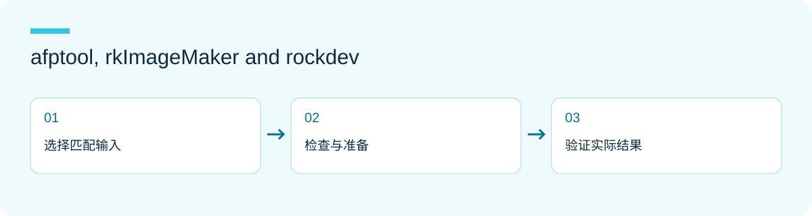





rockdev 打包目录分两步工作：`afptool` 按 `package-file` 组织文件，`rkImageMaker` 再组合这些数据、Loader 和芯片信息。固件容器不是可以直接当作磁盘写入的原始镜像。

## 准备一致的输入目录

分区镜像与匹配 Loader 放入 `Image/`，提供 `Image/parameter` 或 `Image/parameter.txt`，逐项检查顶层 `package-file`。引用文件必须存在，目标分区必须与 parameter 一致，所有组件来自同一板卡构建。

## 使用对应平台脚本

包内 RK3588 脚本使用如下两步：

```text
./afptool -pack ./ Image/update.img
./rkImageMaker -RK3588 Image/MiniLoaderAll.bin Image/update.img update.img -os_type:androidos
```

这是保留 `-os_type:androidos` 的 RK3588 原例，不是通用 Linux 配方。`Image/update.img` 是中间数据包，顶层 `update.img` 才是最终固件容器。从脚本预期的 rockdev 工作目录执行；其他 SoC 和系统配置使用实际 SDK 的脚本。

## 分发前反向检查

README 说明 `unpack.sh` 的解包结果位于 `output`。使用独立工作目录，避免把旧解包结果当成新固件。对比解包文件清单、Loader、分区名称和镜像长度，再记录最终 SHA-256。

## 常见打包错误

RK3588 脚本会检查缺少 parameter 和 package-file。路径不存在、镜像超过分区容量应在输入阶段修正。错误芯片标志可能到烧录时才暴露，因此发布前要核对目标标识。

本次 Linux 目录快照、macOS rockdev 2.1 和 Windows 日期版 RKImageMaker 分别保留，参数不保证相同。生成 `update.img` 只证明打包完成，量产前仍需验证目标板启动、存储、恢复与升级。

## 适用范围与验证状态

本文依据本次工具包及原始资料整理。使用前核对具体板卡、SoC、载板、SDK/BSP 与主机架构。本次未执行烧录、生产配置、寄存器写入或硬件测试；提供下载不代表所有 ArmSoM 产品均支持。

## GitHub 工具目录、版本与 SHA-256

打开 GitHub 对应目录后选择所需平台和版本，再校验文件哈希并完整解压。下方链接均为仓库目录入口。

[前往 GitHub 对应工具目录](https://github.com/ArmSoM/rockchip-tools/tree/main/downloads/firmware-pack-tools)

| 平台 / 版本 | 文件 | SHA-256 |
|---|---|---|
| Linux / directory snapshot | `rockdev-linux-directory-snapshot.zip` | `06049f3eb612de5d1a3866bffe4b1d8d7dabaef4fd38b07decd79380f5af5a36` |
| macOS / 2.1 | `rockdev_v2.1_mac.zip` | `af29d720edba7a0f082f984d57adf5a09b81a8df6deebf7f158aeedabd4018e7` |
| Windows / 20230109 | `RKImageMaker_20230109.zip` | `887863bb2563ba0ab9c77b846a26f47fe7774f95152d66253c4de910419591cd` |

[GitHub · catalog.json](https://github.com/ArmSoM/rockchip-tools/blob/main/catalog.json) · [SHA256SUMS](https://github.com/ArmSoM/rockchip-tools/blob/main/SHA256SUMS)

## 资料依据与原图

- Linux_Pack_Firmware/rockdev/readme.txt; rk3588-mkupdate.sh; unpack.sh
- rockdev_v2.1_mac.zip; RKImageMaker_20230109.zip

## 继续阅读相关流程

- [Firmware_Merger：Flat RK、Flat GPT 与 Compact GPT 固件打包](/zh/articles/rockchip-tool-firmware-merger/)
- [upgrade_tool 下载与使用：命令行烧录、设备选择和结果校验](/zh/articles/rockchip-tool-upgrade-tool/)
- [Rockchip 量产烧录完整指南：USB、SD、烧录器与故障排查](/zh/articles/147-rockchip-firmware-production/)
- [Rockchip 工具下载与使用指南索引](/zh/articles/rockchip-tools-download-guide/)

## 查找准确的 ArmSoM 板卡资料

板卡、载板与接口要求先以产品手册为准。以下链接是平台参考，不表示该归档工具已在这些产品上验证。

[ArmSoM Docs](https://docs.armsom.org/) · [Sige7](https://www.armsom.org/sige7) / [Docs](https://docs.armsom.org/armsom-sige7) · [CM5](https://www.armsom.org/cm5) / [Docs](https://docs.armsom.org/armsom-cm5)


