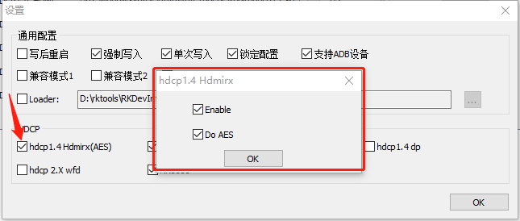




HDCP Key Writer 写入按 Rockchip `.skf` 格式准备的授权密钥。下载工具不包含 HDCP 凭据，也不授予相关许可。本包程序为 1.0.5，附带 PDF 为 V1.0.1。

## 密钥与工具分开管理

授权密钥留在受控生产环境。干净工具包移除了历史日志与保存配置，需要创建自己的工位设置。记录密钥库存和设备对应关系，不公开密钥内容。

## 打包已有合法输入

手册示例把单个密钥文件合成 SKF：

```text
HdcpKeyPack.exe --pack --in .\hdcpkeys --out .\hdcp.skf
```

原输出提醒目标文件已存在时会覆盖。确认输入目录、输出名称和打包数量。打包成功只证明生成了容器，不证明许可有效或设备安装成功。

## 理解写入选项

“单次写入”勾选时每台需手动开始，未勾选时原文描述为设备插入后自动写。“写后重启”控制后续重启。支持 ADB 的流程先通过 `adb reboot loader` 切换设备。原手册要求 Force Write 与当时取消 HDCP 回读有关，不能当作任意覆盖设备身份的建议。

RK3588 有独立控制器/加密选择及逐 key AES 传输选项，兼容模式针对较早平台。按准确 BSP 与工位方案配置，先测试一台授权样机再自动化。

## 验证实际应用路径

记录密钥分配、设备身份、写入结果，按授权测试流程验证目标显示和内容保护链路。打包数量不是 HDCP 互通测试结果。写入状态不确定时先核对库存，不自动再消耗一把密钥。本次整理没有提供或烧写密钥。

## 适用范围与验证状态

本文依据本次工具包及原始资料整理。使用前核对具体板卡、SoC、载板、SDK/BSP 与主机架构。本次未执行烧录、生产配置、寄存器写入或硬件测试；提供下载不代表所有 ArmSoM 产品均支持。

## 工具下载、版本与 SHA-256

下载对应压缩包，校验哈希后完整解压。Linux PinDebug 分卷请先按链接中的说明还原；下方该项哈希对应合并后的完整文件。

| 主机 / 版本 | 下载包 |
|---|---|
| Windows / 1.0.5 | [Rockchip_HdcpKey_Writer_V1.0.5-clean.zip](https://raw.githubusercontent.com/ArmSoM/rockchip-tools/main/downloads/hdcp-key-writer/Rockchip_HdcpKey_Writer_V1.0.5-clean.zip) |

**Rockchip_HdcpKey_Writer_V1.0.5-clean.zip — SHA-256**

```text
39291cd73a8b979de8e70c0109cffecd40f72e26788951a72296449de67c6e3b
```

[GitHub · catalog.json](https://github.com/ArmSoM/rockchip-tools/blob/main/catalog.json) · [SHA256SUMS](https://github.com/ArmSoM/rockchip-tools/blob/main/SHA256SUMS)

## 资料依据与原图

- Rockchip_User_Guide_HDCP_Key_Flash.pdf V1.0.1; HDCP Key Writer 1.0.5 package
- [原始 PDF: Rockchip_User_Guide_HDCP_Key_Flash.pdf](https://raw.githubusercontent.com/ArmSoM/rockchip-tools/main/manuals/e1ef88b767b1.pdf)

插图直接提取自标明的原始 PDF。只有中文原图时保留原界面文字，图注按语言整理；这些是历史示例，不是本次 ArmSoM 测试截图。



Rockchip_User_Guide_HDCP_Key_Flash.pdf · p. 3

## 继续阅读相关流程

- [RKDevInfoWriteTool：受控写入序列号与 MAC 信息](/zh/articles/rockchip-tool-devinfo-write/)
- [RK3588 HDCP 完整开发指南：密钥、固件、HDMI/DP 配置与故障分析](/zh/articles/046-rockchip-rk3588-hdcp/)
- [Rockchip 工具下载与使用指南索引](/zh/articles/rockchip-tools-download-guide/)

## 查找准确的 ArmSoM 板卡资料

板卡、载板与接口要求先以产品手册为准。以下链接是平台参考，不表示该归档工具已在这些产品上验证。

[ArmSoM Docs](https://docs.armsom.org/) · [Sige7](https://www.armsom.org/sige7) / [Docs](https://docs.armsom.org/armsom-sige7) · [CM5](https://www.armsom.org/cm5) / [Docs](https://docs.armsom.org/armsom-cm5)


