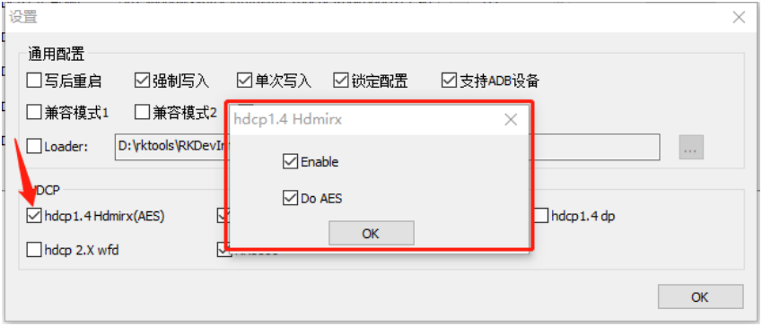




## HDCP Key Writer V1.0.1：完整配置与打包流程

工具用于写入授权的 HDCP key，输入是专用打包工具生成的 `.skf`。手册 V1.0.1 与下载包 1.0.5 版本不同。本节保留全部配置、HdcpKeyPack 示例和 KeyConvertor 图示；只展示文件名和示例日志，不提供真实密钥。

<figure style="margin:1.6rem 0">
<a href="/assets/rockchip-tools/manuals/e1ef88b767b1/p02-f01.png" target="_blank" rel="noopener" aria-label="查看完整图片"></a>
<figcaption style="margin-top:.6rem;font-size:.9em;line-height:1.55"><strong>图 1：HDCP Key Writer 主界面与写入日志</strong></figcaption>
</figure>

### 1. 通用与 HDCP 配置

| 配置 | 含义 |
|---|---|
| 写后重启 / Reboot | 控制写入后是否重启 |
| 强制写入 / Force write | 普通逻辑先判断是否已写，已写则跳过；原稿说明 HDCP 取消读取功能，因此此项必须勾选。仅描述该工具版本行为。 |
| 单次写入 / Single write | 勾选后每次手动按写入；不勾选则插入设备自动写入 |
| 锁定配置 / Lock configuration | 主界面不能使能烧写项 |
| 支持 ADB / ADB support | 写入前先调用 `adb reboot loader` 从 ADB 切换 Loader |
| 兼容模式 1 / 2 | 兼容早期平台，失败时原文建议尝试其中一个模式 |
| RK3588 | 控制器和 key 加密方式不同，需要明确选择是否 RK3588 |
| HDCP / AES | 分别使能各 HDCP 写入项；RK3588 的每个 key 可独立使能传输 AES 加密 |

<figure style="margin:1.6rem 0">
<a href="/assets/rockchip-tools/manuals/e1ef88b767b1/p02-f02.png" target="_blank" rel="noopener" aria-label="查看完整图片"></a>
<figcaption style="margin-top:.6rem;font-size:.9em;line-height:1.55"><strong>图 2：通用配置与 HDCP 写入项</strong></figcaption>
</figure>

<figure style="margin:1.6rem 0">
<a href="/assets/rockchip-tools/manuals/e1ef88b767b1/p03-f01.png" target="_blank" rel="noopener" aria-label="查看完整图片"></a>
<figcaption style="margin-top:.6rem;font-size:.9em;line-height:1.55"><strong>图 3：为 HDCP key 启用 AES 传输加密</strong></figcaption>
</figure>

### 2. HdcpKeyPack

HDCP2.3 原始 key 经配套脚本提取为一个文件一个 key。原文示例包含 10 个、每个 1000 字节的文件；将它们放在 `hdcpkeys` 后打包成 skf。`--pack` 打包，`--in` 指输入目录，`--out` 指输出文件。目标存在时会覆盖，先保留生产批次备份。

```text
HdcpKeyPack.exe --pack --in .\hdcpkeys --out .\hdcp.skf
```

```text
Current dir is D:\rktools\002-windows\003-hdcp\RKDevInfoTool\bin\
output filename is .\hdcp.skf
dest file exist, will be overwrite
file D:\rktools\002-windows\003-hdcp\RKDevInfoTool\bin\.\hdcpkeys\fw_hdcp_receivers_0737C22DEC.bin size is 1000
file D:\rktools\002-windows\003-hdcp\RKDevInfoTool\bin\.\hdcpkeys\fw_hdcp_receivers_32DC5BF80C.bin size is 1000
file D:\rktools\002-windows\003-hdcp\RKDevInfoTool\bin\.\hdcpkeys\fw_hdcp_receivers_4D64BA99B4.bin size is 1000
file D:\rktools\002-windows\003-hdcp\RKDevInfoTool\bin\.\hdcpkeys\fw_hdcp_receivers_55EEC3E501.bin size is 1000
file D:\rktools\002-windows\003-hdcp\RKDevInfoTool\bin\.\hdcpkeys\fw_hdcp_receivers_62CCAA07DB.bin size is 1000
file D:\rktools\002-windows\003-hdcp\RKDevInfoTool\bin\.\hdcpkeys\fw_hdcp_receivers_9D3355F824.bin size is 1000
file D:\rktools\002-windows\003-hdcp\RKDevInfoTool\bin\.\hdcpkeys\fw_hdcp_receivers_AA113C1AFE.bin size is 1000
file D:\rktools\002-windows\003-hdcp\RKDevInfoTool\bin\.\hdcpkeys\fw_hdcp_receivers_B29B45664B.bin size is 1000
file D:\rktools\002-windows\003-hdcp\RKDevInfoTool\bin\.\hdcpkeys\fw_hdcp_receivers_CD23A407F3.bin size is 1000
file D:\rktools\002-windows\003-hdcp\RKDevInfoTool\bin\.\hdcpkeys\fw_hdcp_receivers_F8C83DD213.bin size is 1000
10 file packed to .\hdcp.skf[CRC: 0xC75F3091]
```

### 3. KeyConvertor

原稿最后一页以完整界面图说明 KeyConvertor 的输入文件选择和转换配置，没有单独给出命令行参数。下方保留原图；按持有的授权 key 格式选择转换项，不能把 HDCP 版本、接收/发送用途或芯片选项混用。

KeyConvertor 原图中的提取步骤：选择原始 `.bin`，设置提取范围和每文件 KEY 个数，再点击“提取”。示例将 10 个 key、每文件 3 个，拆成 `1-3`、`4-6`、`7-9`、`10-10` 四组，并把拆分后的 bin 转成对应 skf；结果在图示 `separate_key` 目录。这个数量是原文演示值，不是生产配额。

<figure style="margin:1.6rem 0">
<a href="/assets/rockchip-tools/manuals/e1ef88b767b1/p05-f01.png" target="_blank" rel="noopener" aria-label="查看完整图片"></a>
<figcaption style="margin-top:.6rem;font-size:.9em;line-height:1.55"><strong>图 4：KeyConvertor 提取、分组与转换结果</strong></figcaption>
</figure>

## 适用范围与验证状态

本文依据本次工具包及原始资料整理。使用前核对具体板卡、SoC、载板、SDK/BSP 与主机架构。本次未执行烧录、生产配置、寄存器写入或硬件测试；提供下载不代表所有 ArmSoM 产品均支持。

## GitHub 工具目录、版本与 SHA-256

打开 GitHub 对应目录后选择所需平台和版本，再校验文件哈希并完整解压。下方链接均为仓库目录入口。

[前往 GitHub 对应工具目录](https://github.com/ArmSoM/rockchip-tools/tree/main/downloads/hdcp-key-writer)

| 平台 / 版本 | 文件 | SHA-256 |
|---|---|---|
| Windows / 1.0.5 | `Rockchip_HdcpKey_Writer_V1.0.5-clean.zip` | `39291cd73a8b979de8e70c0109cffecd40f72e26788951a72296449de67c6e3b` |

[GitHub · catalog.json](https://github.com/ArmSoM/rockchip-tools/blob/main/catalog.json) · [SHA256SUMS](https://github.com/ArmSoM/rockchip-tools/blob/main/SHA256SUMS)

## 资料依据与原图

- Rockchip_User_Guide_HDCP_Key_Flash.pdf

## 继续阅读相关流程

- [RKDevInfoWriteTool：受控写入序列号与 MAC 信息](/zh/articles/rockchip-tool-devinfo-write/)
- [RK3588 HDCP 完整开发指南：密钥、固件、HDMI/DP 配置与故障分析](/zh/articles/046-rockchip-rk3588-hdcp/)
- [Rockchip 工具下载与使用指南索引](/zh/articles/rockchip-tools-download-guide/)

## 查找准确的 ArmSoM 板卡资料

板卡、载板与接口要求先以产品手册为准。以下链接是平台参考，不表示该归档工具已在这些产品上验证。

[ArmSoM Docs](https://docs.armsom.org/) · [Sige7](https://www.armsom.org/sige7) / [Docs](https://docs.armsom.org/armsom-sige7) · [CM5](https://www.armsom.org/cm5) / [Docs](https://docs.armsom.org/armsom-cm5)


