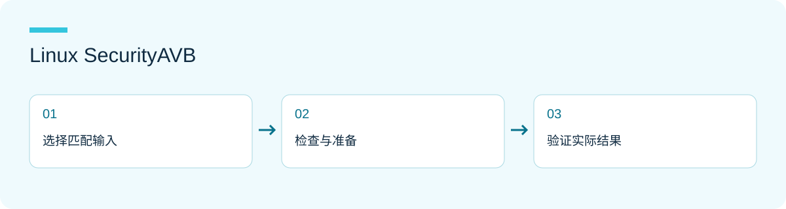





这份 Linux AVB 包描述较早的证书与永久属性验证启动方案，适合维护对应 BSP，不能直接替代新版 SDK 的 verified boot 实现。

## 先查看接口定义

脚本帮助列出 `-n`、`-f`、`-s`、`-d`、`-l`、`-u`，先阅读源码与帮助：

```text
./avb_user_tool.sh -h
```

`-n` 接收 16 字节产品标识并生成密钥，但本脚本会先删除现有 `avb_keys` 目录，不能在有需保留密钥的目录随意运行。`-f` 用安全启动私钥准备属性，`-s` 签 boot/recovery；`-d` 写永久属性，`-l`/`-u` 锁定/解锁设备。这些操作的影响并不相同。

## 使用隔离的项目输入

干净下载包已移除原始示例密钥目录。应在受控环境生成并保护项目自己的密钥。脚本涉及 PRK、PIK、PSK、PUK，证书与产品标识必须一致，并核对历史脚本对 Python、OpenSSL、主机工具的依赖。

## 镜像空间要求

脚本要求分区长度按 4096 字节对齐，为 AVB 元数据留空间，错误信息描述至少比原文件多 68K。应核对实际计算与分区大小，不能为了签名成功直接截断镜像。认证也不等于文件系统加密。

## 不混用不同代际方案

V2.2.5 手册讨论 4M security 分区和当时 OP-TEE 方案；博客新版资料属于不同 SDK，分区与信任链要求须分别保留。永久配置前先验证失败路径、签名更新和恢复。本文不提供生产密钥，也未完成硬件验证。

## 适用范围与验证状态

本文依据本次工具包及原始资料整理。使用前核对具体板卡、SoC、载板、SDK/BSP 与主机架构。本次未执行烧录、生产配置、寄存器写入或硬件测试；提供下载不代表所有 ArmSoM 产品均支持。

## 工具下载、版本与 SHA-256

下载对应压缩包，校验哈希后完整解压。Linux PinDebug 分卷请先按链接中的说明还原；下方该项哈希对应合并后的完整文件。

| 主机 / 版本 | 下载包 |
|---|---|
| Linux / manual 2.2.5 | [linux-security-avb-without-keys.zip](https://raw.githubusercontent.com/ArmSoM/rockchip-tools/main/downloads/linux-avb/linux-security-avb-without-keys.zip) |

**linux-security-avb-without-keys.zip — SHA-256**

```text
fc7eae22caeadd51d85723b65451c70e88475a2c9ba7e7f5394ca1314688d17d
```

[GitHub · catalog.json](https://github.com/ArmSoM/rockchip-tools/blob/main/catalog.json) · [SHA256SUMS](https://github.com/ArmSoM/rockchip-tools/blob/main/SHA256SUMS)

## 资料依据与原图

- Rockchip_User_Manual_Linux_AVB_EN.pdf V2.2.5; avb_user_tool.sh
- [原始 PDF: Rockchip_User_Manual_Linux_AVB_EN.pdf](https://raw.githubusercontent.com/ArmSoM/rockchip-tools/main/manuals/50f19e52844b.pdf)

## 继续阅读相关流程

- [Rockchip Linux Secure Boot 完整开发指南](/zh/articles/203-rockchip-linux-secure-boot/)
- [Rockchip U-Boot Nextdev 开发指南：启动、驱动、SPL/TPL、FIT与安全校验](/zh/articles/157-rockchip-uboot-nextdev/)
- [rk_sign_tool 与 sign_tool：Rockchip 固件签名和校验流程](/zh/articles/rockchip-tool-rk-sign-tool/)
- [Rockchip 工具下载与使用指南索引](/zh/articles/rockchip-tools-download-guide/)

## 查找准确的 ArmSoM 板卡资料

板卡、载板与接口要求先以产品手册为准。以下链接是平台参考，不表示该归档工具已在这些产品上验证。

[ArmSoM Docs](https://docs.armsom.org/) · [Sige7](https://www.armsom.org/sige7) / [Docs](https://docs.armsom.org/armsom-sige7) · [CM5](https://www.armsom.org/cm5) / [Docs](https://docs.armsom.org/armsom-cm5)


