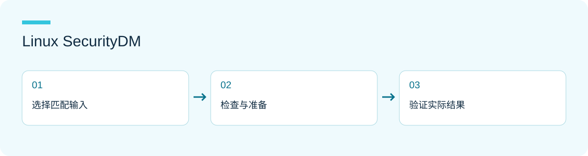





Linux SecurityDM 1.01 包含历史 `mkdm.sh`、配置、启动镜像工具以及嵌套 ramdisk 压缩包。`dmv`、`fde`、`fde-s`、`ramdisk` 模式分别服务于完整性、加密和镜像准备，不能互相替代。

## 执行前先静态检查

提供真实镜像前，阅读脚本、ramdisk 内容与帮助：

```text
./mkdm.sh --help
```

脚本中 `-d` 指定根分区，`-s` 为只读系统镜像，`-k` 为内核，`-r` 为 resource，`-c` 为配置，`-m` 为模式；长选项涉及输入输出、文件系统类型与镜像长度。值必须来自匹配 BSP，其他产品的分区路径可能指向错误设备。

## 隔离镜像构建流程

保留原文件系统、kernel、resource 副本，先明确根文件系统是否只读、需求是完整性还是加密。`dmv` 路线要求只读文件系统；加密镜像路线不能默认接受压缩文件系统输入。

脚本可能执行需特权的挂载、loop 和 `dmsetup` 操作，应在受控构建主机审查执行，不是纯文件查看工具。代码还可能输出密钥参数，应先用测试值并脱敏日志，再做生产集成。

## 验证启动依赖

内核配置、ramdisk/init、映射参数与生成文件系统必须一致。使用非生产材料测试正常启动、数据损坏处理、恢复和更新。生成启动镜像不证明板卡已经启用安全存储或加密；保留全部构建输入和哈希。

## 适用范围与验证状态

本文依据本次工具包及原始资料整理。使用前核对具体板卡、SoC、载板、SDK/BSP 与主机架构。本次未执行烧录、生产配置、寄存器写入或硬件测试；提供下载不代表所有 ArmSoM 产品均支持。

## GitHub 工具目录、版本与 SHA-256

打开 GitHub 对应目录后选择所需平台和版本，再校验文件哈希并完整解压。下方链接均为仓库目录入口。

[前往 GitHub 对应工具目录](https://github.com/ArmSoM/rockchip-tools/tree/main/downloads/linux-dm)

| 平台 / 版本 | 文件 | SHA-256 |
|---|---|---|
| Linux / 1.01 | `Linux_SecurityDM_v1_01.tar.gz` | `2db8bc9618a326f624e5bc519f95ac00ec33df6db47ba82ab446367fa4de5912` |

[GitHub · catalog.json](https://github.com/ArmSoM/rockchip-tools/blob/main/catalog.json) · [SHA256SUMS](https://github.com/ArmSoM/rockchip-tools/blob/main/SHA256SUMS)

## 资料依据与原图

- Linux_SecurityDM_v1_01.tar.gz: mkdm.sh, configuration and nested ramdisk archive

## 继续阅读相关流程

- [Linux SecurityAVB：密钥、启动镜像签名与版本边界](/zh/articles/rockchip-tool-linux-avb/)
- [Rockchip Linux Secure Boot 完整开发指南](/zh/articles/203-rockchip-linux-secure-boot/)
- [Rockchip 工具下载与使用指南索引](/zh/articles/rockchip-tools-download-guide/)

## 查找准确的 ArmSoM 板卡资料

板卡、载板与接口要求先以产品手册为准。以下链接是平台参考，不表示该归档工具已在这些产品上验证。

[ArmSoM Docs](https://docs.armsom.org/) · [Sige7](https://www.armsom.org/sige7) / [Docs](https://docs.armsom.org/armsom-sige7) · [CM5](https://www.armsom.org/cm5) / [Docs](https://docs.armsom.org/armsom-cm5)


