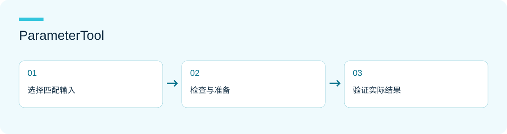



分区参数连接固件打包与存储写入位置。ParameterTool 包包含 `parameter_tool.exe`、配置，以及嵌套 boot_merger 压缩包，没有独立使用 PDF，因此本文聚焦可核查的分区审查流程，不编造未记录的界面按钮。

## 从板卡已知布局开始

复制实际 SDK parameter 文件并保留原版，记录存储容量、分区顺序、名称、偏移、大小和末尾扩容分区。换算十六进制前先确认该 SDK 格式的单位，不能把十六进制数自动理解为字节地址。

## 修改要保持整体一致

对需要变大的镜像，将最终文件长度和格式元数据与预留分区比较，核对后续分区起点和设备总容量。分区名称还要与 `package-file`、RKDevTool 下载项、相关启动参数一致。A/B 产品需要一致的槽位名称和启动升级逻辑，不能仅复制两个分区项。

## 保存后如何验证

逐行比较修改前后文本，排查意外改动，再用匹配 SDK 重新打包和解包固件。将 parameter 导入 RKDevTool 检查生成下载项，不立即执行写入。最终布局在有备份和恢复方式的开发板上验证。

## 包内容边界

嵌套 boot_merger ZIP 是同一工具的另一份拷贝，不应多算成一个新工具或手册。原包保留它，但不能认为旧 Loader 格式适用于新 SoC。仅凭这个压缩包不能给所有 ArmSoM 产品发布通用分区表。

## 适用范围与验证状态

本文依据本次工具包及原始资料整理。使用前核对具体板卡、SoC、载板、SDK/BSP 与主机架构。本次未执行烧录、生产配置、寄存器写入或硬件测试；提供下载不代表所有 ArmSoM 产品均支持。

## GitHub 工具目录、版本与 SHA-256

打开 GitHub 对应目录后选择所需平台和版本，再校验文件哈希并完整解压。下方链接均为仓库目录入口。

[前往 GitHub 对应工具目录](https://github.com/ArmSoM/rockchip-tools/tree/main/downloads/parameter-tool)

| 平台 / 版本 | 文件 | SHA-256 |
|---|---|---|
| Windows / 1.2 | `ParameterTool_v1.2.zip` | `46e4cda5ca71bd12444fc75c517753fe0f3fda9db1ce3917d1a5a3f48e92a6f2` |

[GitHub · catalog.json](https://github.com/ArmSoM/rockchip-tools/blob/main/catalog.json) · [SHA256SUMS](https://github.com/ArmSoM/rockchip-tools/blob/main/SHA256SUMS)

## 资料依据与原图

- ParameterTool_v1.2.zip: parameter_tool.exe, config.json, nested boot_merger_v1.32_win.zip; existing storage guide

## 继续阅读相关流程

- [Rockchip 存储应用完整说明：Flash、启动流程、分区、烧录与 Vendor Storage](/zh/articles/099-rockchip-storage-application/)
- [RKDevTool 下载与使用：Loader、分区镜像和整包固件烧录](/zh/articles/rockchip-tool-rkdevtool/)
- [afptool 与 rkImageMaker：理解并打包 Rockchip update.img](/zh/articles/rockchip-tool-firmware-pack-tools/)
- [Rockchip 工具下载与使用指南索引](/zh/articles/rockchip-tools-download-guide/)

## 查找准确的 ArmSoM 板卡资料

板卡、载板与接口要求先以产品手册为准。以下链接是平台参考，不表示该归档工具已在这些产品上验证。

[ArmSoM Docs](https://docs.armsom.org/) · [Sige7](https://www.armsom.org/sige7) / [Docs](https://docs.armsom.org/armsom-sige7) · [CM5](https://www.armsom.org/cm5) / [Docs](https://docs.armsom.org/armsom-cm5)


