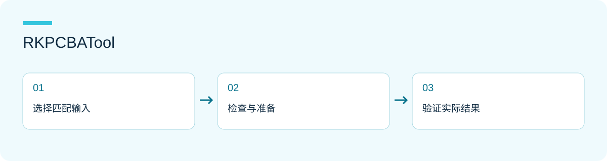
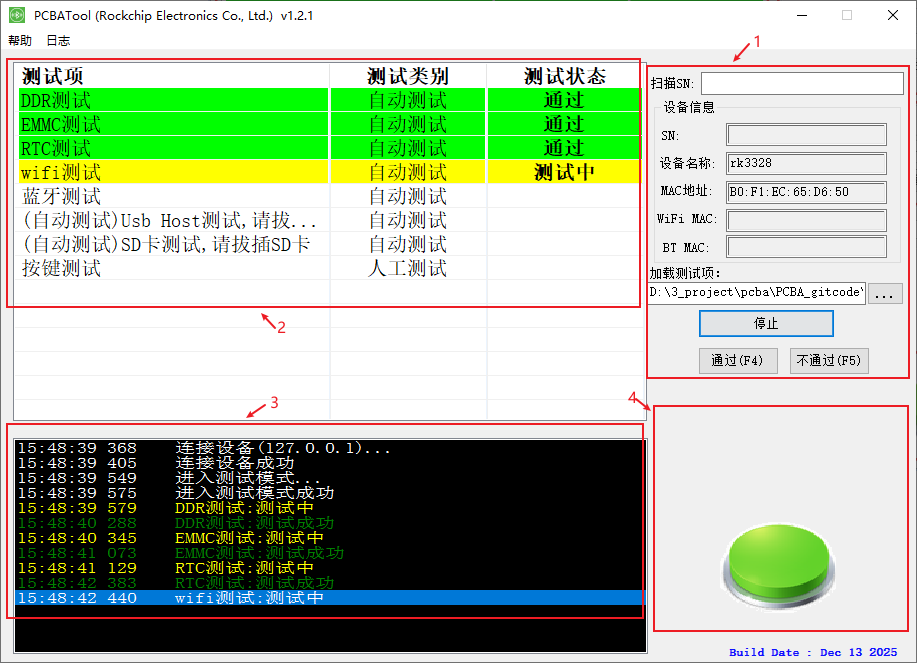





RKPCBATool 由 Windows 主机程序配合 Linux 目标端测试程序工作，可组织存储、无线、音频、按键等测试，但对应功能必须由 BSP 实现。它与旧版 Android PCBA 工具不是同一流程。

## 安装与连接

完整安装/解压，使用全英文路径，原手册指出非英文路径可能影响 ADB 执行。目标板启动包含 PCBA 功能的固件，连接 ADB。文档中的绿色连接状态表示发现 ADB 设备，橙色表示不可用；已连接不代表测试通过。

## 加载测试计划

按 **F2** 或加载项旁的 **...** 选择 JSON。`test_item` 标识测试，`test_bin_name` 指向目标程序，`test_type` 区分自动和人工判定。下面是 ArmSoM 按已记录字段整理的有效 JSON 示例，关闭 MES，未作量产验证：

```json
{
  "meta": {"version": "1.0", "needreboot": false},
  "test_groups": [{
    "test_item": "key_test",
    "test_bin_name": "echo_key_test",
    "name": "Key Test",
    "test_type": "manual",
    "enable": 1,
    "is_loop_test": false,
    "is_first": false,
    "is_last": false,
    "is_check_sn": false
  }],
  "mes_config": {"use_mes": false}
}
```

只有目标程序真实存在时才能保留示例程序名。按实际贴装、夹具修改测试项。原文 JSON 存在格式不一致，并给出示例 MES 地址，不应直接复制到真实工位。

## 正确执行与判定

手册描述自动项和首个人工项一起开始；人工项需操作员点击 Pass/Fail 后进入下一项。音频要有明确听音/录音判据，按键需对应板级名称。Wi-Fi 扫描通过不代表吞吐性能通过。仅测试已支持接口，禁用和不适用项分别记录。

## 集成与版本差异

`needreboot` 控制完成后重启，原文 A/B rootfs 示例属于特定产品流程。扩展测试需要主机配置/界面与目标程序、协议共同配合。中文 V1.2.0 已删旧 Camera 小节，英文同版本虽然修订表说明删除，正文仍保留旧段；以中文现行结构为主，将英文相机说明作为历史信息，不承诺当前支持。

归档计划哈希、主机工具版本、目标固件、夹具及每台结果。工具 1.2.1 与手册 V1.2.0 是两个版本标识。本文未执行生产测试。

## 适用范围与验证状态

本文依据本次工具包及原始资料整理。使用前核对具体板卡、SoC、载板、SDK/BSP 与主机架构。本次未执行烧录、生产配置、寄存器写入或硬件测试；提供下载不代表所有 ArmSoM 产品均支持。

## 工具下载、版本与 SHA-256

下载对应压缩包，校验哈希后完整解压。Linux PinDebug 分卷请先按链接中的说明还原；下方该项哈希对应合并后的完整文件。

| 主机 / 版本 | 下载包 |
|---|---|
| Windows host + Linux target / 1.2.1 | [RKPCBATool_v1.2.1_20251226.zip](https://raw.githubusercontent.com/ArmSoM/rockchip-tools/main/downloads/pcba-tool/RKPCBATool_v1.2.1_20251226.zip) |

**RKPCBATool_v1.2.1_20251226.zip — SHA-256**

```text
ec3747fa2360e8e1793920882d7ec51a4aa1087a4cfab5d3c218f677999440bc
```

[GitHub · catalog.json](https://github.com/ArmSoM/rockchip-tools/blob/main/catalog.json) · [SHA256SUMS](https://github.com/ArmSoM/rockchip-tools/blob/main/SHA256SUMS)

## 资料依据与原图

- RKPCBATool 1.2.1 package; Rockchip_Developer_Guide_Linux_PCBA_CN/EN V1.2.0 (2025-12-13)
- [原始 PDF: Rockchip_Developer_Guide_Linux_PCBA_CN.pdf](https://raw.githubusercontent.com/ArmSoM/rockchip-tools/main/manuals/31be89bdda4b.pdf)
- [原始 PDF: Rockchip_Developer_Guide_Linux_PCBA_EN.pdf](https://raw.githubusercontent.com/ArmSoM/rockchip-tools/main/manuals/6cb5fb2c60e8.pdf)

插图直接提取自标明的原始 PDF。只有中文原图时保留原界面文字，图注按语言整理；这些是历史示例，不是本次 ArmSoM 测试截图。



Rockchip_Developer_Guide_Linux_PCBA_CN.pdf · p. 5

## 继续阅读相关流程

- [Rockchip Linux PCBA 测试开发指南](/zh/articles/197-rockchip-linux-pcba/)
- [Rockchip PCBA 测试工具开发指南](/zh/articles/252-rockchip-pcba-test-tool/)
- [RKDevInfoWriteTool：受控写入序列号与 MAC 信息](/zh/articles/rockchip-tool-devinfo-write/)
- [Rockchip 工具下载与使用指南索引](/zh/articles/rockchip-tools-download-guide/)

## 查找准确的 ArmSoM 板卡资料

板卡、载板与接口要求先以产品手册为准。以下链接是平台参考，不表示该归档工具已在这些产品上验证。

[ArmSoM Docs](https://docs.armsom.org/) · [Sige7](https://www.armsom.org/sige7) / [Docs](https://docs.armsom.org/armsom-sige7) · [CM5](https://www.armsom.org/cm5) / [Docs](https://docs.armsom.org/armsom-cm5)


