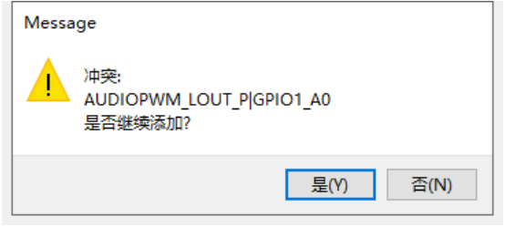
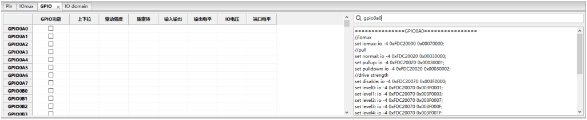




## PinDebug V1.1 完整操作指南

手册列出 RK3588、RK3566、RK3568、RV1126、RV1109、RV1106、RV1103、RK3528。它用于查询 IOMUX 并配置引脚属性；本次 Windows 1.18、Linux 1.11 的界面可能与手册不同。以下按原文 1.1–1.11 展开，配图为中文原图。

### 1.1 打开工程

所有操作前先选 SoC。Pin 页按引脚/GPIO 显示复用定义：搜索框支持 Function 搜索；右击 Function 输出设置命令；连接设备后双击 Function 会直接设置该引脚；引脚和 IO 编号两列支持排序。IOmux 页从模块视角列出可控制的模块。

<figure style="margin:1.6rem 0">
<a href="/assets/rockchip-tools/manuals/1cae2e2c0777/p02-f01.png" target="_blank" rel="noopener" aria-label="查看完整图片"></a>
<figcaption style="margin-top:.6rem;font-size:.9em;line-height:1.55"><strong>图 1：选择芯片并打开工程</strong></figcaption>
</figure>

<figure style="margin:1.6rem 0">
<a href="/assets/rockchip-tools/manuals/1cae2e2c0777/p02-f02.png" target="_blank" rel="noopener" aria-label="查看完整图片"></a>
<figcaption style="margin-top:.6rem;font-size:.9em;line-height:1.55"><strong>图 2：Pin 视图中的引脚与复用功能</strong></figcaption>
</figure>

<figure style="margin:1.6rem 0">
<a href="/assets/rockchip-tools/manuals/1cae2e2c0777/p03-f01.png" target="_blank" rel="noopener" aria-label="查看完整图片"></a>
<figcaption style="margin-top:.6rem;font-size:.9em;line-height:1.55"><strong>图 3：按功能模块查看 IOmux</strong></figcaption>
</figure>

### 1.2 连接设备

工具通过 ADB 通信。先打开工程，在设备上启用 ADB，连接电脑，再点击工具栏连接图标。

<figure style="margin:1.6rem 0">
<a href="/assets/rockchip-tools/manuals/1cae2e2c0777/p03-f02.png" target="_blank" rel="noopener" aria-label="查看完整图片"></a>
<figcaption style="margin-top:.6rem;font-size:.9em;line-height:1.55"><strong>图 4：连接设备</strong></figcaption>
</figure>

### 1.3 读取 IOMUX

读取全部 IOMUX 寄存器后，Pin 与 IOmux 两个页面同步更新。离线定义表不能代替这里的设备实际读值。

<figure style="margin:1.6rem 0">
<a href="/assets/rockchip-tools/manuals/1cae2e2c0777/p03-f03.png" target="_blank" rel="noopener" aria-label="查看完整图片"></a>
<figcaption style="margin-top:.6rem;font-size:.9em;line-height:1.55"><strong>图 5：从设备读取 IOMUX</strong></figcaption>
</figure>

<figure style="margin:1.6rem 0">
<a href="/assets/rockchip-tools/manuals/1cae2e2c0777/p04-f01.png" target="_blank" rel="noopener" aria-label="查看完整图片"></a>
<figcaption style="margin-top:.6rem;font-size:.9em;line-height:1.55"><strong>图 6：IOmux 视图中的当前功能配置</strong></figcaption>
</figure>

<figure style="margin:1.6rem 0">
<a href="/assets/rockchip-tools/manuals/1cae2e2c0777/p04-f02.png" target="_blank" rel="noopener" aria-label="查看完整图片"></a>
<figcaption style="margin-top:.6rem;font-size:.9em;line-height:1.55"><strong>图 7：Pin 视图高亮已启用的功能</strong></figcaption>
</figure>

### 1.4 修改 IOMUX

在 IOmux 页勾选功能 IO，将其设为该功能；取消勾选会改为 GPIO。发生复用冲突时工具提示，可取消或确认修改。

<figure style="margin:1.6rem 0">
<a href="/assets/rockchip-tools/manuals/1cae2e2c0777/p05-f01.png" target="_blank" rel="noopener" aria-label="查看完整图片"></a>
<figcaption style="margin-top:.6rem;font-size:.9em;line-height:1.55"><strong>图 8：复用功能冲突提示</strong></figcaption>
</figure>

### 1.5 功能 IO 上下拉及驱动强度

对已选中的功能 IO，选中并右击可读取/修改上下拉和驱动强度。原图以 EMMC_CLKOUT 演示读取和修改，实际操作前需核对该信号是否正在被存储控制器使用。

<figure style="margin:1.6rem 0">
<a href="/assets/rockchip-tools/manuals/1cae2e2c0777/p05-f02.png" target="_blank" rel="noopener" aria-label="查看完整图片"></a>
<figcaption style="margin-top:.6rem;font-size:.9em;line-height:1.55"><strong>图 9：查看 EMMC_CLKOUT 的上下拉与驱动强度</strong></figcaption>
</figure>

<figure style="margin:1.6rem 0">
<a href="/assets/rockchip-tools/manuals/1cae2e2c0777/p05-f03.png" target="_blank" rel="noopener" aria-label="查看完整图片"></a>
<figcaption style="margin-top:.6rem;font-size:.9em;line-height:1.55"><strong>图 10：设置 EMMC_CLKOUT 属性</strong></figcaption>
</figure>

### 1.6 GPIO 数据读取与修改

原文以 GPIO1C3 演示。“GPIO 功能”勾选表示当前是 GPIO；输入/输出来自 GPIO 的 `ddr` 寄存器；输出电平来自 `dr`；IO 电压来自 PMU `vsel`；端口电平来自 `ext_port`。`ddr` 在这里是方向寄存器，不是 DDR 内存。

<figure style="margin:1.6rem 0">
<a href="/assets/rockchip-tools/manuals/1cae2e2c0777/p06-f01.png" target="_blank" rel="noopener" aria-label="查看完整图片"></a>
<figcaption style="margin-top:.6rem;font-size:.9em;line-height:1.55"><strong>图 11：GPIO 状态与电平列表</strong></figcaption>
</figure>

<figure style="margin:1.6rem 0">
<a href="/assets/rockchip-tools/manuals/1cae2e2c0777/p06-f02.png" target="_blank" rel="noopener" aria-label="查看完整图片"></a>
<figcaption style="margin-top:.6rem;font-size:.9em;line-height:1.55"><strong>图 12：设置 GPIO1C3 属性</strong></figcaption>
</figure>

### 1.7 读取 Regulator

工具通过 `cat` 设备的 regulator summary 节点并解析全部 domain 数据。原文没有给出完整节点路径，不编造可复制路径。

<figure style="margin:1.6rem 0">
<a href="/assets/rockchip-tools/manuals/1cae2e2c0777/p06-f03.png" target="_blank" rel="noopener" aria-label="查看完整图片"></a>
<figcaption style="margin-top:.6rem;font-size:.9em;line-height:1.55"><strong>图 13：读取 Regulator 信息</strong></figcaption>
</figure>

<figure style="margin:1.6rem 0">
<a href="/assets/rockchip-tools/manuals/1cae2e2c0777/p07-f01.png" target="_blank" rel="noopener" aria-label="查看完整图片"></a>
<figcaption style="margin-top:.6rem;font-size:.9em;line-height:1.55"><strong>图 14：Regulator 与电源域信息</strong></figcaption>
</figure>

### 1.8 读取电压域选择

解析电压选择寄存器生成所有 domain 列表。原文 1.8 写 `vesl`，1.6 写 `vsel`，保留这处拼写差异供核对；寄存器选择值不是实测电压。

<figure style="margin:1.6rem 0">
<a href="/assets/rockchip-tools/manuals/1cae2e2c0777/p07-f02.png" target="_blank" rel="noopener" aria-label="查看完整图片"></a>
<figcaption style="margin-top:.6rem;font-size:.9em;line-height:1.55"><strong>图 15：读取电压域选择</strong></figcaption>
</figure>

<figure style="margin:1.6rem 0">
<a href="/assets/rockchip-tools/manuals/1cae2e2c0777/p07-f03.png" target="_blank" rel="noopener" aria-label="查看完整图片"></a>
<figcaption style="margin-top:.6rem;font-size:.9em;line-height:1.55"><strong>图 16：电源域 Vsel 列表</strong></figcaption>
</figure>

### 1.9 检查 IOmux

按模块打印已选中的 IO，主要用于模块存在多个 mode 时判断实际生效的那组 IO。

<figure style="margin:1.6rem 0">
<a href="/assets/rockchip-tools/manuals/1cae2e2c0777/p07-f04.png" target="_blank" rel="noopener" aria-label="查看完整图片"></a>
<figcaption style="margin-top:.6rem;font-size:.9em;line-height:1.55"><strong>图 17：检查 IOmux 配置</strong></figcaption>
</figure>

<figure style="margin:1.6rem 0">
<a href="/assets/rockchip-tools/manuals/1cae2e2c0777/p08-f01.png" target="_blank" rel="noopener" aria-label="查看完整图片"></a>
<figcaption style="margin-top:.6rem;font-size:.9em;line-height:1.55"><strong>图 18：各模块 IOmux 模式的检查结果</strong></figcaption>
</figure>

### 1.10 导出 GPIO 配置表

打开工程后，可将 GPIO 配置导出为 Excel 表格。导出时记录工程对应的 SoC，并区分静态定义和读取设备后得到的数据。

<figure style="margin:1.6rem 0">
<a href="/assets/rockchip-tools/manuals/1cae2e2c0777/p08-f02.png" target="_blank" rel="noopener" aria-label="查看完整图片"></a>
<figcaption style="margin-top:.6rem;font-size:.9em;line-height:1.55"><strong>图 19：导出的 GPIO 配置表</strong></figcaption>
</figure>

### 1.11 离线检索 GPIO 命令

打开工程后，无须连接设备即可检索 IOMUX、上下拉、驱动强度、施密特触发等配置命令。输入 `help` 查看检索说明，原文以 `gpio0a0` 演示查询。生成命令并不证明适用于当前载板电气连接。

<figure style="margin:1.6rem 0">
<a href="/assets/rockchip-tools/manuals/1cae2e2c0777/p09-f01.png" target="_blank" rel="noopener" aria-label="查看完整图片"></a>
<figcaption style="margin-top:.6rem;font-size:.9em;line-height:1.55"><strong>图 20：离线 GPIO 命令帮助</strong></figcaption>
</figure>

<figure style="margin:1.6rem 0">
<a href="/assets/rockchip-tools/manuals/1cae2e2c0777/p09-f02.png" target="_blank" rel="noopener" aria-label="查看完整图片"></a>
<figcaption style="margin-top:.6rem;font-size:.9em;line-height:1.55"><strong>图 21：检索指定 GPIO 的寄存器命令</strong></figcaption>
</figure>

### 离线检索语法（原截图转写）

以下输入在工具检索框中，不是 shell 命令。支持正则表达式。导出表和检索截图来自示例工程，不同图的地址并不相同，不能混成一个板卡配置。

```text
gpio [mux|pull|ds|smt|ddr|dr]
gpio0a0
gpio0a0 mux
gpio0a0 pull
gpio0a0 ds
gpio0a0 smt
gpio0a0 ddr
gpio0a0 dr
gpio0a0 ddr|dr
```

## 适用范围与验证状态

本文依据本次工具包及原始资料整理。使用前核对具体板卡、SoC、载板、SDK/BSP 与主机架构。本次未执行烧录、生产配置、寄存器写入或硬件测试；提供下载不代表所有 ArmSoM 产品均支持。

## GitHub 工具目录、版本与 SHA-256

打开 GitHub 对应目录后选择所需平台和版本，再校验文件哈希并完整解压。下方链接均为仓库目录入口。

[前往 GitHub 对应工具目录](https://github.com/ArmSoM/rockchip-tools/tree/main/downloads/pin-debug)

| 平台 / 版本 | 文件 | SHA-256 |
|---|---|---|
| Linux / 1.11 | `pin_debug_tool_v1.11_for_linux.tar.gz` | `16cb25b8fc2533e8f730a790c7486ab5042baa964b3bdb95a161ddce143c4a34` |
| Windows / 1.18 | `pin_debug_tool_v1.18_20250322_win.zip` | `88c550ee9a578eaa451a9b8a05b3d088247dc63dd9bd426b832191994dc6a7d5` |

[GitHub · catalog.json](https://github.com/ArmSoM/rockchip-tools/blob/main/catalog.json) · [SHA256SUMS](https://github.com/ArmSoM/rockchip-tools/blob/main/SHA256SUMS)

## 资料依据与原图

- PinDebug_UserManual.pdf

## 继续阅读相关流程

- [Rockchip Linux Pinctrl 完整指南：GPIO、IOMUX、驱动强度与 DTS](/zh/articles/116-rockchip-linux-pinctrl/)
- [USB SQ Tool 1.5：从 USB 眼图排查到 PHY 参数与代码生成](/zh/articles/rockchip-tool-usb-sq-tool/)
- [Rockchip 工具下载与使用指南索引](/zh/articles/rockchip-tools-download-guide/)

## 查找准确的 ArmSoM 板卡资料

板卡、载板与接口要求先以产品手册为准。以下链接是平台参考，不表示该归档工具已在这些产品上验证。

[ArmSoM Docs](https://docs.armsom.org/) · [Sige7](https://www.armsom.org/sige7) / [Docs](https://docs.armsom.org/armsom-sige7) · [CM5](https://www.armsom.org/cm5) / [Docs](https://docs.armsom.org/armsom-cm5)


