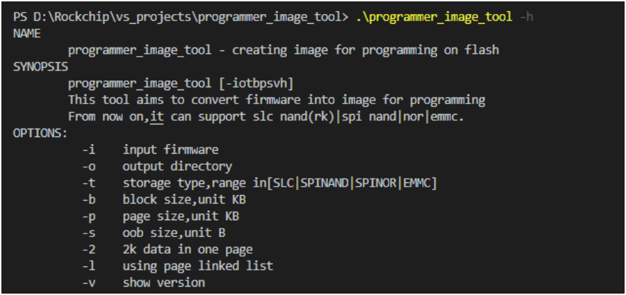
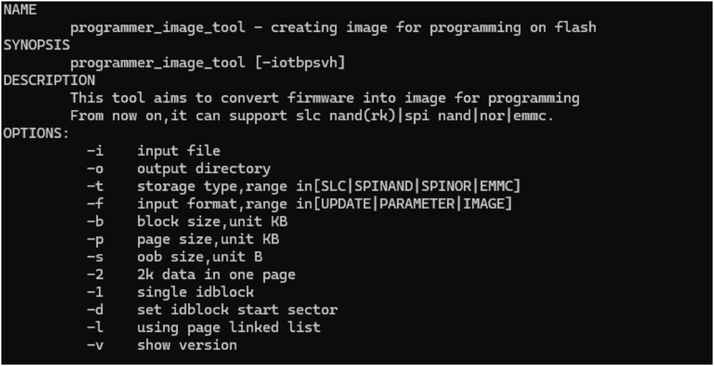




## programmer_image_tool：两份手册的全部示例

两份 `user_manual.pdf` 分别随 Linux 1.26 和 Windows 1.28 提供，四组命令相同。Linux 稿“usage description”留下损坏的本地图片链接；Windows 稿该处是帮助截图，以下保留可读原图和全部文本示例。输出是给烧录器使用的镜像，并不代表工具已经向板卡烧写。

### 1. eMMC

```text
./programmer_image_tool -i update.img -t emmc
```

运行完成后在程序目录生成 `out_image.bin`。

### 2. SPI NOR

```text
./programmer_image_tool -i update.img -t spinor
```

同样在程序目录生成 `out_image.bin`，但目标类型是 SPI NOR，不能把 eMMC 输出互换使用。

### 3. SPI NAND：256 KB block、4 KB page

```text
./programmer_image_tool -i update.img -b 256 -p 4 -t spinand -o out
```

在 `out` 目录生成按分区命名的镜像。原稿写作 `partiiton_name.img`，表示分区名占位，不是要求实际文件名拼错。

### 4. SLC NAND：256 KB block、4 KB page、256 B OOB

```text
./programmer_image_tool -i update.img -b 256 -p 4 -s 256 -t slc -2 -o rockdev
```

在 `rockdev` 目录生成分区镜像。原文小标题还写 `2k_page`，命令却为 `-p 4` 并带 `-2`；保留原样；下方帮助截图已确认 `-2` 表示每页 2k 数据，不能擅改物理页大小。必须结合实际 NAND 数据手册和工具帮助确认。

## 帮助截图中的完整参数

已从 Windows 原稿截图核实：`-2` 表示每页 2k 数据，不是把 `-p 4` 改写成 2 KB 物理页。下列为原图的可复制转写；SYNOPSIS 比 OPTIONS 项少，保留这处原文差异。

<figure style="margin:1.6rem 0">
<a href="/assets/rockchip-tools/manuals/454e7646c90d/p01-f01.png" target="_blank" rel="noopener" aria-label="查看完整图片"></a>
<figcaption style="margin-top:.6rem;font-size:.9em;line-height:1.55"><strong>图 1：programmer_image_tool 命令帮助</strong></figcaption>
</figure>

```text
NAME
    programmer_image_tool - creating image for programming on flash
SYNOPSIS
    programmer_image_tool [-iotbpsvh]
DESCRIPTION
    This tool aims to convert firmware into image for programming
    From now on,it can support slc nand(rk)|spi nand|nor|emmc.
OPTIONS:
    -i    input file
    -o    output directory
    -t    storage type,range in[SLC|SPINAND|SPINOR|EMMC]
    -f    input format,range in[UPDATE|PARAMETER|IMAGE]
    -b    block size,unit KB
    -p    page size,unit KB
    -s    oob size,unit B
    -2    2k data in one page
    -1    single idblock
    -d    set idblock start sector
    -l    using page linked list
    -v    show version
```

<figure style="margin:1.6rem 0">
<a href="/assets/rockchip-tools/manuals/47ce51e919d3/p01-f01.png" target="_blank" rel="noopener" aria-label="查看完整图片"></a>
<figcaption style="margin-top:.6rem;font-size:.9em;line-height:1.55"><strong>图 2：输入格式与 idblock 参数</strong></figcaption>
</figure>

## 适用范围与验证状态

本文依据本次工具包及原始资料整理。使用前核对具体板卡、SoC、载板、SDK/BSP 与主机架构。本次未执行烧录、生产配置、寄存器写入或硬件测试；提供下载不代表所有 ArmSoM 产品均支持。

## GitHub 工具目录、版本与 SHA-256

打开 GitHub 对应目录后选择所需平台和版本，再校验文件哈希并完整解压。下方链接均为仓库目录入口。

[前往 GitHub 对应工具目录](https://github.com/ArmSoM/rockchip-tools/tree/main/downloads/programmer-image-tool)

| 平台 / 版本 | 文件 | SHA-256 |
|---|---|---|
| Linux / 1.26 | `programmer_image_tool_v1.26_linux.tar.gz` | `ea38df34e97cd697aa53d09af06fa1ff2b0847fe2c9699c49d1890509cc5c0d0` |
| Windows / 1.28 | `programmer_image_tool_v1.28.zip` | `696d07d8232a637ef59b724d0c0522e500fc9f26571c2633d96271ffce48e56f` |

[GitHub · catalog.json](https://github.com/ArmSoM/rockchip-tools/blob/main/catalog.json) · [SHA256SUMS](https://github.com/ArmSoM/rockchip-tools/blob/main/SHA256SUMS)

## 资料依据与原图

- user_manual.pdf
- user_manual.pdf

## 继续阅读相关流程

- [Firmware_Merger：Flat RK、Flat GPT 与 Compact GPT 固件打包](/zh/articles/rockchip-tool-firmware-merger/)
- [afptool 与 rkImageMaker：理解并打包 Rockchip update.img](/zh/articles/rockchip-tool-firmware-pack-tools/)
- [Rockchip 存储应用完整说明：Flash、启动流程、分区、烧录与 Vendor Storage](/zh/articles/099-rockchip-storage-application/)
- [Rockchip 工具下载与使用指南索引](/zh/articles/rockchip-tools-download-guide/)

## 查找准确的 ArmSoM 板卡资料

板卡、载板与接口要求先以产品手册为准。以下链接是平台参考，不表示该归档工具已在这些产品上验证。

[ArmSoM Docs](https://docs.armsom.org/) · [Sige7](https://www.armsom.org/sige7) / [Docs](https://docs.armsom.org/armsom-sige7) · [CM5](https://www.armsom.org/cm5) / [Docs](https://docs.armsom.org/armsom-cm5)


