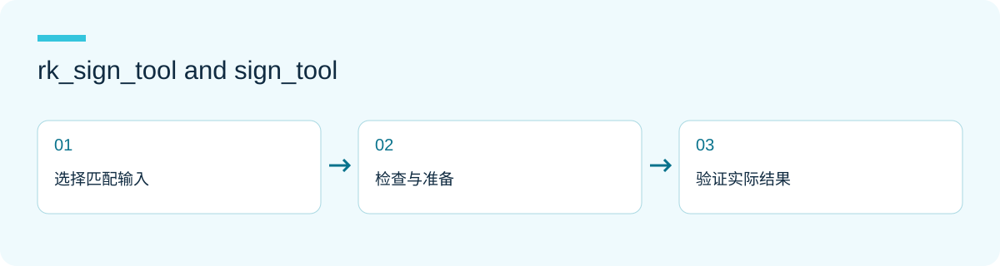





## sign_tool V1.0 手册：签名、校验与外部签名

本节完整整理工具包中的命令行签名手册。示例使用 `sign_tool`，不是推断所有 `rk_sign_tool` 版本参数相同。签名不等于烧写 OTP/eFuse；`0x20` 明确开启 miniloader 写 OTP 的能力，须按匹配的安全启动方案审查。

| SoC | Digest | Signature | Padding |
|---|---|---|---|
| 3229, 3228h, 3368, 3228, 3288, 3399, 3328 | SHA256 | RSA2048 | NOPADD |
| 3588, 3566, 3568, 3308, 3326, px30, 1808, 3228P, 1109, 1126, 2206 | SHA256 | RSA2048 | PSSPADD |

### 1. 签名前准备

生成 RSA2048 密钥对，显式 `--bits=2048` 或省略参数均为原文写法。先选择芯片，再加载公私钥；选择会被保存，后续芯片和密钥不变时无需重选。下面的 `1126` 和文件名是示例。

```text
sign_tool kk --bits=2048
sign_tool kk
sign_tool cc --chip=1126
sign_tool.exe lk --key private_key.pem --pubkey public_key.pem
```

可选签名 Flag 和中间数据目录如下。输出目录也可用作外部签名的输入目录。两条 `kk` 是替代写法，不是要求连续生成两次密钥。

```text
sign_tool ss --flag=0x20
sign_tool ss --out .\data_out
```

### 2. 五类对象的签名与校验

完整 update 固件会解包、签名内部 loader/uboot/boot/trust 再重新打包，耗时较长。A/B 方案不通过该工具签 boot，需在 `setting.ini` 设置 `exclude_boot_sign=true`。Loader 操作解包并插入安全结构后重打包；IDBlock 由 mkimage 生成，包含引导结构、DDR 初始化及 Boot 代码。DDR 测试配置及 uboot/trust/boot 镜像分别使用相应命令。

```text
sign_tool sf --firmware update.img
sign_tool vf --firmware update.img

sign_tool sl --loader miniloader.bin
sign_tool vl --loader miniloader.bin

sign_tool sb --idb 1126_idblock.bin
sign_tool vb --idb 1126_idblock.bin

sign_tool sd --cfg 1126_ddr_test.cfg
sign_tool vd --cfg 1126_ddr_test.cfg

sign_tool si --img uboot.img
sign_tool vi --img uboot.img
```

### 3.1 提取待签名数据

提取时可仅提供公钥。设置 extract 和输出目录，再执行第二节任一种签名操作，将待签名数据放入目录；这里以 update.img 为例。

```text
sign_tool ss --extract
sign_tool ss --out wait_sign_dir
sign_tool sf --firmware update.img
```

### 3.2 在外部签名

对目录内全部文件用私钥签名，将结果以原文件名放回 `wait_sign_dir`。PSS 示例恢复为一行命令，参数不变。NOPADD 则先建 256 字节全零 buffer，把 SHA256 摘要复制到最后 32 字节，再执行第二条命令。算法必须对应上表的目标芯片。

```text
openssl pkeyutl -sign -in to_sign.bin -inkey privatekey.pem -out signed.bin -pkeyopt digest:sha256 -pkeyopt rsa_padding_mode:pss -pkeyopt rsa_pss_saltlen:-1

openssl rsautl -sign -in to_sign.bin -inkey privatekey.pem -raw -out signed.bin
```

### 3.3 注入签名

```text
sign_tool ss --inject
sign_tool sf --firmware update.img
```

工具从此前设置的目录读取签名数据并注入对应位置；完成后再用匹配的 `v*` 命令校验。本文未执行签名、写 OTP 或设备烧录。

## 适用范围与验证状态

本文依据本次工具包及原始资料整理。使用前核对具体板卡、SoC、载板、SDK/BSP 与主机架构。本次未执行烧录、生产配置、寄存器写入或硬件测试；提供下载不代表所有 ArmSoM 产品均支持。

## GitHub 工具目录、版本与 SHA-256

打开 GitHub 对应目录后选择所需平台和版本，再校验文件哈希并完整解压。下方链接均为仓库目录入口。

[前往 GitHub 对应工具目录](https://github.com/ArmSoM/rockchip-tools/tree/main/downloads/rk-sign-tool)

| 平台 / 版本 | 文件 | SHA-256 |
|---|---|---|
| Linux / 1.42 | `rk_sign_tool_v1.42_linux.zip` | `799a0fad6e363b141e244580479ed8434e05c070d924db8a289e277e50a7ca1d` |
| Linux / directory snapshot | `rk_sign_tool-linux-directory-snapshot.zip` | `db3cd185e5e38b886be0a162a92d3400368acfb5684744b8e91af5ef9cdeb06e` |
| macOS / 1.2 | `sign_tool_v1.2_mac.zip` | `30ee08cb35681b735f1636bcc9215af64c4b6b5ca303a0889509be32209ea8ed` |

[GitHub · catalog.json](https://github.com/ArmSoM/rockchip-tools/blob/main/catalog.json) · [SHA256SUMS](https://github.com/ArmSoM/rockchip-tools/blob/main/SHA256SUMS)

## 资料依据与原图

- sign_tool用户使用手册.pdf

## 继续阅读相关流程

- [Rockchip Secure Boot 完整应用指南：签名、eFuse、OTP 与验证](/zh/articles/105-rockchip-secure-boot/)
- [Rockchip Linux Secure Boot 完整开发指南](/zh/articles/203-rockchip-linux-secure-boot/)
- [EfuseTool 1.42：建立可追溯的安全启动配置工位](/zh/articles/rockchip-tool-efuse-tool/)
- [Rockchip 工具下载与使用指南索引](/zh/articles/rockchip-tools-download-guide/)

## 查找准确的 ArmSoM 板卡资料

板卡、载板与接口要求先以产品手册为准。以下链接是平台参考，不表示该归档工具已在这些产品上验证。

[ArmSoM Docs](https://docs.armsom.org/) · [Sige7](https://www.armsom.org/sige7) / [Docs](https://docs.armsom.org/armsom-sige7) · [CM5](https://www.armsom.org/cm5) / [Docs](https://docs.armsom.org/armsom-cm5)


