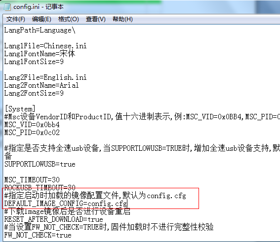
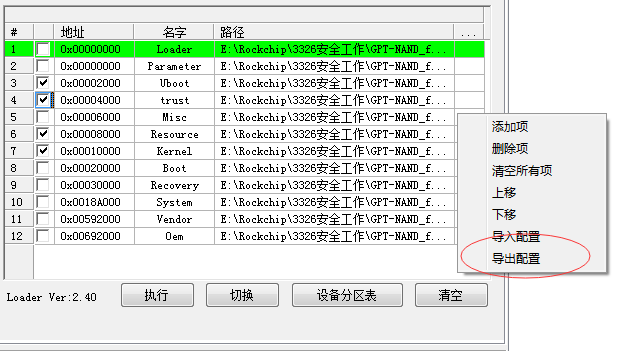




RKDevTool 是 Windows 下进行 Rockusb 固件操作的图形工具，适合 ArmSoM 开发板启动调试与烧录问题复现。完整 `update.img`、单独的分区镜像和 Loader 是不同输入，连接设备前先选清楚操作路线。

## 主机与板卡准备

使用 DriverAssitant 安装匹配的 Rockusb 驱动，完整解压 RKDevTool，保留语言文件与 DLL。按板卡手册确认数据 USB 口、供电和恢复/Maskrom 进入方式。任何写入前先备份。系统运行时的 ADB 连接与 Loader、Maskrom 连接不能混为一谈。

## 建立可重复的分区配置

1. 在下载区右键选择“导入配置”，文件类型选 **ParameterFile**，打开同一固件构建的 parameter。
2. 工具生成分区项后，删除不需要写入的项，逐项指定镜像；多存储板卡还要选择目标存储。
3. 对比镜像大小与分区容量，导出 **ConfigFile**。手册指出，`config.ini` 的 `DEFAULT_IMAGE_CONFIG` 可指定启动时加载的配置。
4. 执行前重新核对勾选项。成功导入配置并不代表配置与连接的板卡匹配。

## LoaderToDDR 与 Loader 的区别

Maskrom 下选择 **LoaderToDDR**，是把升级代码下载到 RAM，原文说明这一过程不写设备存储；选择 **Loader** 则生成 IDBlock 并写入存储。排查 DDR 初始化时尤其要区分。Loader 必须与板卡和 DDR 配置一致。

烧录整包时选择 `update.img`，设备进入 Maskrom 或 Loader 后执行升级。写单独分区时先加载 parameter。按地址写入绕过了这种对应关系，不可直接照搬别的板卡偏移。“擦除所有”会清空存储数据。

## 按失败阶段排查

| 现象 | 优先检查 |
|---|---|
| 识别不到设备 | 数据线、正确接口、驱动和设备模式 |
| 下载 Boot 失败 | DDR/Loader 匹配、供电、USB；重试前重启 |
| 镜像过大 | 分区定义与实际镜像长度 |
| 芯片标识或摘要错误 | 打包输入、镜像完整性，重新生成正确固件 |
| 偶发通讯错误 | USB 和供电；必现错误也要检查设备端 |

## 版本与验收

包内同时包含 2018 年中英 V1.2 手册、面向 V2.88 工具的 2021 年中文 V1.0 手册，目录修订说明到 3.37。因此不能只凭文档版本数字判断新旧。插图来自原手册，不是 ArmSoM 实测截图。烧录后记录结果，并验证冷启动、存储识别与系统版本；传输成功不等于整机验证通过。

## 适用范围与验证状态

本文依据本次工具包及原始资料整理。使用前核对具体板卡、SoC、载板、SDK/BSP 与主机架构。本次未执行烧录、生产配置、寄存器写入或硬件测试；提供下载不代表所有 ArmSoM 产品均支持。

## 工具下载、版本与 SHA-256

下载对应压缩包，校验哈希后完整解压。Linux PinDebug 分卷请先按链接中的说明还原；下方该项哈希对应合并后的完整文件。

| 主机 / 版本 | 下载包 |
|---|---|
| Windows / 3.37 release notes | [RKDevTool-windows-directory-snapshot.zip](https://raw.githubusercontent.com/ArmSoM/rockchip-tools/main/downloads/rkdevtool/RKDevTool-windows-directory-snapshot.zip) |

**RKDevTool-windows-directory-snapshot.zip — SHA-256**

```text
d453bd22c00141f12ef39469629d478aa61304763bdb2977288d6f019a74f20c
```

[GitHub · catalog.json](https://github.com/ArmSoM/rockchip-tools/blob/main/catalog.json) · [SHA256SUMS](https://github.com/ArmSoM/rockchip-tools/blob/main/SHA256SUMS)

## 资料依据与原图

- RKDevTool_manual_v1.2_cn.pdf; RKDevTool_manual_v1.2_en.pdf (2018)
- 开发工具使用说明_v1.0.pdf (2021, tool V2.88); bundled revision notes through 3.37
- [原始 PDF: RKDevTool_manual_v1.2_cn.pdf](https://raw.githubusercontent.com/ArmSoM/rockchip-tools/main/manuals/27081f89d32f.pdf)
- [原始 PDF: RKDevTool_manual_v1.2_en.pdf](https://raw.githubusercontent.com/ArmSoM/rockchip-tools/main/manuals/6a8a5813c129.pdf)
- [原始 PDF: 开发工具使用说明_v1.0.pdf](https://raw.githubusercontent.com/ArmSoM/rockchip-tools/main/manuals/be6d064c5f70.pdf)

插图直接提取自标明的原始 PDF。只有中文原图时保留原界面文字，图注按语言整理；这些是历史示例，不是本次 ArmSoM 测试截图。



RKDevTool_manual_v1.2_cn.pdf · p. 5



RKDevTool_manual_v1.2_cn.pdf · p. 5

## 继续阅读相关流程

- [Rockchip 存储应用完整说明：Flash、启动流程、分区、烧录与 Vendor Storage](/zh/articles/099-rockchip-storage-application/)
- [DriverAssitant 5.13：Windows Rockusb 与 ADB 驱动安装排查](/zh/articles/rockchip-tool-driver-assistant/)
- [upgrade_tool 下载与使用：命令行烧录、设备选择和结果校验](/zh/articles/rockchip-tool-upgrade-tool/)
- [Rockchip 工具下载与使用指南索引](/zh/articles/rockchip-tools-download-guide/)

## 查找准确的 ArmSoM 板卡资料

板卡、载板与接口要求先以产品手册为准。以下链接是平台参考，不表示该归档工具已在这些产品上验证。

[ArmSoM Docs](https://docs.armsom.org/) · [Sige7](https://www.armsom.org/sige7) / [Docs](https://docs.armsom.org/armsom-sige7) · [CM5](https://www.armsom.org/cm5) / [Docs](https://docs.armsom.org/armsom-cm5)


