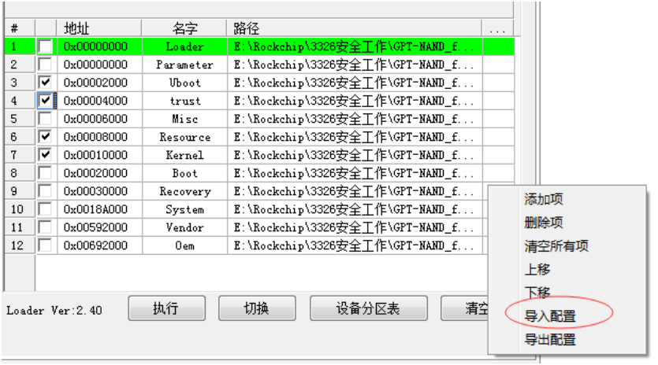
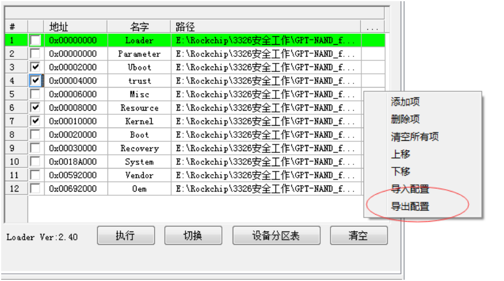
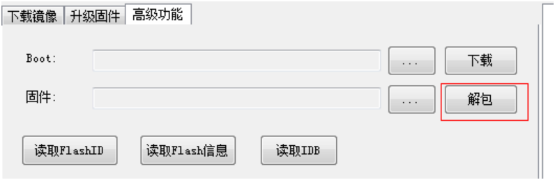
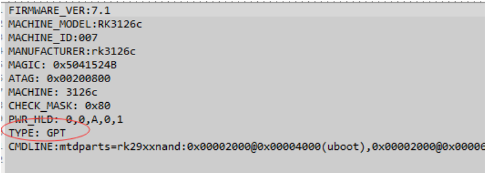
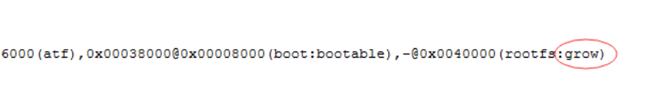
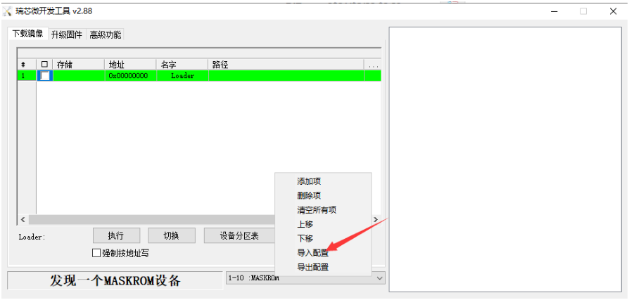



## RKDevTool 手册整合：分区、固件及高级操作

本节整合 2018 年中英文 V1.2 与 2021 年中文 V1.0（工具 2.88）。版本号不是按年份递增，不能把 2018 V1.2 当成更新稿；工具包本身是 3.37 发布记录快照。中文图取中文原稿，英俄德图取对应英文稿；仅 2021 稿新增界面无英文图时保留中文并标注。以下覆盖两版全部技术功能。

### 1. 创建、导入和导出烧录配置

在下载配置区右击，选择导入配置；文件类型选 `ParameterFile` 后打开项目 parameter，自动生成分区下载项。删除不需要的项，设置对应镜像及目标存储（单存储可省略）。完成后导出为 `ConfigFile`，以后直接导入。默认配置不一定匹配项目。`Config.ini` 的 `DEFAULT_IMAGE_CONFIG` 可指定启动加载文件；V1.2 也说明替换工具目录 `config.cfg` 可让下次启动加载。改配置后重启工具。

### 2. Boot 下载与 Loader 烧写的区别

Maskrom 下的 Boot 下载执行 Loader 的 DDR 初始化，把 usbplug 载入 DDR，不写存储。双击第一行 Loader，选择 `LoaderToDDR`，勾选执行。持久烧写则选择 `Loader`，生成 IDBlock 并写存储，Maskrom/Loader 均可。Boot 失败检查 DDR 焊接、主控、匹配 Loader 和 USB；重试前重启设备。持久写入另需检查 Flash 支持、虚焊及芯片标志。

### 3. 分区镜像与设备分区表

连接 Loader/Maskrom 设备，Maskrom 时勾选 Loader；选择 parameter 取得各分区地址和大小，选镜像和目标存储，勾选所需分区再执行。地址为零时不能直接假定正确。若希望使用设备现有布局，V1.2 的“设备分区表”会读取、解析并加载设备端表。不存在/占用的文件、镜像超过分区、USB 异常需分别解决。

### 4. 设备模式及多设备选择

检测为 ADB、MSC、MTP、UVC 时先使用“切换”进入 Rockusb；Loader 可再通过“进入 Maskrom”切换。连接多台设备时，先通过设备下拉框选择目标，再进行后续操作。

### 5. update.img 完整升级

选择 update.img，连接 Maskrom/Loader 设备，点击升级。V1.2 说明该界面也接受 Loader 文件。失败依次检查文件存在/占用、格式和损坏、摘要、打包工具版本、分区大小、芯片标志、USB/设备通信；偶发通信错误优先排查线缆，固定重现则排查设备端。

### 6. 强制按地址写文件

勾选“强制按地址写”，选择文件，地址栏填入写入位置，再勾选文件执行。该操作绕过常规按分区定位，必须根据实际存储布局核对，不能用于规避错误镜像或分区过小的问题。

### 7. 擦除存储

2021 手册要求进入 Maskrom、成功下载 Boot 后再擦除；按起始扇区与扇区数擦除仅列 eMMC，全擦列 `emmc|nor|nand`。2018 手册说明擦除 Flash 会遍历所有 Block，包括固件前的系统块；反复升级失败可考虑先擦除，但这会丢失数据。不要把新版命令行工具的 SPI 擦除支持套到旧 GUI。

### 8. 读取 Chip 信息

执行“读取 Chip 信息”；输出 `Image Chip Flag` 应与 Loader/固件打包时设置一致。不匹配时重新准备对应芯片文件。

### 9. 多存储操作

在 Maskrom 中先下载 Boot，再读取存储列表：勾表示当前存储，叉表示不支持，圈表示支持。选择带圈项，点击切换存储。

### 10. 解包固件

解包到工具 `output`：`boot.bin` 是打包使用的 Loader，`firmware.img` 是 afptool 生成的内部固件，`Android` 目录是 firmware.img 展开内容。原稿文件名保持不变。

### 11. GPT 与扩展能力

V1.2 支持通过 parameter 或 `partition_table.img` 下载 GPT。parameter 必须有 `TYPE:GPT`，最后分区使用 `grow` 分配剩余空间。通过 `Read Capability` 查看 `DirectLBA`，必须 enable，否则工具提示不支持 GPT。

### 12. 清空序列号及故障排查

V1.2 的清空序列号可清除统一动态库工具写入的序列号。下载项不存在时检查对应分区的镜像路径。下载失败可更新 Rockusb 驱动/工具，换带屏蔽 USB 线及电脑后置口，检查 Flash 虚焊、损坏或支持情况。校验失败检查 parameter 分区大小、Flash 软件映射及 DDR 稳定性；原文提出擦除 Flash 后重试，须先评估数据丢失。非中文系统使用全英文工具路径；Windows 7/Vista 以管理员运行；修改 Config.ini 后重启。

### 中英文 V1.2 的补充差异

英文全擦步骤要求先以 Firmware 选择 update.img 或 loader.bin，再连接 Maskrom/Loader 并点击 EraseFlash；中文 2021 稿则明确要求 Maskrom 及先下载 Boot，按实际版本操作。英文 Clear sn 还注明会清除 IDBlock sector3 中的 SN、MAC 等，而中文仅写统一动态库写入的序列号。英文下载失败建议更新工具和 Loader，中文建议更新 Rockusb 驱动和工具，故两者均列入检查。英文要求管理员账户，中文特指 Win7/Vista。

## 适用范围与验证状态

本文依据本次工具包及原始资料整理。使用前核对具体板卡、SoC、载板、SDK/BSP 与主机架构。本次未执行烧录、生产配置、寄存器写入或硬件测试；提供下载不代表所有 ArmSoM 产品均支持。

## GitHub 工具目录、版本与 SHA-256

打开 GitHub 对应目录后选择所需平台和版本，再校验文件哈希并完整解压。下方链接均为仓库目录入口。

[前往 GitHub 对应工具目录](https://github.com/ArmSoM/rockchip-tools/tree/main/downloads/rkdevtool)

| 平台 / 版本 | 文件 | SHA-256 |
|---|---|---|
| Windows / 3.37 release notes | `RKDevTool-windows-directory-snapshot.zip` | `d453bd22c00141f12ef39469629d478aa61304763bdb2977288d6f019a74f20c` |

[GitHub · catalog.json](https://github.com/ArmSoM/rockchip-tools/blob/main/catalog.json) · [SHA256SUMS](https://github.com/ArmSoM/rockchip-tools/blob/main/SHA256SUMS)

## 资料依据与原图

- RKDevTool_manual_v1.2_cn.pdf
- RKDevTool_manual_v1.2_en.pdf
- 开发工具使用说明_v1.0.pdf

### 原手册操作界面与图示

界面图保留原手册语言；中文使用中文原稿，英俄德优先使用英文原稿，无英文原图的新增界面仍为中文。图中的值是手册示例，不是当前板卡实测。

RKDevTool_manual_v1.2_cn.pdf · p. 4

RKDevTool_manual_v1.2_cn.pdf · p. 5

RKDevTool_manual_v1.2_cn.pdf · p. 5

RKDevTool_manual_v1.2_cn.pdf · p. 6

RKDevTool_manual_v1.2_cn.pdf · p. 7

RKDevTool_manual_v1.2_cn.pdf · p. 8

RKDevTool_manual_v1.2_cn.pdf · p. 8

RKDevTool_manual_v1.2_cn.pdf · p. 9

RKDevTool_manual_v1.2_cn.pdf · p. 9

RKDevTool_manual_v1.2_cn.pdf · p. 9

RKDevTool_manual_v1.2_cn.pdf · p. 10

RKDevTool_manual_v1.2_cn.pdf · p. 10

RKDevTool_manual_v1.2_cn.pdf · p. 11

RKDevTool_manual_v1.2_cn.pdf · p. 12

RKDevTool_manual_v1.2_cn.pdf · p. 12

RKDevTool_manual_v1.2_cn.pdf · p. 13

RKDevTool_manual_v1.2_cn.pdf · p. 13

RKDevTool_manual_v1.2_cn.pdf · p. 13

RKDevTool_manual_v1.2_cn.pdf · p. 14

开发工具使用说明_v1.0.pdf · p. 2

开发工具使用说明_v1.0.pdf · p. 2

开发工具使用说明_v1.0.pdf · p. 3

开发工具使用说明_v1.0.pdf · p. 4

开发工具使用说明_v1.0.pdf · p. 5

开发工具使用说明_v1.0.pdf · p. 5

开发工具使用说明_v1.0.pdf · p. 6

开发工具使用说明_v1.0.pdf · p. 7

开发工具使用说明_v1.0.pdf · p. 8

开发工具使用说明_v1.0.pdf · p. 9

开发工具使用说明_v1.0.pdf · p. 9

开发工具使用说明_v1.0.pdf · p. 10

开发工具使用说明_v1.0.pdf · p. 11

开发工具使用说明_v1.0.pdf · p. 11

## 继续阅读相关流程

- [Rockchip 存储应用完整说明：Flash、启动流程、分区、烧录与 Vendor Storage](/zh/articles/099-rockchip-storage-application/)
- [DriverAssitant 5.13：Windows Rockusb 与 ADB 驱动安装排查](/zh/articles/rockchip-tool-driver-assistant/)
- [upgrade_tool 下载与使用：命令行烧录、设备选择和结果校验](/zh/articles/rockchip-tool-upgrade-tool/)
- [Rockchip 工具下载与使用指南索引](/zh/articles/rockchip-tools-download-guide/)

## 查找准确的 ArmSoM 板卡资料

板卡、载板与接口要求先以产品手册为准。以下链接是平台参考，不表示该归档工具已在这些产品上验证。

[ArmSoM Docs](https://docs.armsom.org/) · [Sige7](https://www.armsom.org/sige7) / [Docs](https://docs.armsom.org/armsom-sige7) · [CM5](https://www.armsom.org/cm5) / [Docs](https://docs.armsom.org/armsom-cm5)


