

## RKDevTool 手册整合：分区、固件及高级操作

本节整合 2018 年中英文 V1.2 与 2021 年中文 V1.0（工具 2.88）。版本号不是按年份递增，不能把 2018 V1.2 当成更新稿；工具包本身是 3.37 发布记录快照。中文图取中文原稿，英俄德图取对应英文稿；仅 2021 稿新增界面无英文图时保留中文并标注。以下覆盖两版全部技术功能。

### 1. 创建、导入和导出烧录配置

#### 1.1 从 parameter 创建配置

先确认 parameter 来自当前项目。在下载配置区空白处右击，选择“导入配置”。下面是工具 2.88 的菜单位置。

<figure style="margin:1.6rem 0">

<figcaption style="margin-top:.6rem;font-size:.9em;line-height:1.55"><strong>图 1：右键菜单中的“导入配置”入口</strong></figcaption>
</figure>

在打开的文件对话框中，将文件类型改为 `ParameterFile`，再选择项目的 parameter 文件。工具将根据分区表创建下载项。

<figure style="margin:1.6rem 0">

<figcaption style="margin-top:.6rem;font-size:.9em;line-height:1.55"><strong>图 2：文件类型选择 ParameterFile，再打开分区配置</strong></figcaption>
</figure>

配置导入后，删除不需要的下载项，为保留的项目选择镜像文件，再指定目标存储。设备只有一种存储时，可省略存储选择。工具自带的默认配置不一定适用于当前项目。2018 V1.2 的导入入口如下，界面文字有所不同。

<figure style="margin:1.6rem 0">

<figcaption style="margin-top:.6rem;font-size:.9em;line-height:1.55"><strong>图 3：V1.2 的分区配置导入菜单</strong></figcaption>
</figure>

#### 1.2 导出配置，供下次复用

配置完成后，在下载区右击并选择“导出配置”，保存为 `ConfigFile`。下次可直接导入这个配置文件。V1.2 还说明：替换工具目录的 `config.cfg`，可以让工具启动时加载该配置。

<figure style="margin:1.6rem 0">

<figcaption style="margin-top:.6rem;font-size:.9em;line-height:1.55"><strong>图 4：导出当前分区配置，保留镜像及分区对应关系</strong></figcaption>
</figure>

#### 1.3 指定启动时加载的配置

如果要指定工具启动时自动加载的文件，可修改 `Config.ini` 中的 `DEFAULT_IMAGE_CONFIG`。保存配置后重启工具，使修改生效。图中的路径是原稿示例，应替换为本项目的配置位置。

<figure style="margin:1.6rem 0">

<figcaption style="margin-top:.6rem;font-size:.9em;line-height:1.55"><strong>图 5：Config.ini 中的 DEFAULT_IMAGE_CONFIG 配置项</strong></figcaption>
</figure>

### 2. Boot 下载与 Loader 烧写的区别

#### 2.1 只将 Boot 下载到内存

Maskrom 下的 Boot 下载会执行 Loader 中的 DDR 初始化，并把 usbplug 载入 DDR 运行，不写设备存储。双击下载区第一行的 Loader，选择 `LoaderToDDR`，勾选该项后点击“执行”。

<figure style="margin:1.6rem 0">

<figcaption style="margin-top:.6rem;font-size:.9em;line-height:1.55"><strong>图 6：LoaderToDDR：下载升级代码到 DDR，不写入存储</strong></figcaption>
</figure>

2018 V1.2 提供另一条入口：在高级功能区选择 Boot 文件，再点击“下载”。它同样用于把 Boot 下载到内存。

<figure style="margin:1.6rem 0">
<a href="/assets/rockchip-tools/manuals/27081f89d32f/p08-f02.png" target="_blank" rel="noopener" aria-label="查看原尺寸图片">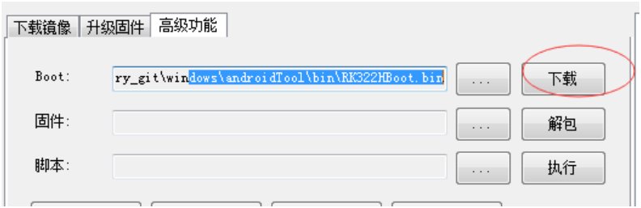</a>
<figcaption style="margin-top:.6rem;font-size:.9em;line-height:1.55"><strong>图 7：V1.2 高级功能中的 Boot 下载入口</strong></figcaption>
</figure>

在 V1.2 的下载列表中，也可以通过 Loader 下拉框选择 `LoaderToDDR`。两种入口对应同一类内存下载操作；重试前先重启设备，并检查 DDR 焊接、主控、Loader 匹配情况及 USB 通信。

<figure style="margin:1.6rem 0">
<a href="/assets/rockchip-tools/manuals/27081f89d32f/p09-f01.png" target="_blank" rel="noopener" aria-label="查看原尺寸图片">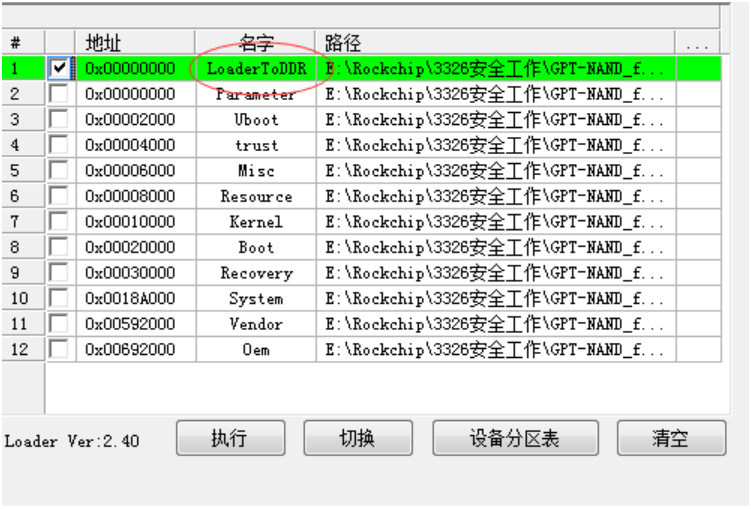</a>
<figcaption style="margin-top:.6rem;font-size:.9em;line-height:1.55"><strong>图 8：V1.2 列表中的 LoaderToDDR 选项</strong></figcaption>
</figure>

#### 2.2 将 Loader 持久写入存储

需要烧写 Loader 时，将第一行类型设为 `Loader`，勾选后执行。Maskrom 和 Loader 模式均可进行；工具会生成 IDBlock 并写入存储。除了 DDR、主控和 USB，还需检查 Flash 支持列表、虚焊及芯片标志。偶发通信失败优先检查 USB，必现失败检查设备端。

<figure style="margin:1.6rem 0">

<figcaption style="margin-top:.6rem;font-size:.9em;line-height:1.55"><strong>图 9：Loader 选项：生成 IDBlock 并写入设备存储</strong></figcaption>
</figure>

### 3. 分区镜像与设备分区表

连接 Loader/Maskrom 设备，Maskrom 时勾选 Loader；选择 parameter 取得各分区地址和大小，选镜像和目标存储，勾选所需分区再执行。地址为零时不能直接假定正确。若希望使用设备现有布局，V1.2 的“设备分区表”会读取、解析并加载设备端表。不存在/占用的文件、镜像超过分区、USB 异常需分别解决。

<figure style="margin:1.6rem 0">

<figcaption style="margin-top:.6rem;font-size:.9em;line-height:1.55"><strong>图 10：确认分区、镜像路径和目标存储后，执行勾选项目</strong></figcaption>
</figure>

旧版 V1.2 同样要求核对下载项前的分区地址。下图展示 Maskrom 设备的列表；如果地址未正确加载，先选择本项目 parameter，不要直接使用零地址。需要沿用设备现有分区布局时，可使用“设备分区表”读取、解析并加载。

<figure style="margin:1.6rem 0">
<a href="/assets/rockchip-tools/manuals/27081f89d32f/p06-f01.png" target="_blank" rel="noopener" aria-label="查看原尺寸图片">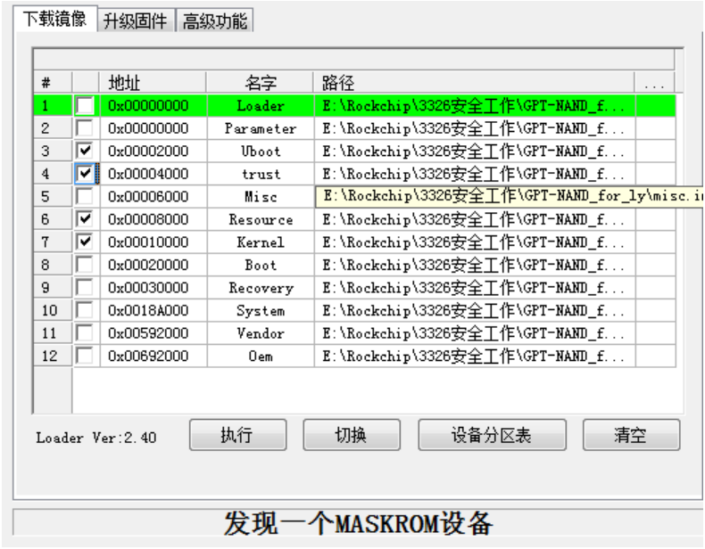</a>
<figcaption style="margin-top:.6rem;font-size:.9em;line-height:1.55"><strong>图 11：V1.2 分区下载列表及设备状态</strong></figcaption>
</figure>

### 4. 设备模式及多设备选择

如果设备被检测为 ADB、MSC、MTP 或 UVC，先点击“切换”，进入 Rockusb 的 Loader 或 Maskrom 状态，再进行烧录。下图以 ADB 设备为例。

<figure style="margin:1.6rem 0">

<figcaption style="margin-top:.6rem;font-size:.9em;line-height:1.55"><strong>图 12：通过“切换”将 ADB 设备转入 Rockusb 模式</strong></figcaption>
</figure>

设备已经处于 Loader 时，可在高级功能中点击“进入 Maskrom”。操作后重新确认界面显示的设备状态。

<figure style="margin:1.6rem 0">

<figcaption style="margin-top:.6rem;font-size:.9em;line-height:1.55"><strong>图 13：工具 2.88 的“进入 Maskrom”按钮</strong></figcaption>
</figure>

2018 V1.2 对应的入口如下；该功能的前提同样是设备处于 Loader。

<figure style="margin:1.6rem 0">
<a href="/assets/rockchip-tools/manuals/27081f89d32f/p11-f01.png" target="_blank" rel="noopener" aria-label="查看原尺寸图片">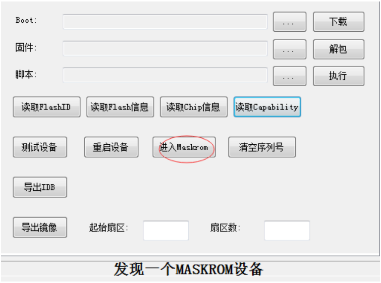</a>
<figcaption style="margin-top:.6rem;font-size:.9em;line-height:1.55"><strong>图 14：V1.2 的 Loader → Maskrom 切换入口</strong></figcaption>
</figure>

同时连接多台设备时，在执行任何后续操作前，先在设备下拉框中选择目标设备。不要仅凭“发现设备”的提示就开始写入。

<figure style="margin:1.6rem 0">

<figcaption style="margin-top:.6rem;font-size:.9em;line-height:1.55"><strong>图 15：多设备环境下先选择操作对象</strong></figcaption>
</figure>

### 5. update.img 完整升级

选择 update.img，连接 Maskrom/Loader 设备，点击升级。V1.2 说明该界面也接受 Loader 文件。失败依次检查文件存在/占用、格式和损坏、摘要、打包工具版本、分区大小、芯片标志、USB/设备通信；偶发通信错误优先排查线缆，固定重现则排查设备端。

<figure style="margin:1.6rem 0">

<figcaption style="margin-top:.6rem;font-size:.9em;line-height:1.55"><strong>图 16：选择 update.img、确认设备模式，再点击升级</strong></figcaption>
</figure>

2018 V1.2 的升级界面如下。该版本说明 Firmware 也可以选择 Loader 文件；使用完整 update.img 与单独 Loader 时，应确认自己实际要执行的操作。

<figure style="margin:1.6rem 0">
<a href="/assets/rockchip-tools/manuals/27081f89d32f/p07-f01.png" target="_blank" rel="noopener" aria-label="查看原尺寸图片">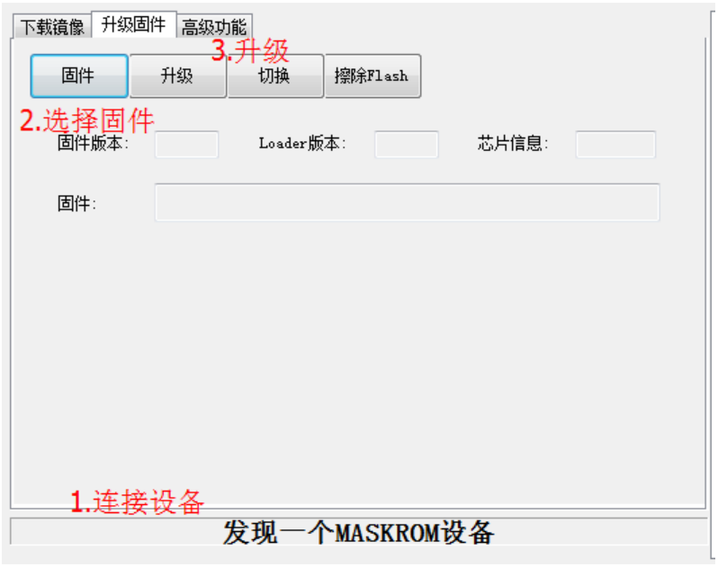</a>
<figcaption style="margin-top:.6rem;font-size:.9em;line-height:1.55"><strong>图 17：V1.2 的固件选择与 Upgrade 操作区</strong></figcaption>
</figure>

### 6. 强制按地址写文件

勾选“强制按地址写”，选择文件，地址栏填入写入位置，再勾选文件执行。该操作绕过常规按分区定位，必须根据实际存储布局核对，不能用于规避错误镜像或分区过小的问题。

<figure style="margin:1.6rem 0">

<figcaption style="margin-top:.6rem;font-size:.9em;line-height:1.55"><strong>图 18：强制按地址写入时，逐项核对文件、地址与勾选状态</strong></figcaption>
</figure>

### 7. 擦除存储

2021 手册要求进入 Maskrom、成功下载 Boot 后再擦除；按起始扇区与扇区数擦除仅列 eMMC，全擦列 `emmc|nor|nand`。2018 手册说明擦除 Flash 会遍历所有 Block，包括固件前的系统块；反复升级失败可考虑先擦除，但这会丢失数据。不要把新版命令行工具的 SPI 擦除支持套到旧 GUI。

<figure style="margin:1.6rem 0">

<figcaption style="margin-top:.6rem;font-size:.9em;line-height:1.55"><strong>图 19：擦除扇区与擦除全部使用不同的操作入口</strong></figcaption>
</figure>

### 8. 读取 Chip 信息

执行“读取 Chip 信息”；输出 `Image Chip Flag` 应与 Loader/固件打包时设置一致。不匹配时重新准备对应芯片文件。

<figure style="margin:1.6rem 0">

<figcaption style="margin-top:.6rem;font-size:.9em;line-height:1.55"><strong>图 20：读取 Chip 信息后，在输出区核对 Image Chip Flag</strong></figcaption>
</figure>

V1.2 的输出区同样显示芯片标志。出现“校验芯片失败”时，用这里读到的值检查固件或 Loader 的打包配置。

<figure style="margin:1.6rem 0">
<a href="/assets/rockchip-tools/manuals/27081f89d32f/p13-f02.png" target="_blank" rel="noopener" aria-label="查看原尺寸图片">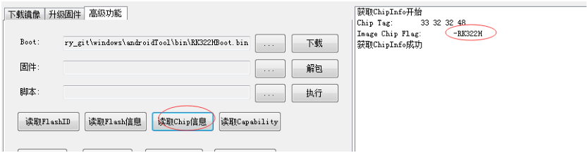</a>
<figcaption style="margin-top:.6rem;font-size:.9em;line-height:1.55"><strong>图 21：V1.2 的芯片信息读取与 Image Chip Flag 输出</strong></figcaption>
</figure>

下图为手册中的打包配置示例，标出了芯片字段。它用于说明“打包标志应与读取结果一致”，不能把图中的芯片值直接套用到另一块板卡。

<figure style="margin:1.6rem 0">

<figcaption style="margin-top:.6rem;font-size:.9em;line-height:1.55"><strong>图 22：打包配置中的芯片字段示例</strong></figcaption>
</figure>

### 9. 多存储操作

在 Maskrom 中先下载 Boot，再读取存储列表：勾表示当前存储，叉表示不支持，圈表示支持。选择带圈项，点击切换存储。

<figure style="margin:1.6rem 0">

<figcaption style="margin-top:.6rem;font-size:.9em;line-height:1.55"><strong>图 23：读取存储列表，按支持状态选择并切换目标存储</strong></figcaption>
</figure>

### 10. 解包固件

解包到工具 `output`：`boot.bin` 是打包使用的 Loader，`firmware.img` 是 afptool 生成的内部固件，`Android` 目录是 firmware.img 展开内容。原稿文件名保持不变。

<figure style="margin:1.6rem 0">

<figcaption style="margin-top:.6rem;font-size:.9em;line-height:1.55"><strong>图 24：选择完整固件后，通过“解包”输出镜像文件</strong></figcaption>
</figure>

旧版 V1.2 的解包按钮位于高级功能区。解包结果用于检查固件内容，不会因此自动完成设备烧录。

<figure style="margin:1.6rem 0">

<figcaption style="margin-top:.6rem;font-size:.9em;line-height:1.55"><strong>图 25：V1.2 高级功能区的固件解包入口</strong></figcaption>
</figure>

### 11. GPT 与扩展能力

V1.2 可以使用 parameter 或 `partition_table.img` 下载 GPT。使用 parameter 时，首先确认文件中包含 `TYPE:GPT`。

<figure style="margin:1.6rem 0">

<figcaption style="margin-top:.6rem;font-size:.9em;line-height:1.55"><strong>图 26：parameter 中的 TYPE:GPT 属性</strong></figcaption>
</figure>

最后一个分区需要使用 `grow` 属性，才能把剩余存储空间分配给该分区。保留本项目实际的分区地址和名称，不照抄示例布局。

<figure style="margin:1.6rem 0">

<figcaption style="margin-top:.6rem;font-size:.9em;line-height:1.55"><strong>图 27：最后一个分区的 grow 属性</strong></figcaption>
</figure>

检查分区描述后，在下载区选择相应的 parameter 或 GPT 镜像。下图展示 V1.2 的选择位置。

<figure style="margin:1.6rem 0">
<a href="/assets/rockchip-tools/manuals/27081f89d32f/p10-f01.png" target="_blank" rel="noopener" aria-label="查看原尺寸图片">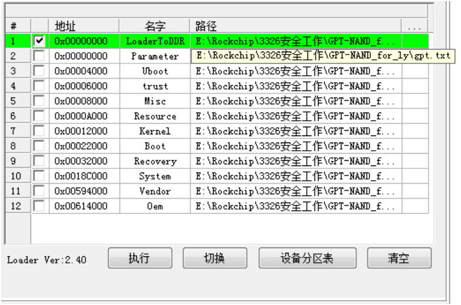</a>
<figcaption style="margin-top:.6rem;font-size:.9em;line-height:1.55"><strong>图 28：下载区选择 GPT 分区描述文件</strong></figcaption>
</figure>

下载前通过 `Read Capability` 检查扩展能力。`DirectLBA` 必须为 enable；若未开启，工具会提示不支持写 GPT。该条件不能用“强制按地址写”绕过。

<figure style="margin:1.6rem 0">
<a href="/assets/rockchip-tools/manuals/27081f89d32f/p10-f02.png" target="_blank" rel="noopener" aria-label="查看原尺寸图片">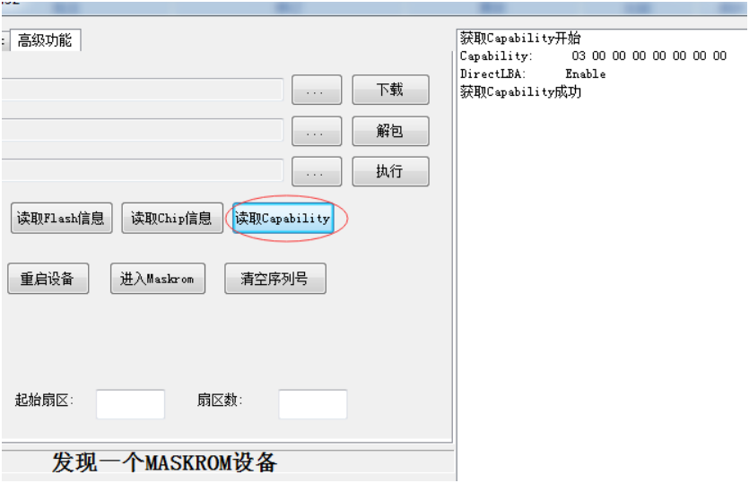</a>
<figcaption style="margin-top:.6rem;font-size:.9em;line-height:1.55"><strong>图 29：Read Capability 输出中的 DirectLBA 能力</strong></figcaption>
</figure>

### 12. 清空序列号及故障排查

#### 12.1 清空序列号

V1.2 的“清空序列号”用于清除统一动态库工具写入的序列号。英文手册进一步说明会涉及 IDBlock sector3 中的 SN、MAC 等内容；执行前明确需要清除哪些设备信息。

<figure style="margin:1.6rem 0">
<a href="/assets/rockchip-tools/manuals/27081f89d32f/p12-f01.png" target="_blank" rel="noopener" aria-label="查看原尺寸图片">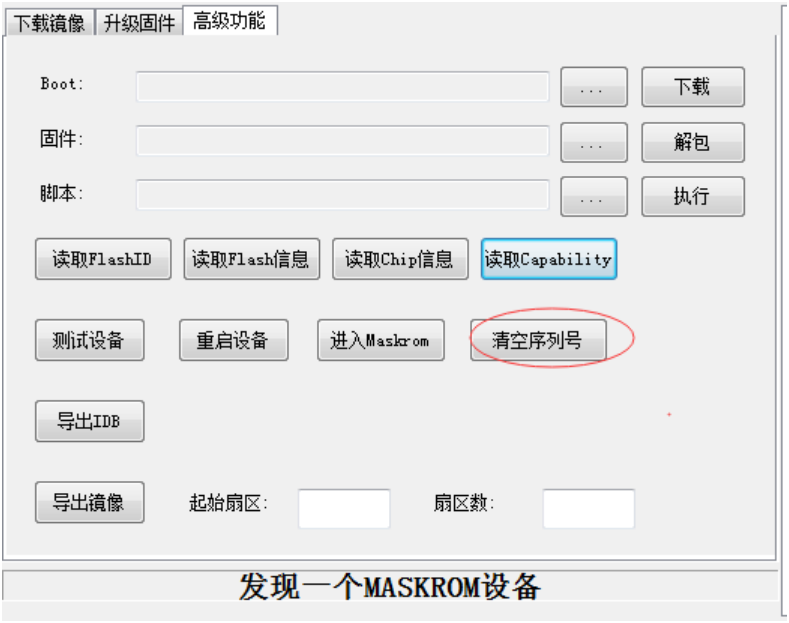</a>
<figcaption style="margin-top:.6rem;font-size:.9em;line-height:1.55"><strong>图 30：V1.2 的清空序列号入口</strong></figcaption>
</figure>

#### 12.2 下载项不存在

“下载项不存在”应先检查相应分区的镜像路径。中文示例指向 kernel 分区；英文示例提示 boot 文件缺失。按照错误提示定位具体文件。

<figure style="margin:1.6rem 0">
<a href="/assets/rockchip-tools/manuals/27081f89d32f/p12-f02.png" target="_blank" rel="noopener" aria-label="查看原尺寸图片">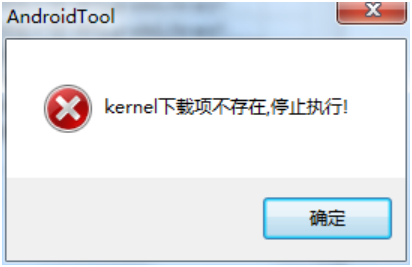</a>
<figcaption style="margin-top:.6rem;font-size:.9em;line-height:1.55"><strong>图 31：下载项缺失提示：检查消息中指定的镜像文件</strong></figcaption>
</figure>

#### 12.3 加载固件失败

检查固件是否被其他程序占用、格式是否正确、文件是否损坏。校验芯片失败则回到“读取 Chip 信息”，核对 `Image Chip Flag` 与 Loader/固件的打包标志。

<figure style="margin:1.6rem 0">
<a href="/assets/rockchip-tools/manuals/27081f89d32f/p13-f01.png" target="_blank" rel="noopener" aria-label="查看原尺寸图片">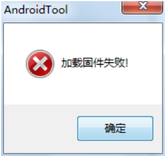</a>
<figcaption style="margin-top:.6rem;font-size:.9em;line-height:1.55"><strong>图 32：固件加载失败提示</strong></figcaption>
</figure>

#### 12.4 下载或校验失败

- **下载 Boot 失败**：检查 DDR 焊接、主控和 Loader 是否匹配，检查 USB；重试前重启设备。
- **下载固件或分区镜像失败**：中文稿建议更新 Rockusb 驱动及工具，英文稿还建议核对工具与 Loader；更换带屏蔽 USB 线，使用电脑后置端口，并检查 Flash 支持、虚焊和损坏。
- **校验失败**：确认 parameter 分区大小能容纳镜像，检查 Flash 软件映射及 DDR 稳定性。原稿建议必要时擦除 Flash 后重试，但应先评估数据丢失。

#### 12.5 不支持写 GPT

遇到下图所示提示时，通过 `Read Capability` 确认 `DirectLBA` 是否开启，再检查本项目的 GPT 配置。

<figure style="margin:1.6rem 0">
<a href="/assets/rockchip-tools/manuals/27081f89d32f/p14-f01.png" target="_blank" rel="noopener" aria-label="查看原尺寸图片">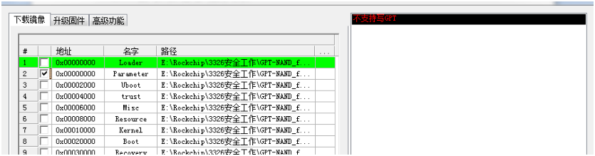</a>
<figcaption style="margin-top:.6rem;font-size:.9em;line-height:1.55"><strong>图 33：不支持 GPT 时检查 DirectLBA</strong></figcaption>
</figure>

#### 12.6 路径、权限与配置生效

非中文系统使用全英文工具路径。英文 V1.2 要求管理员账户，中文稿特别说明 Windows 7/Vista 需以管理员运行。修改 `Config.ini` 后重启工具，使设置生效。

### 中英文 V1.2 的补充差异

英文全擦步骤要求先以 Firmware 选择 update.img 或 loader.bin，再连接 Maskrom/Loader 并点击 EraseFlash；中文 2021 稿则明确要求 Maskrom 及先下载 Boot，按实际版本操作。英文 Clear sn 还注明会清除 IDBlock sector3 中的 SN、MAC 等，而中文仅写统一动态库写入的序列号。英文下载失败建议更新工具和 Loader，中文建议更新 Rockusb 驱动和工具，故两者均列入检查。英文要求管理员账户，中文特指 Win7/Vista。

## 适用范围与验证状态

本文依据本次工具包及原始资料整理。使用前核对具体板卡、SoC、载板、SDK/BSP 与主机架构。本次未执行烧录、生产配置、寄存器写入或硬件测试；提供下载不代表所有 ArmSoM 产品均支持。

## GitHub 工具目录、版本与 SHA-256

打开 GitHub 对应目录后选择所需平台和版本，再校验文件哈希并完整解压。下方链接均为仓库目录入口。

[前往 GitHub 对应工具目录](https://github.com/ArmSoM/rockchip-tools/tree/main/downloads/rkdevtool)

| 平台 / 版本 | 文件 | SHA-256 |
|---|---|---|
| Windows / 3.37 release notes | `RKDevTool-windows-directory-snapshot.zip` | `d453bd22c00141f12ef39469629d478aa61304763bdb2977288d6f019a74f20c` |

[GitHub · catalog.json](https://github.com/ArmSoM/rockchip-tools/blob/main/catalog.json) · [SHA256SUMS](https://github.com/ArmSoM/rockchip-tools/blob/main/SHA256SUMS)

## 资料依据与原图

- RKDevTool_manual_v1.2_cn.pdf
- RKDevTool_manual_v1.2_en.pdf
- 开发工具使用说明_v1.0.pdf

## 继续阅读相关流程

- [Rockchip 存储应用完整说明：Flash、启动流程、分区、烧录与 Vendor Storage](/zh/articles/099-rockchip-storage-application/)
- [DriverAssitant 5.13：Windows Rockusb 与 ADB 驱动安装排查](/zh/articles/rockchip-tool-driver-assistant/)
- [upgrade_tool 下载与使用：命令行烧录、设备选择和结果校验](/zh/articles/rockchip-tool-upgrade-tool/)
- [Rockchip 工具下载与使用指南索引](/zh/articles/rockchip-tools-download-guide/)

## 查找准确的 ArmSoM 板卡资料

板卡、载板与接口要求先以产品手册为准。以下链接是平台参考，不表示该归档工具已在这些产品上验证。

[ArmSoM Docs](https://docs.armsom.org/) · [Sige7](https://www.armsom.org/sige7) / [Docs](https://docs.armsom.org/armsom-sige7) · [CM5](https://www.armsom.org/cm5) / [Docs](https://docs.armsom.org/armsom-cm5)


