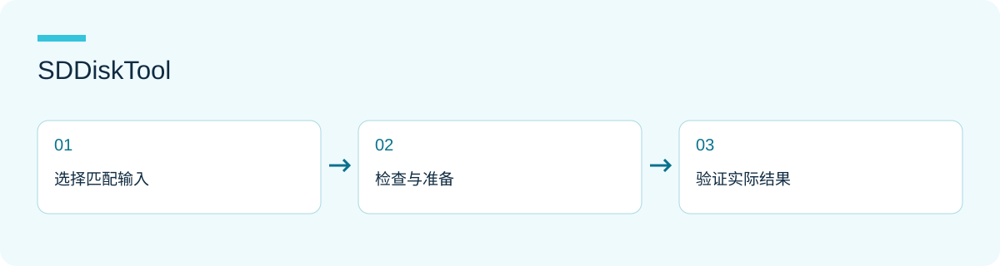



SDDiskTool 制作不同用途的 Rockchip 可移动介质，界面提供 Upgrade Firmware、PCBA Test、SD Boot。它们并不等同于把任意 Linux 发行版磁盘镜像写进卡里。

## 先确定目标行为

SD Boot 准备受支持镜像的启动介质；升级卡可能进入更新流程并写板载存储；PCBA 卡用于测试。插卡前明确目标 Bootloader 会执行什么操作，制卡和更新板卡是两个阶段。

## 制作顺序

1. 使用内容可擦除的卡，按容量与设备身份确认目标，不只看盘符。
2. 按界面顺序选择可移动磁盘、功能模式、匹配固件。
3. 提供 SDK 所需文件；工具对缺少 `SDBoot.bin`、`sd_boot_config.config` 有明确报错。
4. 点击 Create 前再次核对目标，原确认提示明确会丢失所选磁盘数据。
5. 成功后安全弹出，按板卡手册的启动优先级和上电流程使用。

## 排查与恢复

找不到可移动盘、无法锁定/卸载卷、缺固件、格式化失败属于不同阶段。关闭占用卷的程序，核对设备后再重试。Restore 也会破坏卡上数据，不是恢复板卡原来的数据。

## 版本和结果验收

1.78 修复写备用 GPT 时的地址访问错误，早期记录还涉及 grow 分区、大固件处理。这些修复不代表全平台兼容。验证实际启动/升级结果，保留已知可用恢复办法；制卡成功不能证明固件与某块 ArmSoM 板卡匹配。

## 适用范围与验证状态

本文依据本次工具包及原始资料整理。使用前核对具体板卡、SoC、载板、SDK/BSP 与主机架构。本次未执行烧录、生产配置、寄存器写入或硬件测试；提供下载不代表所有 ArmSoM 产品均支持。

## GitHub 工具目录、版本与 SHA-256

打开 GitHub 对应目录后选择所需平台和版本，再校验文件哈希并完整解压。下方链接均为仓库目录入口。

[前往 GitHub 对应工具目录](https://github.com/ArmSoM/rockchip-tools/tree/main/downloads/sd-disk-tool)

| 平台 / 版本 | 文件 | SHA-256 |
|---|---|---|
| Windows / 1.78 | `SDDiskTool_v1.78.zip` | `4b4a8349c102b2b791ce2ae6f179c94aa81962e788df7232b603e9bb76549d08` |

[GitHub · catalog.json](https://github.com/ArmSoM/rockchip-tools/blob/main/catalog.json) · [SHA256SUMS](https://github.com/ArmSoM/rockchip-tools/blob/main/SHA256SUMS)

## 资料依据与原图

- SDDiskTool_v1.78.zip: English.ini and revision.txt; Rockchip SD-card boot guide

## 继续阅读相关流程

- [Rockchip SD 卡启动：升级卡、启动卡、修复卡与 BCB 完整指南](/zh/articles/087-rockchip-sd-card-boot/)
- [RKDevTool 下载与使用：Loader、分区镜像和整包固件烧录](/zh/articles/rockchip-tool-rkdevtool/)
- [Rockchip 工具下载与使用指南索引](/zh/articles/rockchip-tools-download-guide/)

## 查找准确的 ArmSoM 板卡资料

板卡、载板与接口要求先以产品手册为准。以下链接是平台参考，不表示该归档工具已在这些产品上验证。

[ArmSoM Docs](https://docs.armsom.org/) · [Sige7](https://www.armsom.org/sige7) / [Docs](https://docs.armsom.org/armsom-sige7) · [CM5](https://www.armsom.org/cm5) / [Docs](https://docs.armsom.org/armsom-cm5)


